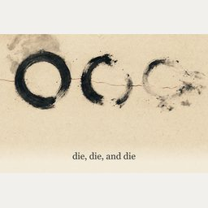

<!-- Generated by scripts/build_gallery.py; edit collection catalogs, then rebuild. -->
# 作品目录

[返回总目录](../CATALOG.md) · [在图库中浏览](../index.html#collection=abstract-art-abstract-art-ai-generated)

生成作品 · **1 张** · 原目录：[abstract-art/abstract-art-ai-generated](../abstract-art/abstract-art-ai-generated/)

[原合集目录](../abstract-art/abstract-art-ai-generated/CATALOG.md)

[分类：主题插画](../index.html#category=illustrations)

| 缩略图 | 标题与描述 | 文件与记录 |
| --- | --- | --- |
|  | **abstract cycles 01 die and die** | [原图](../abstract-art/abstract-art-ai-generated/abstract-cycles-01-die-and-die.png) 1536 × 1024 [元数据](../abstract-art/abstract-art-ai-generated/metadata/abstract-cycles-01-die-and-die.json) [提示词](../abstract-art/abstract-art-ai-generated/prompts/abstract-cycles-01-die-and-die.txt) abstract-cycles-01-die-and-die.png |
