<!-- Generated by scripts/build_gallery.py; edit collection catalogs, then rebuild. -->
# 作品目录

[返回总目录](../CATALOG.md) · [在图库中浏览](../index.html#collection=classical-poetry-classical-poetry-ai-generated)

生成作品 · **46 张** · 原目录：[classical-poetry/classical-poetry-ai-generated](../classical-poetry/classical-poetry-ai-generated/)

[原合集目录](../classical-poetry/classical-poetry-ai-generated/CATALOG.md)

[分类：主题插画](../index.html#category=illustrations)

| 缩略图 | 标题与描述 | 文件与记录 |
| --- | --- | --- |
| [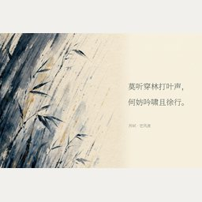](../classical-poetry/classical-poetry-ai-generated/ding-feng-bo-01-walk-through-rain.png) | **ding feng bo 01 walk through rain** | [原图](../classical-poetry/classical-poetry-ai-generated/ding-feng-bo-01-walk-through-rain.png) 1536 × 1024 [元数据](../classical-poetry/classical-poetry-ai-generated/metadata/ding-feng-bo-01-walk-through-rain.json) [提示词](../classical-poetry/classical-poetry-ai-generated/prompts/ding-feng-bo-01-walk-through-rain.txt) [提示词 2](../classical-poetry/classical-poetry-ai-generated/prompts/ding-feng-bo-01-walk-through-rain-poem.txt) ding-feng-bo-01-walk-through-rain.png |
| [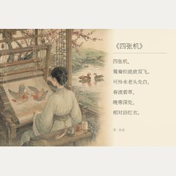](../classical-poetry/classical-poetry-ai-generated/four-shuttles-01-woven-mandarin-ducks.png) | **four shuttles 01 woven mandarin ducks** | [原图](../classical-poetry/classical-poetry-ai-generated/four-shuttles-01-woven-mandarin-ducks.png) 1536 × 1024 [元数据](../classical-poetry/classical-poetry-ai-generated/metadata/four-shuttles-01-woven-mandarin-ducks.json) [提示词](../classical-poetry/classical-poetry-ai-generated/prompts/four-shuttles-01-woven-mandarin-ducks.txt) [提示词 2](../classical-poetry/classical-poetry-ai-generated/prompts/four-shuttles-01-woven-mandarin-ducks-poem.txt) four-shuttles-01-woven-mandarin-ducks.png |
| [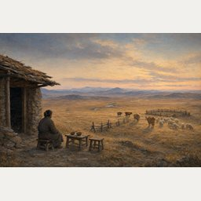](../classical-poetry/classical-poetry-ai-generated/frontier-promise-01-empty-seat-at-dusk.png) | **frontier promise 01 empty seat at dusk** | [原图](../classical-poetry/classical-poetry-ai-generated/frontier-promise-01-empty-seat-at-dusk.png) 1536 × 1024 [元数据](../classical-poetry/classical-poetry-ai-generated/metadata/frontier-promise-01-empty-seat-at-dusk.json) [提示词](../classical-poetry/classical-poetry-ai-generated/prompts/frontier-promise-01-empty-seat-at-dusk.txt) [提示词 2](../classical-poetry/classical-poetry-ai-generated/prompts/frontier-promise-01-empty-seat-at-dusk-source.txt) frontier-promise-01-empty-seat-at-dusk.png |
| [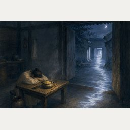](../classical-poetry/classical-poetry-ai-generated/huangliang-moonlight-01-long-dream.png) | **huangliang moonlight 01 long dream** | [原图](../classical-poetry/classical-poetry-ai-generated/huangliang-moonlight-01-long-dream.png) 1536 × 1024 [元数据](../classical-poetry/classical-poetry-ai-generated/metadata/huangliang-moonlight-01-long-dream.json) [提示词](../classical-poetry/classical-poetry-ai-generated/prompts/huangliang-moonlight-01-long-dream.txt) [提示词 2](../classical-poetry/classical-poetry-ai-generated/prompts/huangliang-moonlight-01-long-dream-source.txt) huangliang-moonlight-01-long-dream.png |
| [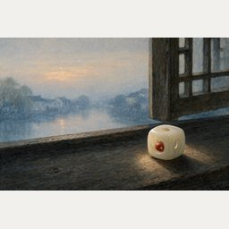](../classical-poetry/classical-poetry-ai-generated/linglong-dice-01-red-bean-longing.png) | **linglong dice 01 red bean longing** | [原图](../classical-poetry/classical-poetry-ai-generated/linglong-dice-01-red-bean-longing.png) 1536 × 1024 [元数据](../classical-poetry/classical-poetry-ai-generated/metadata/linglong-dice-01-red-bean-longing.json) [提示词](../classical-poetry/classical-poetry-ai-generated/prompts/linglong-dice-01-red-bean-longing.txt) [提示词 2](../classical-poetry/classical-poetry-ai-generated/prompts/linglong-dice-01-red-bean-longing-source.txt) linglong-dice-01-red-bean-longing.png |
| [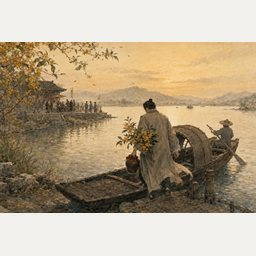](../classical-poetry/classical-poetry-ai-generated/poetic-longing-01-osmanthus-return.png) | **poetic longing 01 osmanthus return** | [原图](../classical-poetry/classical-poetry-ai-generated/poetic-longing-01-osmanthus-return.png) 1536 × 1024 [元数据](../classical-poetry/classical-poetry-ai-generated/metadata/poetic-longing-01-osmanthus-return.json) [提示词](../classical-poetry/classical-poetry-ai-generated/prompts/poetic-longing-01-osmanthus-return.txt) [提示词 2](../classical-poetry/classical-poetry-ai-generated/prompts/poetic-longing-01-osmanthus-return-source.txt) poetic-longing-01-osmanthus-return.png |
| [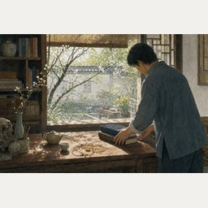](../classical-poetry/classical-poetry-ai-generated/poetic-longing-02-tea-spilled-book.png) | **poetic longing 02 tea spilled book** | [原图](../classical-poetry/classical-poetry-ai-generated/poetic-longing-02-tea-spilled-book.png) 1536 × 1024 [元数据](../classical-poetry/classical-poetry-ai-generated/metadata/poetic-longing-02-tea-spilled-book.json) [提示词](../classical-poetry/classical-poetry-ai-generated/prompts/poetic-longing-02-tea-spilled-book.txt) [提示词 2](../classical-poetry/classical-poetry-ai-generated/prompts/poetic-longing-02-tea-spilled-book-source.txt) poetic-longing-02-tea-spilled-book.png |
| [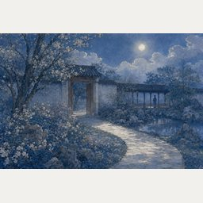](../classical-poetry/classical-poetry-ai-generated/poetic-longing-03-moonlit-return-path.png) | **poetic longing 03 moonlit return path** | [原图](../classical-poetry/classical-poetry-ai-generated/poetic-longing-03-moonlit-return-path.png) 1536 × 1024 [元数据](../classical-poetry/classical-poetry-ai-generated/metadata/poetic-longing-03-moonlit-return-path.json) [提示词](../classical-poetry/classical-poetry-ai-generated/prompts/poetic-longing-03-moonlit-return-path.txt) [提示词 2](../classical-poetry/classical-poetry-ai-generated/prompts/poetic-longing-03-moonlit-return-path-source.txt) poetic-longing-03-moonlit-return-path.png |
| [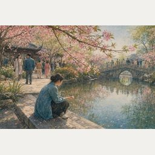](../classical-poetry/classical-poetry-ai-generated/poetic-longing-04-spring-already-distant.png) | **poetic longing 04 spring already distant** | [原图](../classical-poetry/classical-poetry-ai-generated/poetic-longing-04-spring-already-distant.png) 1536 × 1024 [元数据](../classical-poetry/classical-poetry-ai-generated/metadata/poetic-longing-04-spring-already-distant.json) [提示词](../classical-poetry/classical-poetry-ai-generated/prompts/poetic-longing-04-spring-already-distant.txt) [提示词 2](../classical-poetry/classical-poetry-ai-generated/prompts/poetic-longing-04-spring-already-distant-source.txt) poetic-longing-04-spring-already-distant.png |
| [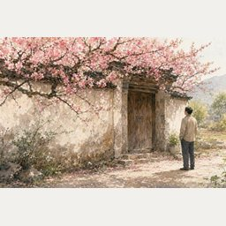](../classical-poetry/classical-poetry-ai-generated/poetic-longing-05-peach-blossom-door.png) | **poetic longing 05 peach blossom door** | [原图](../classical-poetry/classical-poetry-ai-generated/poetic-longing-05-peach-blossom-door.png) 1536 × 1024 [元数据](../classical-poetry/classical-poetry-ai-generated/metadata/poetic-longing-05-peach-blossom-door.json) [提示词](../classical-poetry/classical-poetry-ai-generated/prompts/poetic-longing-05-peach-blossom-door.txt) [提示词 2](../classical-poetry/classical-poetry-ai-generated/prompts/poetic-longing-05-peach-blossom-door-source.txt) poetic-longing-05-peach-blossom-door.png |
| [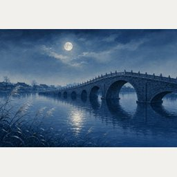](../classical-poetry/classical-poetry-ai-generated/poetic-longing-06-silent-moon-bridge.png) | **poetic longing 06 silent moon bridge** | [原图](../classical-poetry/classical-poetry-ai-generated/poetic-longing-06-silent-moon-bridge.png) 1536 × 1024 [元数据](../classical-poetry/classical-poetry-ai-generated/metadata/poetic-longing-06-silent-moon-bridge.json) [提示词](../classical-poetry/classical-poetry-ai-generated/prompts/poetic-longing-06-silent-moon-bridge.txt) [提示词 2](../classical-poetry/classical-poetry-ai-generated/prompts/poetic-longing-06-silent-moon-bridge-source.txt) poetic-longing-06-silent-moon-bridge.png |
| [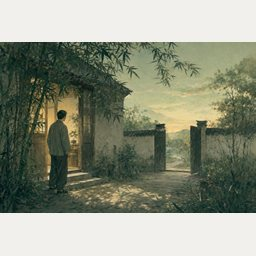](../classical-poetry/classical-poetry-ai-generated/poetic-longing-07-bamboo-mistaken-visitor.png) | **poetic longing 07 bamboo mistaken visitor** | [原图](../classical-poetry/classical-poetry-ai-generated/poetic-longing-07-bamboo-mistaken-visitor.png) 1536 × 1024 [元数据](../classical-poetry/classical-poetry-ai-generated/metadata/poetic-longing-07-bamboo-mistaken-visitor.json) [提示词](../classical-poetry/classical-poetry-ai-generated/prompts/poetic-longing-07-bamboo-mistaken-visitor.txt) [提示词 2](../classical-poetry/classical-poetry-ai-generated/prompts/poetic-longing-07-bamboo-mistaken-visitor-source.txt) poetic-longing-07-bamboo-mistaken-visitor.png |
| [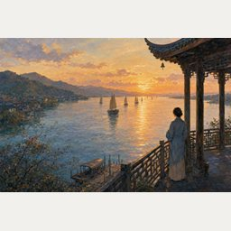](../classical-poetry/classical-poetry-ai-generated/poetic-longing-08-passing-sails-waiting.png) | **poetic longing 08 passing sails waiting** | [原图](../classical-poetry/classical-poetry-ai-generated/poetic-longing-08-passing-sails-waiting.png) 1536 × 1024 [元数据](../classical-poetry/classical-poetry-ai-generated/metadata/poetic-longing-08-passing-sails-waiting.json) [提示词](../classical-poetry/classical-poetry-ai-generated/prompts/poetic-longing-08-passing-sails-waiting.txt) [提示词 2](../classical-poetry/classical-poetry-ai-generated/prompts/poetic-longing-08-passing-sails-waiting-source.txt) poetic-longing-08-passing-sails-waiting.png |
| [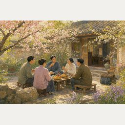](../classical-poetry/classical-poetry-ai-generated/poetic-longing-09-guest-forgotten-dream.png) | **poetic longing 09 guest forgotten dream** | [原图](../classical-poetry/classical-poetry-ai-generated/poetic-longing-09-guest-forgotten-dream.png) 1536 × 1024 [元数据](../classical-poetry/classical-poetry-ai-generated/metadata/poetic-longing-09-guest-forgotten-dream.json) [提示词](../classical-poetry/classical-poetry-ai-generated/prompts/poetic-longing-09-guest-forgotten-dream.txt) [提示词 2](../classical-poetry/classical-poetry-ai-generated/prompts/poetic-longing-09-guest-forgotten-dream-source.txt) poetic-longing-09-guest-forgotten-dream.png |
| [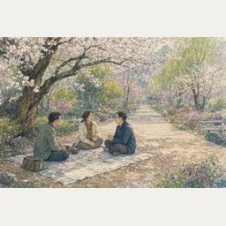](../classical-poetry/classical-poetry-ai-generated/poetic-longing-10-fewer-flower-companions.png) | **poetic longing 10 fewer flower companions** | [原图](../classical-poetry/classical-poetry-ai-generated/poetic-longing-10-fewer-flower-companions.png) 1536 × 1024 [元数据](../classical-poetry/classical-poetry-ai-generated/metadata/poetic-longing-10-fewer-flower-companions.json) [提示词](../classical-poetry/classical-poetry-ai-generated/prompts/poetic-longing-10-fewer-flower-companions.txt) [提示词 2](../classical-poetry/classical-poetry-ai-generated/prompts/poetic-longing-10-fewer-flower-companions-source.txt) poetic-longing-10-fewer-flower-companions.png |
| [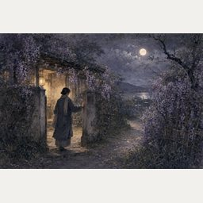](../classical-poetry/classical-poetry-ai-generated/poetic-longing-11-ten-year-flower-shadow.png) | **poetic longing 11 ten year flower shadow** | [原图](../classical-poetry/classical-poetry-ai-generated/poetic-longing-11-ten-year-flower-shadow.png) 1536 × 1024 [元数据](../classical-poetry/classical-poetry-ai-generated/metadata/poetic-longing-11-ten-year-flower-shadow.json) [提示词](../classical-poetry/classical-poetry-ai-generated/prompts/poetic-longing-11-ten-year-flower-shadow.txt) [提示词 2](../classical-poetry/classical-poetry-ai-generated/prompts/poetic-longing-11-ten-year-flower-shadow-source.txt) poetic-longing-11-ten-year-flower-shadow.png |
| [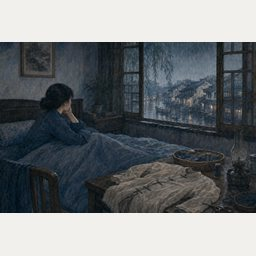](../classical-poetry/classical-poetry-ai-generated/poetic-longing-12-rain-unmended-clothes.png) | **poetic longing 12 rain unmended clothes** | [原图](../classical-poetry/classical-poetry-ai-generated/poetic-longing-12-rain-unmended-clothes.png) 1536 × 1024 [元数据](../classical-poetry/classical-poetry-ai-generated/metadata/poetic-longing-12-rain-unmended-clothes.json) [提示词](../classical-poetry/classical-poetry-ai-generated/prompts/poetic-longing-12-rain-unmended-clothes.txt) [提示词 2](../classical-poetry/classical-poetry-ai-generated/prompts/poetic-longing-12-rain-unmended-clothes-source.txt) poetic-longing-12-rain-unmended-clothes.png |
| [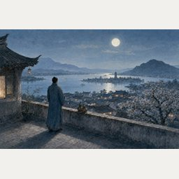](../classical-poetry/classical-poetry-ai-generated/poetic-longing-13-same-rooftop-moon.png) | **poetic longing 13 same rooftop moon** | [原图](../classical-poetry/classical-poetry-ai-generated/poetic-longing-13-same-rooftop-moon.png) 1536 × 1024 [元数据](../classical-poetry/classical-poetry-ai-generated/metadata/poetic-longing-13-same-rooftop-moon.json) [提示词](../classical-poetry/classical-poetry-ai-generated/prompts/poetic-longing-13-same-rooftop-moon.txt) [提示词 2](../classical-poetry/classical-poetry-ai-generated/prompts/poetic-longing-13-same-rooftop-moon-source.txt) poetic-longing-13-same-rooftop-moon.png |
| [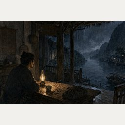](../classical-poetry/classical-poetry-ai-generated/poetic-longing-14-wine-and-rain-lamp.png) | **poetic longing 14 wine and rain lamp** | [原图](../classical-poetry/classical-poetry-ai-generated/poetic-longing-14-wine-and-rain-lamp.png) 1536 × 1024 [元数据](../classical-poetry/classical-poetry-ai-generated/metadata/poetic-longing-14-wine-and-rain-lamp.json) [提示词](../classical-poetry/classical-poetry-ai-generated/prompts/poetic-longing-14-wine-and-rain-lamp.txt) [提示词 2](../classical-poetry/classical-poetry-ai-generated/prompts/poetic-longing-14-wine-and-rain-lamp-source.txt) poetic-longing-14-wine-and-rain-lamp.png |
| [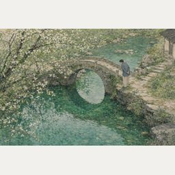](../classical-poetry/classical-poetry-ai-generated/poetic-longing-15-spring-water-reflection.png) | **poetic longing 15 spring water reflection** | [原图](../classical-poetry/classical-poetry-ai-generated/poetic-longing-15-spring-water-reflection.png) 1536 × 1024 [元数据](../classical-poetry/classical-poetry-ai-generated/metadata/poetic-longing-15-spring-water-reflection.json) [提示词](../classical-poetry/classical-poetry-ai-generated/prompts/poetic-longing-15-spring-water-reflection.txt) [提示词 2](../classical-poetry/classical-poetry-ai-generated/prompts/poetic-longing-15-spring-water-reflection-source.txt) poetic-longing-15-spring-water-reflection.png |
| [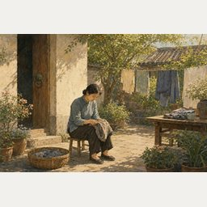](../classical-poetry/classical-poetry-ai-generated/poetic-longing-16-familiar-room-changed.png) | **poetic longing 16 familiar room changed** | [原图](../classical-poetry/classical-poetry-ai-generated/poetic-longing-16-familiar-room-changed.png) 1536 × 1024 [元数据](../classical-poetry/classical-poetry-ai-generated/metadata/poetic-longing-16-familiar-room-changed.json) [提示词](../classical-poetry/classical-poetry-ai-generated/prompts/poetic-longing-16-familiar-room-changed.txt) [提示词 2](../classical-poetry/classical-poetry-ai-generated/prompts/poetic-longing-16-familiar-room-changed-source.txt) poetic-longing-16-familiar-room-changed.png |
| [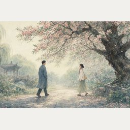](../classical-poetry/classical-poetry-ai-generated/poetic-longing-17-dream-reunion-path.png) | **poetic longing 17 dream reunion path** | [原图](../classical-poetry/classical-poetry-ai-generated/poetic-longing-17-dream-reunion-path.png) 1536 × 1024 [元数据](../classical-poetry/classical-poetry-ai-generated/metadata/poetic-longing-17-dream-reunion-path.json) [提示词](../classical-poetry/classical-poetry-ai-generated/prompts/poetic-longing-17-dream-reunion-path.txt) [提示词 2](../classical-poetry/classical-poetry-ai-generated/prompts/poetic-longing-17-dream-reunion-path-source.txt) poetic-longing-17-dream-reunion-path.png |
| [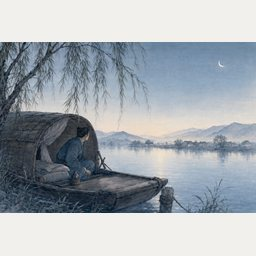](../classical-poetry/classical-poetry-ai-generated/poetic-longing-18-willow-dawn-mooring.png) | **poetic longing 18 willow dawn mooring** | [原图](../classical-poetry/classical-poetry-ai-generated/poetic-longing-18-willow-dawn-mooring.png) 1536 × 1024 [元数据](../classical-poetry/classical-poetry-ai-generated/metadata/poetic-longing-18-willow-dawn-mooring.json) [提示词](../classical-poetry/classical-poetry-ai-generated/prompts/poetic-longing-18-willow-dawn-mooring.txt) [提示词 2](../classical-poetry/classical-poetry-ai-generated/prompts/poetic-longing-18-willow-dawn-mooring-source.txt) poetic-longing-18-willow-dawn-mooring.png |
| [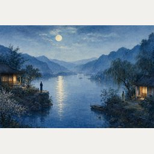](../classical-poetry/classical-poetry-ai-generated/poetic-longing-19-two-shores-one-moon.png) | **poetic longing 19 two shores one moon** | [原图](../classical-poetry/classical-poetry-ai-generated/poetic-longing-19-two-shores-one-moon.png) 1536 × 1024 [元数据](../classical-poetry/classical-poetry-ai-generated/metadata/poetic-longing-19-two-shores-one-moon.json) [提示词](../classical-poetry/classical-poetry-ai-generated/prompts/poetic-longing-19-two-shores-one-moon.txt) [提示词 2](../classical-poetry/classical-poetry-ai-generated/prompts/poetic-longing-19-two-shores-one-moon-source.txt) poetic-longing-19-two-shores-one-moon.png |
| [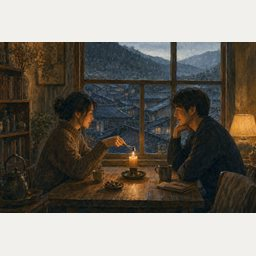](../classical-poetry/classical-poetry-ai-generated/poetic-longing-20-shared-candle-rain.png) | **poetic longing 20 shared candle rain** | [原图](../classical-poetry/classical-poetry-ai-generated/poetic-longing-20-shared-candle-rain.png) 1536 × 1024 [元数据](../classical-poetry/classical-poetry-ai-generated/metadata/poetic-longing-20-shared-candle-rain.json) [提示词](../classical-poetry/classical-poetry-ai-generated/prompts/poetic-longing-20-shared-candle-rain.txt) [提示词 2](../classical-poetry/classical-poetry-ai-generated/prompts/poetic-longing-20-shared-candle-rain-source.txt) poetic-longing-20-shared-candle-rain.png |
| [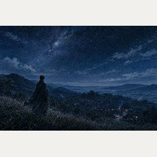](../classical-poetry/classical-poetry-ai-generated/poetic-longing-21-midnight-different-stars.png) | **poetic longing 21 midnight different stars** | [原图](../classical-poetry/classical-poetry-ai-generated/poetic-longing-21-midnight-different-stars.png) 1536 × 1024 [元数据](../classical-poetry/classical-poetry-ai-generated/metadata/poetic-longing-21-midnight-different-stars.json) [提示词](../classical-poetry/classical-poetry-ai-generated/prompts/poetic-longing-21-midnight-different-stars.txt) [提示词 2](../classical-poetry/classical-poetry-ai-generated/prompts/poetic-longing-21-midnight-different-stars-source.txt) poetic-longing-21-midnight-different-stars.png |
| [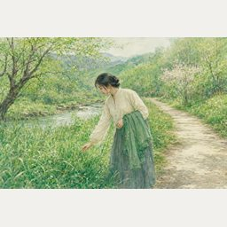](../classical-poetry/classical-poetry-ai-generated/poetic-longing-22-green-silk-meadow.png) | **poetic longing 22 green silk meadow** | [原图](../classical-poetry/classical-poetry-ai-generated/poetic-longing-22-green-silk-meadow.png) 1536 × 1024 [元数据](../classical-poetry/classical-poetry-ai-generated/metadata/poetic-longing-22-green-silk-meadow.json) [提示词](../classical-poetry/classical-poetry-ai-generated/prompts/poetic-longing-22-green-silk-meadow.txt) [提示词 2](../classical-poetry/classical-poetry-ai-generated/prompts/poetic-longing-22-green-silk-meadow-source.txt) poetic-longing-22-green-silk-meadow.png |
| [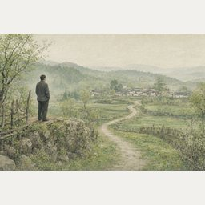](../classical-poetry/classical-poetry-ai-generated/poetic-longing-23-grass-waits-for-return.png) | **poetic longing 23 grass waits for return** | [原图](../classical-poetry/classical-poetry-ai-generated/poetic-longing-23-grass-waits-for-return.png) 1536 × 1024 [元数据](../classical-poetry/classical-poetry-ai-generated/metadata/poetic-longing-23-grass-waits-for-return.json) [提示词](../classical-poetry/classical-poetry-ai-generated/prompts/poetic-longing-23-grass-waits-for-return.txt) [提示词 2](../classical-poetry/classical-poetry-ai-generated/prompts/poetic-longing-23-grass-waits-for-return-source.txt) poetic-longing-23-grass-waits-for-return.png |
| [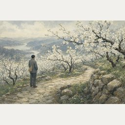](../classical-poetry/classical-poetry-ai-generated/poetic-longing-24-orchard-another-year.png) | **poetic longing 24 orchard another year** | [原图](../classical-poetry/classical-poetry-ai-generated/poetic-longing-24-orchard-another-year.png) 1536 × 1024 [元数据](../classical-poetry/classical-poetry-ai-generated/metadata/poetic-longing-24-orchard-another-year.json) [提示词](../classical-poetry/classical-poetry-ai-generated/prompts/poetic-longing-24-orchard-another-year.txt) [提示词 2](../classical-poetry/classical-poetry-ai-generated/prompts/poetic-longing-24-orchard-another-year-source.txt) poetic-longing-24-orchard-another-year.png |
| [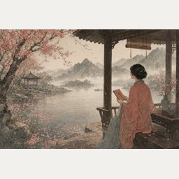](../classical-poetry/classical-poetry-ai-generated/poetic-longing-25-letter-beyond-the-pond.png) | **poetic longing 25 letter beyond the pond** | [原图](../classical-poetry/classical-poetry-ai-generated/poetic-longing-25-letter-beyond-the-pond.png) 1536 × 1024 [元数据](../classical-poetry/classical-poetry-ai-generated/metadata/poetic-longing-25-letter-beyond-the-pond.json) [提示词](../classical-poetry/classical-poetry-ai-generated/prompts/poetic-longing-25-letter-beyond-the-pond.txt) [提示词 2](../classical-poetry/classical-poetry-ai-generated/prompts/poetic-longing-25-letter-beyond-the-pond-source.txt) poetic-longing-25-letter-beyond-the-pond.png |
| [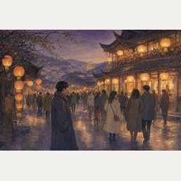](../classical-poetry/classical-poetry-ai-generated/poetic-longing-26-lantern-crowd-absence.png) | **poetic longing 26 lantern crowd absence** | [原图](../classical-poetry/classical-poetry-ai-generated/poetic-longing-26-lantern-crowd-absence.png) 1536 × 1024 [元数据](../classical-poetry/classical-poetry-ai-generated/metadata/poetic-longing-26-lantern-crowd-absence.json) [提示词](../classical-poetry/classical-poetry-ai-generated/prompts/poetic-longing-26-lantern-crowd-absence.txt) [提示词 2](../classical-poetry/classical-poetry-ai-generated/prompts/poetic-longing-26-lantern-crowd-absence-source.txt) poetic-longing-26-lantern-crowd-absence.png |
| [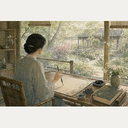](../classical-poetry/classical-poetry-ai-generated/poetic-longing-27-unwritten-flower-paper.png) | **poetic longing 27 unwritten flower paper** | [原图](../classical-poetry/classical-poetry-ai-generated/poetic-longing-27-unwritten-flower-paper.png) 1536 × 1024 [元数据](../classical-poetry/classical-poetry-ai-generated/metadata/poetic-longing-27-unwritten-flower-paper.json) [提示词](../classical-poetry/classical-poetry-ai-generated/prompts/poetic-longing-27-unwritten-flower-paper.txt) [提示词 2](../classical-poetry/classical-poetry-ai-generated/prompts/poetic-longing-27-unwritten-flower-paper-source.txt) poetic-longing-27-unwritten-flower-paper.png |
| [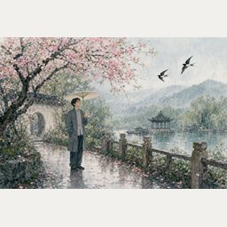](../classical-poetry/classical-poetry-ai-generated/poetic-longing-28-paired-swallows-rain.png) | **poetic longing 28 paired swallows rain** | [原图](../classical-poetry/classical-poetry-ai-generated/poetic-longing-28-paired-swallows-rain.png) 1536 × 1024 [元数据](../classical-poetry/classical-poetry-ai-generated/metadata/poetic-longing-28-paired-swallows-rain.json) [提示词](../classical-poetry/classical-poetry-ai-generated/prompts/poetic-longing-28-paired-swallows-rain.txt) [提示词 2](../classical-poetry/classical-poetry-ai-generated/prompts/poetic-longing-28-paired-swallows-rain-source.txt) poetic-longing-28-paired-swallows-rain.png |
| [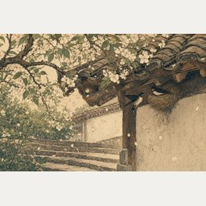](../classical-poetry/classical-poetry-ai-generated/poetic-longing-29-swallows-returning-eaves.png) | **poetic longing 29 swallows returning eaves** | [原图](../classical-poetry/classical-poetry-ai-generated/poetic-longing-29-swallows-returning-eaves.png) 1536 × 1024 [元数据](../classical-poetry/classical-poetry-ai-generated/metadata/poetic-longing-29-swallows-returning-eaves.json) [提示词](../classical-poetry/classical-poetry-ai-generated/prompts/poetic-longing-29-swallows-returning-eaves.txt) [提示词 2](../classical-poetry/classical-poetry-ai-generated/prompts/poetic-longing-29-swallows-returning-eaves-source.txt) poetic-longing-29-swallows-returning-eaves.png |
| [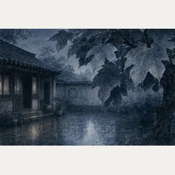](../classical-poetry/classical-poetry-ai-generated/poetic-longing-30-wutong-dusk-rain.png) | **poetic longing 30 wutong dusk rain** | [原图](../classical-poetry/classical-poetry-ai-generated/poetic-longing-30-wutong-dusk-rain.png) 1536 × 1024 [元数据](../classical-poetry/classical-poetry-ai-generated/metadata/poetic-longing-30-wutong-dusk-rain.json) [提示词](../classical-poetry/classical-poetry-ai-generated/prompts/poetic-longing-30-wutong-dusk-rain.txt) [提示词 2](../classical-poetry/classical-poetry-ai-generated/prompts/poetic-longing-30-wutong-dusk-rain-source.txt) poetic-longing-30-wutong-dusk-rain.png |
| [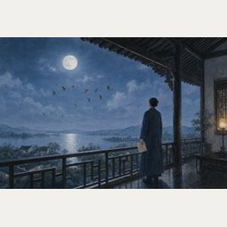](../classical-poetry/classical-poetry-ai-generated/poetic-longing-31-geese-above-west-tower.png) | **poetic longing 31 geese above west tower** | [原图](../classical-poetry/classical-poetry-ai-generated/poetic-longing-31-geese-above-west-tower.png) 1536 × 1024 [元数据](../classical-poetry/classical-poetry-ai-generated/metadata/poetic-longing-31-geese-above-west-tower.json) [提示词](../classical-poetry/classical-poetry-ai-generated/prompts/poetic-longing-31-geese-above-west-tower.txt) [提示词 2](../classical-poetry/classical-poetry-ai-generated/prompts/poetic-longing-31-geese-above-west-tower-source.txt) poetic-longing-31-geese-above-west-tower.png |
| [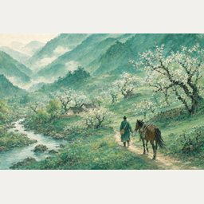](../classical-poetry/classical-poetry-ai-generated/poetic-longing-32-beautiful-valley-departure.png) | **poetic longing 32 beautiful valley departure** | [原图](../classical-poetry/classical-poetry-ai-generated/poetic-longing-32-beautiful-valley-departure.png) 1536 × 1024 [元数据](../classical-poetry/classical-poetry-ai-generated/metadata/poetic-longing-32-beautiful-valley-departure.json) [提示词](../classical-poetry/classical-poetry-ai-generated/prompts/poetic-longing-32-beautiful-valley-departure.txt) [提示词 2](../classical-poetry/classical-poetry-ai-generated/prompts/poetic-longing-32-beautiful-valley-departure-source.txt) poetic-longing-32-beautiful-valley-departure.png |
| [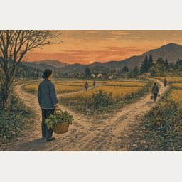](../classical-poetry/classical-poetry-ai-generated/poetic-longing-33-stranger-at-field-fork.png) | **poetic longing 33 stranger at field fork** | [原图](../classical-poetry/classical-poetry-ai-generated/poetic-longing-33-stranger-at-field-fork.png) 1536 × 1024 [元数据](../classical-poetry/classical-poetry-ai-generated/metadata/poetic-longing-33-stranger-at-field-fork.json) [提示词](../classical-poetry/classical-poetry-ai-generated/prompts/poetic-longing-33-stranger-at-field-fork.txt) [提示词 2](../classical-poetry/classical-poetry-ai-generated/prompts/poetic-longing-33-stranger-at-field-fork-source.txt) poetic-longing-33-stranger-at-field-fork.png |
| [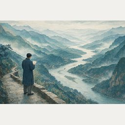](../classical-poetry/classical-poetry-ai-generated/poetic-longing-34-letter-unreachable-valleys.png) | **poetic longing 34 letter unreachable valleys** | [原图](../classical-poetry/classical-poetry-ai-generated/poetic-longing-34-letter-unreachable-valleys.png) 1536 × 1024 [元数据](../classical-poetry/classical-poetry-ai-generated/metadata/poetic-longing-34-letter-unreachable-valleys.json) [提示词](../classical-poetry/classical-poetry-ai-generated/prompts/poetic-longing-34-letter-unreachable-valleys.txt) [提示词 2](../classical-poetry/classical-poetry-ai-generated/prompts/poetic-longing-34-letter-unreachable-valleys-source.txt) poetic-longing-34-letter-unreachable-valleys.png |
| [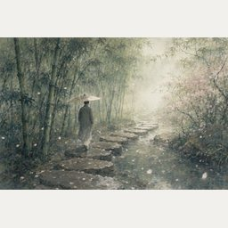](../classical-poetry/classical-poetry-ai-generated/poetic-longing-35-dream-path-rain-petals.png) | **poetic longing 35 dream path rain petals** | [原图](../classical-poetry/classical-poetry-ai-generated/poetic-longing-35-dream-path-rain-petals.png) 1536 × 1024 [元数据](../classical-poetry/classical-poetry-ai-generated/metadata/poetic-longing-35-dream-path-rain-petals.json) [提示词](../classical-poetry/classical-poetry-ai-generated/prompts/poetic-longing-35-dream-path-rain-petals.txt) [提示词 2](../classical-poetry/classical-poetry-ai-generated/prompts/poetic-longing-35-dream-path-rain-petals-source.txt) poetic-longing-35-dream-path-rain-petals.png |
| [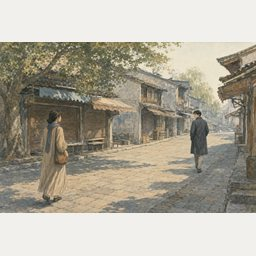](../classical-poetry/classical-poetry-ai-generated/poetic-longing-36-meeting-without-approach.png) | **poetic longing 36 meeting without approach** | [原图](../classical-poetry/classical-poetry-ai-generated/poetic-longing-36-meeting-without-approach.png) 1536 × 1024 [元数据](../classical-poetry/classical-poetry-ai-generated/metadata/poetic-longing-36-meeting-without-approach.json) [提示词](../classical-poetry/classical-poetry-ai-generated/prompts/poetic-longing-36-meeting-without-approach.txt) [提示词 2](../classical-poetry/classical-poetry-ai-generated/prompts/poetic-longing-36-meeting-without-approach-source.txt) poetic-longing-36-meeting-without-approach.png |
| [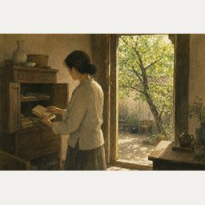](../classical-poetry/classical-poetry-ai-generated/poetic-longing-37-silent-correspondence-cabinet.png) | **poetic longing 37 silent correspondence cabinet** | [原图](../classical-poetry/classical-poetry-ai-generated/poetic-longing-37-silent-correspondence-cabinet.png) 1536 × 1024 [元数据](../classical-poetry/classical-poetry-ai-generated/metadata/poetic-longing-37-silent-correspondence-cabinet.json) [提示词](../classical-poetry/classical-poetry-ai-generated/prompts/poetic-longing-37-silent-correspondence-cabinet.txt) [提示词 2](../classical-poetry/classical-poetry-ai-generated/prompts/poetic-longing-37-silent-correspondence-cabinet-source.txt) poetic-longing-37-silent-correspondence-cabinet.png |
| [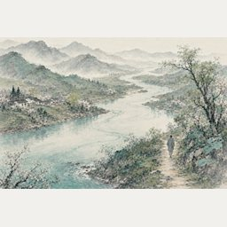](../classical-poetry/classical-poetry-ai-generated/poetic-longing-38-spring-river-distance.png) | **poetic longing 38 spring river distance** | [原图](../classical-poetry/classical-poetry-ai-generated/poetic-longing-38-spring-river-distance.png) 1536 × 1024 [元数据](../classical-poetry/classical-poetry-ai-generated/metadata/poetic-longing-38-spring-river-distance.json) [提示词](../classical-poetry/classical-poetry-ai-generated/prompts/poetic-longing-38-spring-river-distance.txt) [提示词 2](../classical-poetry/classical-poetry-ai-generated/prompts/poetic-longing-38-spring-river-distance-source.txt) poetic-longing-38-spring-river-distance.png |
| [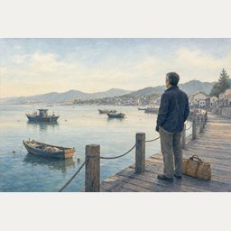](../classical-poetry/classical-poetry-ai-generated/poetic-longing-39-far-coast-gray-temples.png) | **poetic longing 39 far coast gray temples** | [原图](../classical-poetry/classical-poetry-ai-generated/poetic-longing-39-far-coast-gray-temples.png) 1536 × 1024 [元数据](../classical-poetry/classical-poetry-ai-generated/metadata/poetic-longing-39-far-coast-gray-temples.json) [提示词](../classical-poetry/classical-poetry-ai-generated/prompts/poetic-longing-39-far-coast-gray-temples.txt) [提示词 2](../classical-poetry/classical-poetry-ai-generated/prompts/poetic-longing-39-far-coast-gray-temples-source.txt) poetic-longing-39-far-coast-gray-temples.png |
| [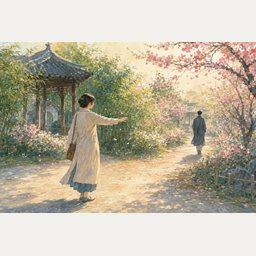](../classical-poetry/classical-poetry-ai-generated/poetic-longing-40-first-longing-crossroads.png) | **poetic longing 40 first longing crossroads** | [原图](../classical-poetry/classical-poetry-ai-generated/poetic-longing-40-first-longing-crossroads.png) 1536 × 1024 [元数据](../classical-poetry/classical-poetry-ai-generated/metadata/poetic-longing-40-first-longing-crossroads.json) [提示词](../classical-poetry/classical-poetry-ai-generated/prompts/poetic-longing-40-first-longing-crossroads.txt) [提示词 2](../classical-poetry/classical-poetry-ai-generated/prompts/poetic-longing-40-first-longing-crossroads-source.txt) poetic-longing-40-first-longing-crossroads.png |
| [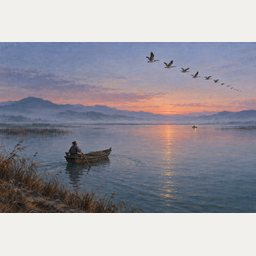](../classical-poetry/classical-poetry-ai-generated/tengwang-autumn-01-fishing-song-wild-geese.png) | **tengwang autumn 01 fishing song wild geese** | [原图](../classical-poetry/classical-poetry-ai-generated/tengwang-autumn-01-fishing-song-wild-geese.png) 1536 × 1024 [元数据](../classical-poetry/classical-poetry-ai-generated/metadata/tengwang-autumn-01-fishing-song-wild-geese.json) [提示词](../classical-poetry/classical-poetry-ai-generated/prompts/tengwang-autumn-01-fishing-song-wild-geese.txt) [提示词 2](../classical-poetry/classical-poetry-ai-generated/prompts/tengwang-autumn-01-fishing-song-wild-geese-source.txt) tengwang-autumn-01-fishing-song-wild-geese.png |
