<!-- Generated by scripts/build_gallery.py; edit collection catalogs, then rebuild. -->
# 作品目录

[返回总目录](../CATALOG.md) · [在图库中浏览](../index.html#collection=climbing-training-climbing-training-ai-generated)

生成作品 · **220 张** · 原目录：[climbing-training/climbing-training-ai-generated](../climbing-training/climbing-training-ai-generated/)

[原合集目录](../climbing-training/climbing-training-ai-generated/CATALOG.md)

[分类：运动与训练](../index.html#category=training)

[专题资料](../climbing-training/HOME-GUIDE.md)

[运动与训练](../climbing-training/HOME-GUIDE.md)

| 缩略图 | 标题与描述 | 文件与记录 |
| --- | --- | --- |
| [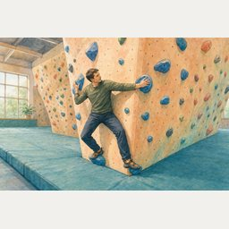](../climbing-training/climbing-training-ai-generated/climbing-atlas-arete-01-arete-low-rounded-edge.png) | **climbing atlas arete 01 arete low rounded edge** | [原图](../climbing-training/climbing-training-ai-generated/climbing-atlas-arete-01-arete-low-rounded-edge.png) 1536 × 1024 [元数据](../climbing-training/climbing-training-ai-generated/metadata/climbing-atlas-arete-01-arete-low-rounded-edge.json) [提示词](../climbing-training/climbing-training-ai-generated/prompts/climbing-atlas-arete-01-arete-low-rounded-edge.txt) [提示词 2](../climbing-training/climbing-training-ai-generated/prompts/climbing-atlas-series.txt) climbing-atlas-arete-01-arete-low-rounded-edge.png |
| [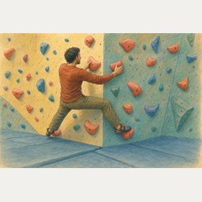](../climbing-training/climbing-training-ai-generated/climbing-atlas-arete-02-arete-two-face-footwork.png) | **climbing atlas arete 02 arete two face footwork** | [原图](../climbing-training/climbing-training-ai-generated/climbing-atlas-arete-02-arete-two-face-footwork.png) 1536 × 1024 [元数据](../climbing-training/climbing-training-ai-generated/metadata/climbing-atlas-arete-02-arete-two-face-footwork.json) [提示词](../climbing-training/climbing-training-ai-generated/prompts/climbing-atlas-arete-02-arete-two-face-footwork.txt) [提示词 2](../climbing-training/climbing-training-ai-generated/prompts/climbing-atlas-series.txt) climbing-atlas-arete-02-arete-two-face-footwork.png |
| [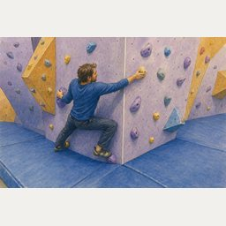](../climbing-training/climbing-training-ai-generated/climbing-atlas-arete-03-arete-short-wrap-reach.png) | **climbing atlas arete 03 arete short wrap reach** | [原图](../climbing-training/climbing-training-ai-generated/climbing-atlas-arete-03-arete-short-wrap-reach.png) 1536 × 1024 [元数据](../climbing-training/climbing-training-ai-generated/metadata/climbing-atlas-arete-03-arete-short-wrap-reach.json) [提示词](../climbing-training/climbing-training-ai-generated/prompts/climbing-atlas-arete-03-arete-short-wrap-reach.txt) [提示词 2](../climbing-training/climbing-training-ai-generated/prompts/climbing-atlas-series.txt) climbing-atlas-arete-03-arete-short-wrap-reach.png |
| [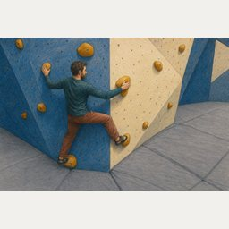](../climbing-training/climbing-training-ai-generated/climbing-atlas-arete-04-arete-paper-plane-balance.png) | **climbing atlas arete 04 arete paper plane balance** | [原图](../climbing-training/climbing-training-ai-generated/climbing-atlas-arete-04-arete-paper-plane-balance.png) 1536 × 1024 [元数据](../climbing-training/climbing-training-ai-generated/metadata/climbing-atlas-arete-04-arete-paper-plane-balance.json) [提示词](../climbing-training/climbing-training-ai-generated/prompts/climbing-atlas-arete-04-arete-paper-plane-balance.txt) [提示词 2](../climbing-training/climbing-training-ai-generated/prompts/climbing-atlas-series.txt) climbing-atlas-arete-04-arete-paper-plane-balance.png |
| [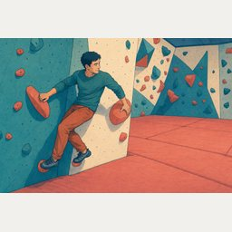](../climbing-training/climbing-training-ai-generated/climbing-atlas-arete-05-arete-static-sidepull.png) | **climbing atlas arete 05 arete static sidepull** | [原图](../climbing-training/climbing-training-ai-generated/climbing-atlas-arete-05-arete-static-sidepull.png) 1536 × 1024 [元数据](../climbing-training/climbing-training-ai-generated/metadata/climbing-atlas-arete-05-arete-static-sidepull.json) [提示词](../climbing-training/climbing-training-ai-generated/prompts/climbing-atlas-arete-05-arete-static-sidepull.txt) [提示词 2](../climbing-training/climbing-training-ai-generated/prompts/climbing-atlas-series.txt) climbing-atlas-arete-05-arete-static-sidepull.png |
| [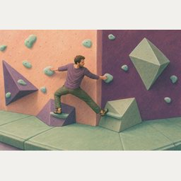](../climbing-training/climbing-training-ai-generated/climbing-atlas-arete-06-arete-low-volume-transfer.png) | **climbing atlas arete 06 arete low volume transfer** | [原图](../climbing-training/climbing-training-ai-generated/climbing-atlas-arete-06-arete-low-volume-transfer.png) 1536 × 1024 [元数据](../climbing-training/climbing-training-ai-generated/metadata/climbing-atlas-arete-06-arete-low-volume-transfer.json) [提示词](../climbing-training/climbing-training-ai-generated/prompts/climbing-atlas-arete-06-arete-low-volume-transfer.txt) [提示词 2](../climbing-training/climbing-training-ai-generated/prompts/climbing-atlas-series.txt) climbing-atlas-arete-06-arete-low-volume-transfer.png |
| [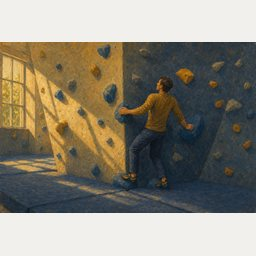](../climbing-training/climbing-training-ai-generated/climbing-atlas-arete-07-arete-sunlit-edge-pause.png) | **climbing atlas arete 07 arete sunlit edge pause** | [原图](../climbing-training/climbing-training-ai-generated/climbing-atlas-arete-07-arete-sunlit-edge-pause.png) 1536 × 1024 [元数据](../climbing-training/climbing-training-ai-generated/metadata/climbing-atlas-arete-07-arete-sunlit-edge-pause.json) [提示词](../climbing-training/climbing-training-ai-generated/prompts/climbing-atlas-arete-07-arete-sunlit-edge-pause.txt) [提示词 2](../climbing-training/climbing-training-ai-generated/prompts/climbing-atlas-series.txt) climbing-atlas-arete-07-arete-sunlit-edge-pause.png |
| [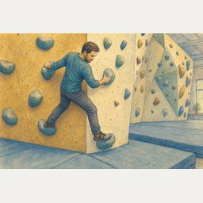](../climbing-training/climbing-training-ai-generated/climbing-atlas-arete-08-arete-careful-down-step.png) | **climbing atlas arete 08 arete careful down step** | [原图](../climbing-training/climbing-training-ai-generated/climbing-atlas-arete-08-arete-careful-down-step.png) 1536 × 1024 [元数据](../climbing-training/climbing-training-ai-generated/metadata/climbing-atlas-arete-08-arete-careful-down-step.json) [提示词](../climbing-training/climbing-training-ai-generated/prompts/climbing-atlas-arete-08-arete-careful-down-step.txt) [提示词 2](../climbing-training/climbing-training-ai-generated/prompts/climbing-atlas-series.txt) climbing-atlas-arete-08-arete-careful-down-step.png |
| [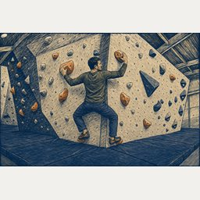](../climbing-training/climbing-training-ai-generated/climbing-atlas-arete-09-arete-broad-opposition-low.png) | **climbing atlas arete 09 arete broad opposition low** | [原图](../climbing-training/climbing-training-ai-generated/climbing-atlas-arete-09-arete-broad-opposition-low.png) 1536 × 1024 [元数据](../climbing-training/climbing-training-ai-generated/metadata/climbing-atlas-arete-09-arete-broad-opposition-low.json) [提示词](../climbing-training/climbing-training-ai-generated/prompts/climbing-atlas-arete-09-arete-broad-opposition-low.txt) [提示词 2](../climbing-training/climbing-training-ai-generated/prompts/climbing-atlas-series.txt) climbing-atlas-arete-09-arete-broad-opposition-low.png |
| [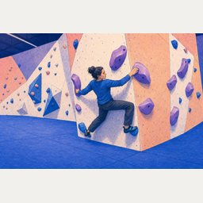](../climbing-training/climbing-training-ai-generated/climbing-atlas-arete-10-arete-low-route-around-turn.png) | **climbing atlas arete 10 arete low route around turn** | [原图](../climbing-training/climbing-training-ai-generated/climbing-atlas-arete-10-arete-low-route-around-turn.png) 1536 × 1024 [元数据](../climbing-training/climbing-training-ai-generated/metadata/climbing-atlas-arete-10-arete-low-route-around-turn.json) [提示词](../climbing-training/climbing-training-ai-generated/prompts/climbing-atlas-arete-10-arete-low-route-around-turn.txt) [提示词 2](../climbing-training/climbing-training-ai-generated/prompts/climbing-atlas-series.txt) climbing-atlas-arete-10-arete-low-route-around-turn.png |
| [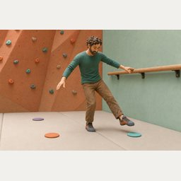](../climbing-training/climbing-training-ai-generated/climbing-atlas-balance-01-ground-three-targets.png) | **climbing atlas balance 01 ground three targets** | [原图](../climbing-training/climbing-training-ai-generated/climbing-atlas-balance-01-ground-three-targets.png) 1536 × 1024 [元数据](../climbing-training/climbing-training-ai-generated/metadata/climbing-atlas-balance-01-ground-three-targets.json) [提示词](../climbing-training/climbing-training-ai-generated/prompts/climbing-atlas-balance-01-ground-three-targets.txt) [提示词 2](../climbing-training/climbing-training-ai-generated/prompts/climbing-atlas-series.txt) climbing-atlas-balance-01-ground-three-targets.png |
| [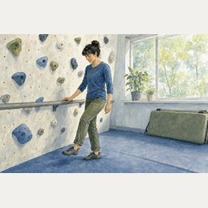](../climbing-training/climbing-training-ai-generated/climbing-atlas-balance-02-supported-single-leg.png) | **climbing atlas balance 02 supported single leg** | [原图](../climbing-training/climbing-training-ai-generated/climbing-atlas-balance-02-supported-single-leg.png) 1536 × 1024 [元数据](../climbing-training/climbing-training-ai-generated/metadata/climbing-atlas-balance-02-supported-single-leg.json) [提示词](../climbing-training/climbing-training-ai-generated/prompts/climbing-atlas-balance-02-supported-single-leg.txt) [提示词 2](../climbing-training/climbing-training-ai-generated/prompts/climbing-atlas-series.txt) climbing-atlas-balance-02-supported-single-leg.png |
| [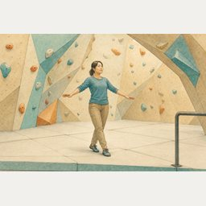](../climbing-training/climbing-training-ai-generated/climbing-atlas-balance-03-tandem-stance.png) | **climbing atlas balance 03 tandem stance** | [原图](../climbing-training/climbing-training-ai-generated/climbing-atlas-balance-03-tandem-stance.png) 1536 × 1024 [元数据](../climbing-training/climbing-training-ai-generated/metadata/climbing-atlas-balance-03-tandem-stance.json) [提示词](../climbing-training/climbing-training-ai-generated/prompts/climbing-atlas-balance-03-tandem-stance.txt) [提示词 2](../climbing-training/climbing-training-ai-generated/prompts/climbing-atlas-series.txt) climbing-atlas-balance-03-tandem-stance.png |
| [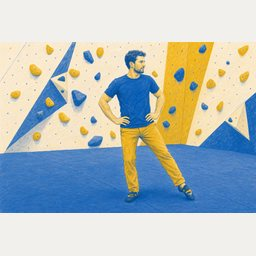](../climbing-training/climbing-training-ai-generated/climbing-atlas-balance-04-side-weight-shift.png) | **climbing atlas balance 04 side weight shift** | [原图](../climbing-training/climbing-training-ai-generated/climbing-atlas-balance-04-side-weight-shift.png) 1536 × 1024 [元数据](../climbing-training/climbing-training-ai-generated/metadata/climbing-atlas-balance-04-side-weight-shift.json) [提示词](../climbing-training/climbing-training-ai-generated/prompts/climbing-atlas-balance-04-side-weight-shift.txt) [提示词 2](../climbing-training/climbing-training-ai-generated/prompts/climbing-atlas-series.txt) climbing-atlas-balance-04-side-weight-shift.png |
| [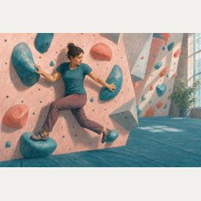](../climbing-training/climbing-training-ai-generated/climbing-atlas-balance-05-low-wall-one-foot-light.png) | **climbing atlas balance 05 low wall one foot light** | [原图](../climbing-training/climbing-training-ai-generated/climbing-atlas-balance-05-low-wall-one-foot-light.png) 1536 × 1024 [元数据](../climbing-training/climbing-training-ai-generated/metadata/climbing-atlas-balance-05-low-wall-one-foot-light.json) [提示词](../climbing-training/climbing-training-ai-generated/prompts/climbing-atlas-balance-05-low-wall-one-foot-light.txt) [提示词 2](../climbing-training/climbing-training-ai-generated/prompts/climbing-atlas-series.txt) climbing-atlas-balance-05-low-wall-one-foot-light.png |
| [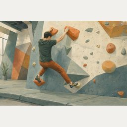](../climbing-training/climbing-training-ai-generated/climbing-atlas-balance-06-hand-stay-foot-shift.png) | **climbing atlas balance 06 hand stay foot shift** | [原图](../climbing-training/climbing-training-ai-generated/climbing-atlas-balance-06-hand-stay-foot-shift.png) 1536 × 1024 [元数据](../climbing-training/climbing-training-ai-generated/metadata/climbing-atlas-balance-06-hand-stay-foot-shift.json) [提示词](../climbing-training/climbing-training-ai-generated/prompts/climbing-atlas-balance-06-hand-stay-foot-shift.txt) [提示词 2](../climbing-training/climbing-training-ai-generated/prompts/climbing-atlas-series.txt) climbing-atlas-balance-06-hand-stay-foot-shift.png |
| [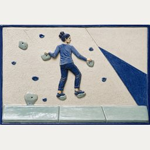](../climbing-training/climbing-training-ai-generated/climbing-atlas-balance-07-slab-upright.png) | **climbing atlas balance 07 slab upright** | [原图](../climbing-training/climbing-training-ai-generated/climbing-atlas-balance-07-slab-upright.png) 1536 × 1024 [元数据](../climbing-training/climbing-training-ai-generated/metadata/climbing-atlas-balance-07-slab-upright.json) [提示词](../climbing-training/climbing-training-ai-generated/prompts/climbing-atlas-balance-07-slab-upright.txt) [提示词 2](../climbing-training/climbing-training-ai-generated/prompts/climbing-atlas-series.txt) climbing-atlas-balance-07-slab-upright.png |
| [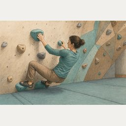](../climbing-training/climbing-training-ai-generated/climbing-atlas-balance-08-stable-tripod.png) | **climbing atlas balance 08 stable tripod** | [原图](../climbing-training/climbing-training-ai-generated/climbing-atlas-balance-08-stable-tripod.png) 1536 × 1024 [元数据](../climbing-training/climbing-training-ai-generated/metadata/climbing-atlas-balance-08-stable-tripod.json) [提示词](../climbing-training/climbing-training-ai-generated/prompts/climbing-atlas-balance-08-stable-tripod.txt) [提示词 2](../climbing-training/climbing-training-ai-generated/prompts/climbing-atlas-series.txt) climbing-atlas-balance-08-stable-tripod.png |
| [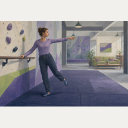](../climbing-training/climbing-training-ai-generated/climbing-atlas-balance-09-standing-soft-reach.png) | **climbing atlas balance 09 standing soft reach** | [原图](../climbing-training/climbing-training-ai-generated/climbing-atlas-balance-09-standing-soft-reach.png) 1536 × 1024 [元数据](../climbing-training/climbing-training-ai-generated/metadata/climbing-atlas-balance-09-standing-soft-reach.json) [提示词](../climbing-training/climbing-training-ai-generated/prompts/climbing-atlas-balance-09-standing-soft-reach.txt) [提示词 2](../climbing-training/climbing-training-ai-generated/prompts/climbing-atlas-series.txt) climbing-atlas-balance-09-standing-soft-reach.png |
| [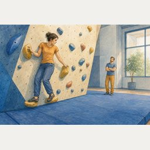](../climbing-training/climbing-training-ai-generated/climbing-atlas-balance-10-pause-before-next-step.png) | **climbing atlas balance 10 pause before next step** | [原图](../climbing-training/climbing-training-ai-generated/climbing-atlas-balance-10-pause-before-next-step.png) 1536 × 1024 [元数据](../climbing-training/climbing-training-ai-generated/metadata/climbing-atlas-balance-10-pause-before-next-step.json) [提示词](../climbing-training/climbing-training-ai-generated/prompts/climbing-atlas-balance-10-pause-before-next-step.txt) [提示词 2](../climbing-training/climbing-training-ai-generated/prompts/climbing-atlas-series.txt) climbing-atlas-balance-10-pause-before-next-step.png |
| [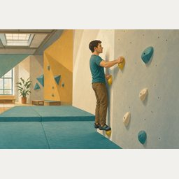](../climbing-training/climbing-training-ai-generated/climbing-atlas-body-position-01-hips-close.png) | **climbing atlas body position 01 hips close** | [原图](../climbing-training/climbing-training-ai-generated/climbing-atlas-body-position-01-hips-close.png) 1536 × 1024 [元数据](../climbing-training/climbing-training-ai-generated/metadata/climbing-atlas-body-position-01-hips-close.json) [提示词](../climbing-training/climbing-training-ai-generated/prompts/climbing-atlas-body-position-01-hips-close.txt) [提示词 2](../climbing-training/climbing-training-ai-generated/prompts/climbing-atlas-series.txt) climbing-atlas-body-position-01-hips-close.png |
| [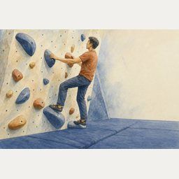](../climbing-training/climbing-training-ai-generated/climbing-atlas-body-position-02-leg-driven-step.png) | **climbing atlas body position 02 leg driven step** | [原图](../climbing-training/climbing-training-ai-generated/climbing-atlas-body-position-02-leg-driven-step.png) 1536 × 1024 [元数据](../climbing-training/climbing-training-ai-generated/metadata/climbing-atlas-body-position-02-leg-driven-step.json) [提示词](../climbing-training/climbing-training-ai-generated/prompts/climbing-atlas-body-position-02-leg-driven-step.txt) [提示词 2](../climbing-training/climbing-training-ai-generated/prompts/climbing-atlas-series.txt) climbing-atlas-body-position-02-leg-driven-step.png |
| [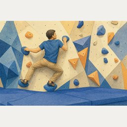](../climbing-training/climbing-training-ai-generated/climbing-atlas-body-position-03-side-on-small-turn.png) | **climbing atlas body position 03 side on small turn** | [原图](../climbing-training/climbing-training-ai-generated/climbing-atlas-body-position-03-side-on-small-turn.png) 1536 × 1024 [元数据](../climbing-training/climbing-training-ai-generated/metadata/climbing-atlas-body-position-03-side-on-small-turn.json) [提示词](../climbing-training/climbing-training-ai-generated/prompts/climbing-atlas-body-position-03-side-on-small-turn.txt) [提示词 2](../climbing-training/climbing-training-ai-generated/prompts/climbing-atlas-series.txt) climbing-atlas-body-position-03-side-on-small-turn.png |
| [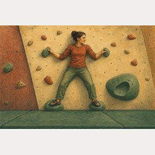](../climbing-training/climbing-training-ai-generated/climbing-atlas-body-position-04-wide-base-easy.png) | **climbing atlas body position 04 wide base easy** | [原图](../climbing-training/climbing-training-ai-generated/climbing-atlas-body-position-04-wide-base-easy.png) 1536 × 1024 [元数据](../climbing-training/climbing-training-ai-generated/metadata/climbing-atlas-body-position-04-wide-base-easy.json) [提示词](../climbing-training/climbing-training-ai-generated/prompts/climbing-atlas-body-position-04-wide-base-easy.txt) [提示词 2](../climbing-training/climbing-training-ai-generated/prompts/climbing-atlas-series.txt) climbing-atlas-body-position-04-wide-base-easy.png |
| [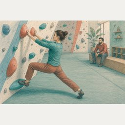](../climbing-training/climbing-training-ai-generated/climbing-atlas-body-position-05-low-flag-near-mat.png) | **climbing atlas body position 05 low flag near mat** | [原图](../climbing-training/climbing-training-ai-generated/climbing-atlas-body-position-05-low-flag-near-mat.png) 1536 × 1024 [元数据](../climbing-training/climbing-training-ai-generated/metadata/climbing-atlas-body-position-05-low-flag-near-mat.json) [提示词](../climbing-training/climbing-training-ai-generated/prompts/climbing-atlas-body-position-05-low-flag-near-mat.txt) [提示词 2](../climbing-training/climbing-training-ai-generated/prompts/climbing-atlas-series.txt) climbing-atlas-body-position-05-low-flag-near-mat.png |
| [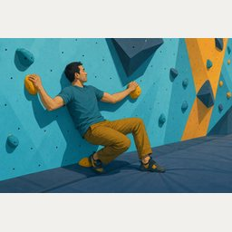](../climbing-training/climbing-training-ai-generated/climbing-atlas-body-position-06-straight-arms-soft.png) | **climbing atlas body position 06 straight arms soft** | [原图](../climbing-training/climbing-training-ai-generated/climbing-atlas-body-position-06-straight-arms-soft.png) 1536 × 1024 [元数据](../climbing-training/climbing-training-ai-generated/metadata/climbing-atlas-body-position-06-straight-arms-soft.json) [提示词](../climbing-training/climbing-training-ai-generated/prompts/climbing-atlas-body-position-06-straight-arms-soft.txt) [提示词 2](../climbing-training/climbing-training-ai-generated/prompts/climbing-atlas-series.txt) climbing-atlas-body-position-06-straight-arms-soft.png |
| [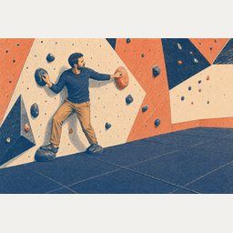](../climbing-training/climbing-training-ai-generated/climbing-atlas-body-position-07-turn-and-look.png) | **climbing atlas body position 07 turn and look** | [原图](../climbing-training/climbing-training-ai-generated/climbing-atlas-body-position-07-turn-and-look.png) 1536 × 1024 [元数据](../climbing-training/climbing-training-ai-generated/metadata/climbing-atlas-body-position-07-turn-and-look.json) [提示词](../climbing-training/climbing-training-ai-generated/prompts/climbing-atlas-body-position-07-turn-and-look.txt) [提示词 2](../climbing-training/climbing-training-ai-generated/prompts/climbing-atlas-series.txt) climbing-atlas-body-position-07-turn-and-look.png |
| [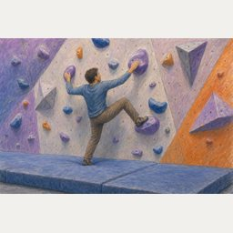](../climbing-training/climbing-training-ai-generated/climbing-atlas-body-position-08-step-up-with-room.png) | **climbing atlas body position 08 step up with room** | [原图](../climbing-training/climbing-training-ai-generated/climbing-atlas-body-position-08-step-up-with-room.png) 1536 × 1024 [元数据](../climbing-training/climbing-training-ai-generated/metadata/climbing-atlas-body-position-08-step-up-with-room.json) [提示词](../climbing-training/climbing-training-ai-generated/prompts/climbing-atlas-body-position-08-step-up-with-room.txt) [提示词 2](../climbing-training/climbing-training-ai-generated/prompts/climbing-atlas-series.txt) climbing-atlas-body-position-08-step-up-with-room.png |
| [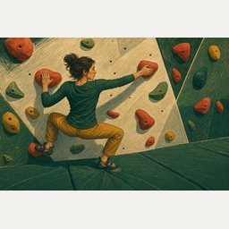](../climbing-training/climbing-training-ai-generated/climbing-atlas-body-position-09-move-one-limb.png) | **climbing atlas body position 09 move one limb** | [原图](../climbing-training/climbing-training-ai-generated/climbing-atlas-body-position-09-move-one-limb.png) 1536 × 1024 [元数据](../climbing-training/climbing-training-ai-generated/metadata/climbing-atlas-body-position-09-move-one-limb.json) [提示词](../climbing-training/climbing-training-ai-generated/prompts/climbing-atlas-body-position-09-move-one-limb.txt) [提示词 2](../climbing-training/climbing-training-ai-generated/prompts/climbing-atlas-series.txt) climbing-atlas-body-position-09-move-one-limb.png |
| [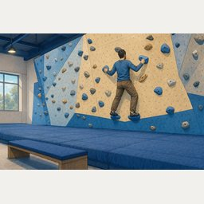](../climbing-training/climbing-training-ai-generated/climbing-atlas-body-position-10-return-to-neutral.png) | **climbing atlas body position 10 return to neutral** | [原图](../climbing-training/climbing-training-ai-generated/climbing-atlas-body-position-10-return-to-neutral.png) 1536 × 1024 [元数据](../climbing-training/climbing-training-ai-generated/metadata/climbing-atlas-body-position-10-return-to-neutral.json) [提示词](../climbing-training/climbing-training-ai-generated/prompts/climbing-atlas-body-position-10-return-to-neutral.txt) [提示词 2](../climbing-training/climbing-training-ai-generated/prompts/climbing-atlas-series.txt) climbing-atlas-body-position-10-return-to-neutral.png |
| [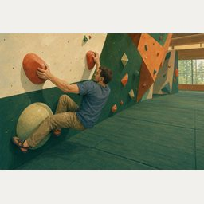](../climbing-training/climbing-training-ai-generated/climbing-atlas-boulder-advanced-01-low-heel-hook-compression.png) | **climbing atlas boulder advanced 01 low heel hook compression** | [原图](../climbing-training/climbing-training-ai-generated/climbing-atlas-boulder-advanced-01-low-heel-hook-compression.png) 1536 × 1024 [元数据](../climbing-training/climbing-training-ai-generated/metadata/climbing-atlas-boulder-advanced-01-low-heel-hook-compression.json) [提示词](../climbing-training/climbing-training-ai-generated/prompts/climbing-atlas-boulder-advanced-01-low-heel-hook-compression.txt) [提示词 2](../climbing-training/climbing-training-ai-generated/prompts/climbing-atlas-series.txt) climbing-atlas-boulder-advanced-01-low-heel-hook-compression.png |
| [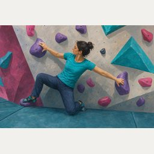](../climbing-training/climbing-training-ai-generated/climbing-atlas-boulder-advanced-02-controlled-drop-knee-low.png) | **climbing atlas boulder advanced 02 controlled drop knee low** | [原图](../climbing-training/climbing-training-ai-generated/climbing-atlas-boulder-advanced-02-controlled-drop-knee-low.png) 1536 × 1024 [元数据](../climbing-training/climbing-training-ai-generated/metadata/climbing-atlas-boulder-advanced-02-controlled-drop-knee-low.json) [提示词](../climbing-training/climbing-training-ai-generated/prompts/climbing-atlas-boulder-advanced-02-controlled-drop-knee-low.txt) [提示词 2](../climbing-training/climbing-training-ai-generated/prompts/climbing-atlas-series.txt) climbing-atlas-boulder-advanced-02-controlled-drop-knee-low.png |
| [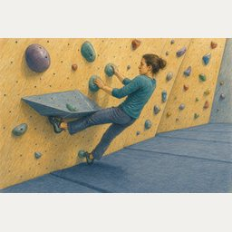](../climbing-training/climbing-training-ai-generated/climbing-atlas-boulder-advanced-03-low-toe-hook-transition.png) | **climbing atlas boulder advanced 03 low toe hook transition** | [原图](../climbing-training/climbing-training-ai-generated/climbing-atlas-boulder-advanced-03-low-toe-hook-transition.png) 1536 × 1024 [元数据](../climbing-training/climbing-training-ai-generated/metadata/climbing-atlas-boulder-advanced-03-low-toe-hook-transition.json) [提示词](../climbing-training/climbing-training-ai-generated/prompts/climbing-atlas-boulder-advanced-03-low-toe-hook-transition.txt) [提示词 2](../climbing-training/climbing-training-ai-generated/prompts/climbing-atlas-series.txt) climbing-atlas-boulder-advanced-03-low-toe-hook-transition.png |
| [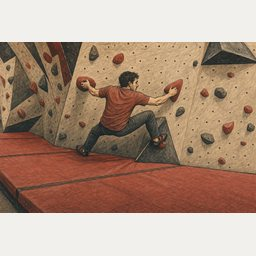](../climbing-training/climbing-training-ai-generated/climbing-atlas-boulder-advanced-04-compact-opposition-sequence.png) | **climbing atlas boulder advanced 04 compact opposition sequence** | [原图](../climbing-training/climbing-training-ai-generated/climbing-atlas-boulder-advanced-04-compact-opposition-sequence.png) 1536 × 1024 [元数据](../climbing-training/climbing-training-ai-generated/metadata/climbing-atlas-boulder-advanced-04-compact-opposition-sequence.json) [提示词](../climbing-training/climbing-training-ai-generated/prompts/climbing-atlas-boulder-advanced-04-compact-opposition-sequence.txt) [提示词 2](../climbing-training/climbing-training-ai-generated/prompts/climbing-atlas-series.txt) climbing-atlas-boulder-advanced-04-compact-opposition-sequence.png |
| [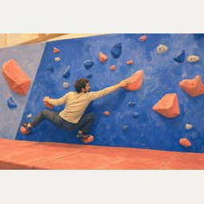](../climbing-training/climbing-training-ai-generated/climbing-atlas-boulder-advanced-05-static-long-reach-low.png) | **climbing atlas boulder advanced 05 static long reach low** | [原图](../climbing-training/climbing-training-ai-generated/climbing-atlas-boulder-advanced-05-static-long-reach-low.png) 1536 × 1024 [元数据](../climbing-training/climbing-training-ai-generated/metadata/climbing-atlas-boulder-advanced-05-static-long-reach-low.json) [提示词](../climbing-training/climbing-training-ai-generated/prompts/climbing-atlas-boulder-advanced-05-static-long-reach-low.txt) [提示词 2](../climbing-training/climbing-training-ai-generated/prompts/climbing-atlas-series.txt) climbing-atlas-boulder-advanced-05-static-long-reach-low.png |
| [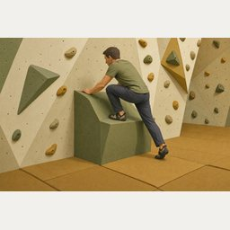](../climbing-training/climbing-training-ai-generated/climbing-atlas-boulder-advanced-06-low-mantle-on-volume.png) | **climbing atlas boulder advanced 06 low mantle on volume** | [原图](../climbing-training/climbing-training-ai-generated/climbing-atlas-boulder-advanced-06-low-mantle-on-volume.png) 1536 × 1024 [元数据](../climbing-training/climbing-training-ai-generated/metadata/climbing-atlas-boulder-advanced-06-low-mantle-on-volume.json) [提示词](../climbing-training/climbing-training-ai-generated/prompts/climbing-atlas-boulder-advanced-06-low-mantle-on-volume.txt) [提示词 2](../climbing-training/climbing-training-ai-generated/prompts/climbing-atlas-series.txt) climbing-atlas-boulder-advanced-06-low-mantle-on-volume.png |
| [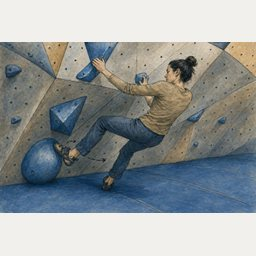](../climbing-training/climbing-training-ai-generated/climbing-atlas-boulder-advanced-07-low-heel-to-foot-release.png) | **climbing atlas boulder advanced 07 low heel to foot release** | [原图](../climbing-training/climbing-training-ai-generated/climbing-atlas-boulder-advanced-07-low-heel-to-foot-release.png) 1536 × 1024 [元数据](../climbing-training/climbing-training-ai-generated/metadata/climbing-atlas-boulder-advanced-07-low-heel-to-foot-release.json) [提示词](../climbing-training/climbing-training-ai-generated/prompts/climbing-atlas-boulder-advanced-07-low-heel-to-foot-release.txt) [提示词 2](../climbing-training/climbing-training-ai-generated/prompts/climbing-atlas-series.txt) climbing-atlas-boulder-advanced-07-low-heel-to-foot-release.png |
| [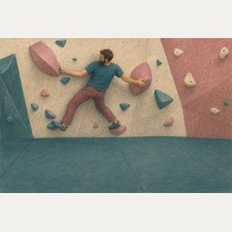](../climbing-training/climbing-training-ai-generated/climbing-atlas-boulder-advanced-08-low-pinches-in-balance.png) | **climbing atlas boulder advanced 08 low pinches in balance** | [原图](../climbing-training/climbing-training-ai-generated/climbing-atlas-boulder-advanced-08-low-pinches-in-balance.png) 1536 × 1024 [元数据](../climbing-training/climbing-training-ai-generated/metadata/climbing-atlas-boulder-advanced-08-low-pinches-in-balance.json) [提示词](../climbing-training/climbing-training-ai-generated/prompts/climbing-atlas-boulder-advanced-08-low-pinches-in-balance.txt) [提示词 2](../climbing-training/climbing-training-ai-generated/prompts/climbing-atlas-series.txt) climbing-atlas-boulder-advanced-08-low-pinches-in-balance.png |
| [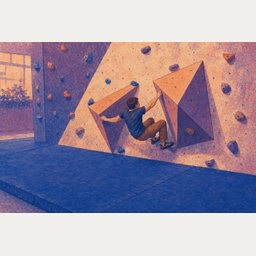](../climbing-training/climbing-training-ai-generated/climbing-atlas-boulder-advanced-09-static-low-box-position.png) | **climbing atlas boulder advanced 09 static low box position** | [原图](../climbing-training/climbing-training-ai-generated/climbing-atlas-boulder-advanced-09-static-low-box-position.png) 1536 × 1024 [元数据](../climbing-training/climbing-training-ai-generated/metadata/climbing-atlas-boulder-advanced-09-static-low-box-position.json) [提示词](../climbing-training/climbing-training-ai-generated/prompts/climbing-atlas-boulder-advanced-09-static-low-box-position.txt) [提示词 2](../climbing-training/climbing-training-ai-generated/prompts/climbing-atlas-series.txt) climbing-atlas-boulder-advanced-09-static-low-box-position.png |
| [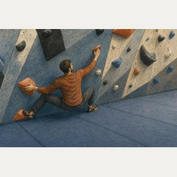](../climbing-training/climbing-training-ai-generated/climbing-atlas-boulder-advanced-10-low-seated-start-extension.png) | **climbing atlas boulder advanced 10 low seated start extension** | [原图](../climbing-training/climbing-training-ai-generated/climbing-atlas-boulder-advanced-10-low-seated-start-extension.png) 1536 × 1024 [元数据](../climbing-training/climbing-training-ai-generated/metadata/climbing-atlas-boulder-advanced-10-low-seated-start-extension.json) [提示词](../climbing-training/climbing-training-ai-generated/prompts/climbing-atlas-boulder-advanced-10-low-seated-start-extension.txt) [提示词 2](../climbing-training/climbing-training-ai-generated/prompts/climbing-atlas-series.txt) climbing-atlas-boulder-advanced-10-low-seated-start-extension.png |
| [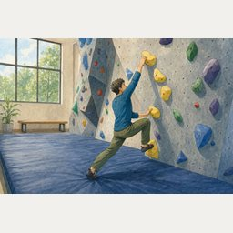](../climbing-training/climbing-training-ai-generated/climbing-atlas-boulder-easy-01-big-holds-first-step.png) | **climbing atlas boulder easy 01 big holds first step** | [原图](../climbing-training/climbing-training-ai-generated/climbing-atlas-boulder-easy-01-big-holds-first-step.png) 1536 × 1024 [元数据](../climbing-training/climbing-training-ai-generated/metadata/climbing-atlas-boulder-easy-01-big-holds-first-step.json) [提示词](../climbing-training/climbing-training-ai-generated/prompts/climbing-atlas-boulder-easy-01-big-holds-first-step.txt) [提示词 2](../climbing-training/climbing-training-ai-generated/prompts/climbing-atlas-series.txt) climbing-atlas-boulder-easy-01-big-holds-first-step.png |
| [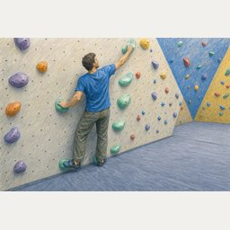](../climbing-training/climbing-training-ai-generated/climbing-atlas-boulder-easy-02-quiet-two-foot-start.png) | **climbing atlas boulder easy 02 quiet two foot start** | [原图](../climbing-training/climbing-training-ai-generated/climbing-atlas-boulder-easy-02-quiet-two-foot-start.png) 1536 × 1024 [元数据](../climbing-training/climbing-training-ai-generated/metadata/climbing-atlas-boulder-easy-02-quiet-two-foot-start.json) [提示词](../climbing-training/climbing-training-ai-generated/prompts/climbing-atlas-boulder-easy-02-quiet-two-foot-start.txt) [提示词 2](../climbing-training/climbing-training-ai-generated/prompts/climbing-atlas-series.txt) climbing-atlas-boulder-easy-02-quiet-two-foot-start.png |
| [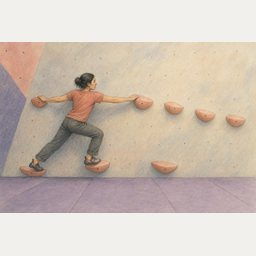](../climbing-training/climbing-training-ai-generated/climbing-atlas-boulder-easy-03-sideways-jug-traverse.png) | **climbing atlas boulder easy 03 sideways jug traverse** | [原图](../climbing-training/climbing-training-ai-generated/climbing-atlas-boulder-easy-03-sideways-jug-traverse.png) 1536 × 1024 [元数据](../climbing-training/climbing-training-ai-generated/metadata/climbing-atlas-boulder-easy-03-sideways-jug-traverse.json) [提示词](../climbing-training/climbing-training-ai-generated/prompts/climbing-atlas-boulder-easy-03-sideways-jug-traverse.txt) [提示词 2](../climbing-training/climbing-training-ai-generated/prompts/climbing-atlas-series.txt) climbing-atlas-boulder-easy-03-sideways-jug-traverse.png |
| [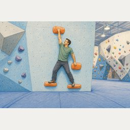](../climbing-training/climbing-training-ai-generated/climbing-atlas-boulder-easy-04-straight-arm-pause.png) | **climbing atlas boulder easy 04 straight arm pause** | [原图](../climbing-training/climbing-training-ai-generated/climbing-atlas-boulder-easy-04-straight-arm-pause.png) 1536 × 1024 [元数据](../climbing-training/climbing-training-ai-generated/metadata/climbing-atlas-boulder-easy-04-straight-arm-pause.json) [提示词](../climbing-training/climbing-training-ai-generated/prompts/climbing-atlas-boulder-easy-04-straight-arm-pause.txt) [提示词 2](../climbing-training/climbing-training-ai-generated/prompts/climbing-atlas-series.txt) climbing-atlas-boulder-easy-04-straight-arm-pause.png |
| [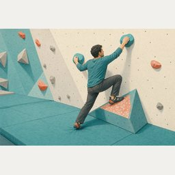](../climbing-training/climbing-training-ai-generated/climbing-atlas-boulder-easy-05-large-volume-step.png) | **climbing atlas boulder easy 05 large volume step** | [原图](../climbing-training/climbing-training-ai-generated/climbing-atlas-boulder-easy-05-large-volume-step.png) 1536 × 1024 [元数据](../climbing-training/climbing-training-ai-generated/metadata/climbing-atlas-boulder-easy-05-large-volume-step.json) [提示词](../climbing-training/climbing-training-ai-generated/prompts/climbing-atlas-boulder-easy-05-large-volume-step.txt) [提示词 2](../climbing-training/climbing-training-ai-generated/prompts/climbing-atlas-series.txt) climbing-atlas-boulder-easy-05-large-volume-step.png |
| [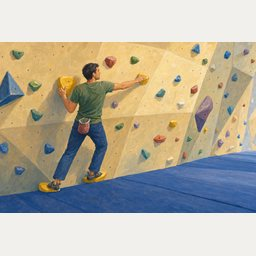](../climbing-training/climbing-training-ai-generated/climbing-atlas-boulder-easy-06-gentle-rightward-reach.png) | **climbing atlas boulder easy 06 gentle rightward reach** | [原图](../climbing-training/climbing-training-ai-generated/climbing-atlas-boulder-easy-06-gentle-rightward-reach.png) 1536 × 1024 [元数据](../climbing-training/climbing-training-ai-generated/metadata/climbing-atlas-boulder-easy-06-gentle-rightward-reach.json) [提示词](../climbing-training/climbing-training-ai-generated/prompts/climbing-atlas-boulder-easy-06-gentle-rightward-reach.txt) [提示词 2](../climbing-training/climbing-training-ai-generated/prompts/climbing-atlas-series.txt) climbing-atlas-boulder-easy-06-gentle-rightward-reach.png |
| [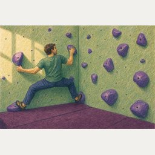](../climbing-training/climbing-training-ai-generated/climbing-atlas-boulder-easy-07-balanced-corner-start.png) | **climbing atlas boulder easy 07 balanced corner start** | [原图](../climbing-training/climbing-training-ai-generated/climbing-atlas-boulder-easy-07-balanced-corner-start.png) 1536 × 1024 [元数据](../climbing-training/climbing-training-ai-generated/metadata/climbing-atlas-boulder-easy-07-balanced-corner-start.json) [提示词](../climbing-training/climbing-training-ai-generated/prompts/climbing-atlas-boulder-easy-07-balanced-corner-start.txt) [提示词 2](../climbing-training/climbing-training-ai-generated/prompts/climbing-atlas-series.txt) climbing-atlas-boulder-easy-07-balanced-corner-start.png |
| [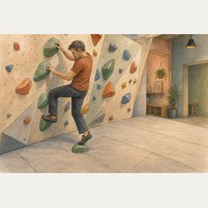](../climbing-training/climbing-training-ai-generated/climbing-atlas-boulder-easy-08-low-step-down-view.png) | **climbing atlas boulder easy 08 low step down view** | [原图](../climbing-training/climbing-training-ai-generated/climbing-atlas-boulder-easy-08-low-step-down-view.png) 1536 × 1024 [元数据](../climbing-training/climbing-training-ai-generated/metadata/climbing-atlas-boulder-easy-08-low-step-down-view.json) [提示词](../climbing-training/climbing-training-ai-generated/prompts/climbing-atlas-boulder-easy-08-low-step-down-view.txt) [提示词 2](../climbing-training/climbing-training-ai-generated/prompts/climbing-atlas-series.txt) climbing-atlas-boulder-easy-08-low-step-down-view.png |
| [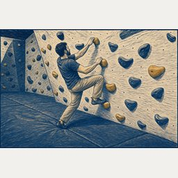](../climbing-training/climbing-training-ai-generated/climbing-atlas-boulder-easy-09-rounded-hold-staircase.png) | **climbing atlas boulder easy 09 rounded hold staircase** | [原图](../climbing-training/climbing-training-ai-generated/climbing-atlas-boulder-easy-09-rounded-hold-staircase.png) 1536 × 1024 [元数据](../climbing-training/climbing-training-ai-generated/metadata/climbing-atlas-boulder-easy-09-rounded-hold-staircase.json) [提示词](../climbing-training/climbing-training-ai-generated/prompts/climbing-atlas-boulder-easy-09-rounded-hold-staircase.txt) [提示词 2](../climbing-training/climbing-training-ai-generated/prompts/climbing-atlas-series.txt) climbing-atlas-boulder-easy-09-rounded-hold-staircase.png |
| [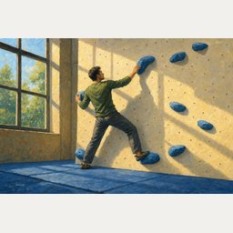](../climbing-training/climbing-training-ai-generated/climbing-atlas-boulder-easy-10-sunlit-beginner-panel.png) | **climbing atlas boulder easy 10 sunlit beginner panel** | [原图](../climbing-training/climbing-training-ai-generated/climbing-atlas-boulder-easy-10-sunlit-beginner-panel.png) 1536 × 1024 [元数据](../climbing-training/climbing-training-ai-generated/metadata/climbing-atlas-boulder-easy-10-sunlit-beginner-panel.json) [提示词](../climbing-training/climbing-training-ai-generated/prompts/climbing-atlas-boulder-easy-10-sunlit-beginner-panel.txt) [提示词 2](../climbing-training/climbing-training-ai-generated/prompts/climbing-atlas-series.txt) climbing-atlas-boulder-easy-10-sunlit-beginner-panel.png |
|  | **climbing atlas boulder moderate 01 cross step traverse** | [原图](../climbing-training/climbing-training-ai-generated/climbing-atlas-boulder-moderate-01-cross-step-traverse.png) 1536 × 1024 [元数据](../climbing-training/climbing-training-ai-generated/metadata/climbing-atlas-boulder-moderate-01-cross-step-traverse.json) [提示词](../climbing-training/climbing-training-ai-generated/prompts/climbing-atlas-boulder-moderate-01-cross-step-traverse.txt) [提示词 2](../climbing-training/climbing-training-ai-generated/prompts/climbing-atlas-series.txt) climbing-atlas-boulder-moderate-01-cross-step-traverse.png |
|  | **climbing atlas boulder moderate 02 low sidepull balance** | [原图](../climbing-training/climbing-training-ai-generated/climbing-atlas-boulder-moderate-02-low-sidepull-balance.png) 1536 × 1024 [元数据](../climbing-training/climbing-training-ai-generated/metadata/climbing-atlas-boulder-moderate-02-low-sidepull-balance.json) [提示词](../climbing-training/climbing-training-ai-generated/prompts/climbing-atlas-boulder-moderate-02-low-sidepull-balance.txt) [提示词 2](../climbing-training/climbing-training-ai-generated/prompts/climbing-atlas-series.txt) climbing-atlas-boulder-moderate-02-low-sidepull-balance.png |
|  | **climbing atlas boulder moderate 03 foot swap on wide edge** | [原图](../climbing-training/climbing-training-ai-generated/climbing-atlas-boulder-moderate-03-foot-swap-on-wide-edge.png) 1536 × 1024 [元数据](../climbing-training/climbing-training-ai-generated/metadata/climbing-atlas-boulder-moderate-03-foot-swap-on-wide-edge.json) [提示词](../climbing-training/climbing-training-ai-generated/prompts/climbing-atlas-boulder-moderate-03-foot-swap-on-wide-edge.txt) [提示词 2](../climbing-training/climbing-training-ai-generated/prompts/climbing-atlas-series.txt) climbing-atlas-boulder-moderate-03-foot-swap-on-wide-edge.png |
|  | **climbing atlas boulder moderate 04 flagged hip shift** | [原图](../climbing-training/climbing-training-ai-generated/climbing-atlas-boulder-moderate-04-flagged-hip-shift.png) 1536 × 1024 [元数据](../climbing-training/climbing-training-ai-generated/metadata/climbing-atlas-boulder-moderate-04-flagged-hip-shift.json) [提示词](../climbing-training/climbing-training-ai-generated/prompts/climbing-atlas-boulder-moderate-04-flagged-hip-shift.txt) [提示词 2](../climbing-training/climbing-training-ai-generated/prompts/climbing-atlas-series.txt) climbing-atlas-boulder-moderate-04-flagged-hip-shift.png |
|  | **climbing atlas boulder moderate 05 shallow roof body close** | [原图](../climbing-training/climbing-training-ai-generated/climbing-atlas-boulder-moderate-05-shallow-roof-body-close.png) 1536 × 1024 [元数据](../climbing-training/climbing-training-ai-generated/metadata/climbing-atlas-boulder-moderate-05-shallow-roof-body-close.json) [提示词](../climbing-training/climbing-training-ai-generated/prompts/climbing-atlas-boulder-moderate-05-shallow-roof-body-close.txt) [提示词 2](../climbing-training/climbing-training-ai-generated/prompts/climbing-atlas-series.txt) climbing-atlas-boulder-moderate-05-shallow-roof-body-close.png |
|  | **climbing atlas boulder moderate 06 two volume bridge** | [原图](../climbing-training/climbing-training-ai-generated/climbing-atlas-boulder-moderate-06-two-volume-bridge.png) 1536 × 1024 [元数据](../climbing-training/climbing-training-ai-generated/metadata/climbing-atlas-boulder-moderate-06-two-volume-bridge.json) [提示词](../climbing-training/climbing-training-ai-generated/prompts/climbing-atlas-boulder-moderate-06-two-volume-bridge.txt) [提示词 2](../climbing-training/climbing-training-ai-generated/prompts/climbing-atlas-series.txt) climbing-atlas-boulder-moderate-06-two-volume-bridge.png |
|  | **climbing atlas boulder moderate 07 rounded sloper stance** | [原图](../climbing-training/climbing-training-ai-generated/climbing-atlas-boulder-moderate-07-rounded-sloper-stance.png) 1536 × 1024 [元数据](../climbing-training/climbing-training-ai-generated/metadata/climbing-atlas-boulder-moderate-07-rounded-sloper-stance.json) [提示词](../climbing-training/climbing-training-ai-generated/prompts/climbing-atlas-boulder-moderate-07-rounded-sloper-stance.txt) [提示词 2](../climbing-training/climbing-training-ai-generated/prompts/climbing-atlas-series.txt) climbing-atlas-boulder-moderate-07-rounded-sloper-stance.png |
|  | **climbing atlas boulder moderate 08 low undercling rise** | [原图](../climbing-training/climbing-training-ai-generated/climbing-atlas-boulder-moderate-08-low-undercling-rise.png) 1536 × 1024 [元数据](../climbing-training/climbing-training-ai-generated/metadata/climbing-atlas-boulder-moderate-08-low-undercling-rise.json) [提示词](../climbing-training/climbing-training-ai-generated/prompts/climbing-atlas-boulder-moderate-08-low-undercling-rise.txt) [提示词 2](../climbing-training/climbing-training-ai-generated/prompts/climbing-atlas-series.txt) climbing-atlas-boulder-moderate-08-low-undercling-rise.png |
|  | **climbing atlas boulder moderate 09 diagonal compression start** | [原图](../climbing-training/climbing-training-ai-generated/climbing-atlas-boulder-moderate-09-diagonal-compression-start.png) 1536 × 1024 [元数据](../climbing-training/climbing-training-ai-generated/metadata/climbing-atlas-boulder-moderate-09-diagonal-compression-start.json) [提示词](../climbing-training/climbing-training-ai-generated/prompts/climbing-atlas-boulder-moderate-09-diagonal-compression-start.txt) [提示词 2](../climbing-training/climbing-training-ai-generated/prompts/climbing-atlas-series.txt) climbing-atlas-boulder-moderate-09-diagonal-compression-start.png |
|  | **climbing atlas boulder moderate 10 reading the next step** | [原图](../climbing-training/climbing-training-ai-generated/climbing-atlas-boulder-moderate-10-reading-the-next-step.png) 1536 × 1024 [元数据](../climbing-training/climbing-training-ai-generated/metadata/climbing-atlas-boulder-moderate-10-reading-the-next-step.json) [提示词](../climbing-training/climbing-training-ai-generated/prompts/climbing-atlas-boulder-moderate-10-reading-the-next-step.txt) [提示词 2](../climbing-training/climbing-training-ai-generated/prompts/climbing-atlas-series.txt) climbing-atlas-boulder-moderate-10-reading-the-next-step.png |
|  | **climbing atlas core 01 heel slide** | [原图](../climbing-training/climbing-training-ai-generated/climbing-atlas-core-01-heel-slide.png) 1536 × 1024 [元数据](../climbing-training/climbing-training-ai-generated/metadata/climbing-atlas-core-01-heel-slide.json) [提示词](../climbing-training/climbing-training-ai-generated/prompts/climbing-atlas-core-01-heel-slide.txt) [提示词 2](../climbing-training/climbing-training-ai-generated/prompts/climbing-atlas-series.txt) climbing-atlas-core-01-heel-slide.png |
|  | **climbing atlas core 02 dead bug reach** | [原图](../climbing-training/climbing-training-ai-generated/climbing-atlas-core-02-dead-bug-reach.png) 1536 × 1024 [元数据](../climbing-training/climbing-training-ai-generated/metadata/climbing-atlas-core-02-dead-bug-reach.json) [提示词](../climbing-training/climbing-training-ai-generated/prompts/climbing-atlas-core-02-dead-bug-reach.txt) [提示词 2](../climbing-training/climbing-training-ai-generated/prompts/climbing-atlas-series.txt) climbing-atlas-core-02-dead-bug-reach.png |
|  | **climbing atlas core 03 bird dog** | [原图](../climbing-training/climbing-training-ai-generated/climbing-atlas-core-03-bird-dog.png) 1536 × 1024 [元数据](../climbing-training/climbing-training-ai-generated/metadata/climbing-atlas-core-03-bird-dog.json) [提示词](../climbing-training/climbing-training-ai-generated/prompts/climbing-atlas-core-03-bird-dog.txt) [提示词 2](../climbing-training/climbing-training-ai-generated/prompts/climbing-atlas-series.txt) climbing-atlas-core-03-bird-dog.png |
|  | **climbing atlas core 04 knee side support** | [原图](../climbing-training/climbing-training-ai-generated/climbing-atlas-core-04-knee-side-support.png) 1536 × 1024 [元数据](../climbing-training/climbing-training-ai-generated/metadata/climbing-atlas-core-04-knee-side-support.json) [提示词](../climbing-training/climbing-training-ai-generated/prompts/climbing-atlas-core-04-knee-side-support.txt) [提示词 2](../climbing-training/climbing-training-ai-generated/prompts/climbing-atlas-series.txt) climbing-atlas-core-04-knee-side-support.png |
|  | **climbing atlas core 05 glute bridge** | [原图](../climbing-training/climbing-training-ai-generated/climbing-atlas-core-05-glute-bridge.png) 1536 × 1024 [元数据](../climbing-training/climbing-training-ai-generated/metadata/climbing-atlas-core-05-glute-bridge.json) [提示词](../climbing-training/climbing-training-ai-generated/prompts/climbing-atlas-core-05-glute-bridge.txt) [提示词 2](../climbing-training/climbing-training-ai-generated/prompts/climbing-atlas-series.txt) climbing-atlas-core-05-glute-bridge.png |
|  | **climbing atlas core 06 quadruped weight shift** | [原图](../climbing-training/climbing-training-ai-generated/climbing-atlas-core-06-quadruped-weight-shift.png) 1536 × 1024 [元数据](../climbing-training/climbing-training-ai-generated/metadata/climbing-atlas-core-06-quadruped-weight-shift.json) [提示词](../climbing-training/climbing-training-ai-generated/prompts/climbing-atlas-core-06-quadruped-weight-shift.txt) [提示词 2](../climbing-training/climbing-training-ai-generated/prompts/climbing-atlas-series.txt) climbing-atlas-core-06-quadruped-weight-shift.png |
|  | **climbing atlas core 07 wall forearm brace** | [原图](../climbing-training/climbing-training-ai-generated/climbing-atlas-core-07-wall-forearm-brace.png) 1536 × 1024 [元数据](../climbing-training/climbing-training-ai-generated/metadata/climbing-atlas-core-07-wall-forearm-brace.json) [提示词](../climbing-training/climbing-training-ai-generated/prompts/climbing-atlas-core-07-wall-forearm-brace.txt) [提示词 2](../climbing-training/climbing-training-ai-generated/prompts/climbing-atlas-series.txt) climbing-atlas-core-07-wall-forearm-brace.png |
|  | **climbing atlas core 08 seated knee lift** | [原图](../climbing-training/climbing-training-ai-generated/climbing-atlas-core-08-seated-knee-lift.png) 1536 × 1024 [元数据](../climbing-training/climbing-training-ai-generated/metadata/climbing-atlas-core-08-seated-knee-lift.json) [提示词](../climbing-training/climbing-training-ai-generated/prompts/climbing-atlas-core-08-seated-knee-lift.txt) [提示词 2](../climbing-training/climbing-training-ai-generated/prompts/climbing-atlas-series.txt) climbing-atlas-core-08-seated-knee-lift.png |
|  | **climbing atlas core 09 tucked hollow easy** | [原图](../climbing-training/climbing-training-ai-generated/climbing-atlas-core-09-tucked-hollow-easy.png) 1536 × 1024 [元数据](../climbing-training/climbing-training-ai-generated/metadata/climbing-atlas-core-09-tucked-hollow-easy.json) [提示词](../climbing-training/climbing-training-ai-generated/prompts/climbing-atlas-core-09-tucked-hollow-easy.txt) [提示词 2](../climbing-training/climbing-training-ai-generated/prompts/climbing-atlas-series.txt) climbing-atlas-core-09-tucked-hollow-easy.png |
|  | **climbing atlas core 10 supine march** | [原图](../climbing-training/climbing-training-ai-generated/climbing-atlas-core-10-supine-march.png) 1536 × 1024 [元数据](../climbing-training/climbing-training-ai-generated/metadata/climbing-atlas-core-10-supine-march.json) [提示词](../climbing-training/climbing-training-ai-generated/prompts/climbing-atlas-core-10-supine-march.txt) [提示词 2](../climbing-training/climbing-training-ai-generated/prompts/climbing-atlas-series.txt) climbing-atlas-core-10-supine-march.png |
|  | **climbing atlas corner 01 corner comfortable stem** | [原图](../climbing-training/climbing-training-ai-generated/climbing-atlas-corner-01-corner-comfortable-stem.png) 1536 × 1024 [元数据](../climbing-training/climbing-training-ai-generated/metadata/climbing-atlas-corner-01-corner-comfortable-stem.json) [提示词](../climbing-training/climbing-training-ai-generated/prompts/climbing-atlas-corner-01-corner-comfortable-stem.txt) [提示词 2](../climbing-training/climbing-training-ai-generated/prompts/climbing-atlas-series.txt) climbing-atlas-corner-01-corner-comfortable-stem.png |
|  | **climbing atlas corner 02 corner one foot transfer** | [原图](../climbing-training/climbing-training-ai-generated/climbing-atlas-corner-02-corner-one-foot-transfer.png) 1536 × 1024 [元数据](../climbing-training/climbing-training-ai-generated/metadata/climbing-atlas-corner-02-corner-one-foot-transfer.json) [提示词](../climbing-training/climbing-training-ai-generated/prompts/climbing-atlas-corner-02-corner-one-foot-transfer.txt) [提示词 2](../climbing-training/climbing-training-ai-generated/prompts/climbing-atlas-series.txt) climbing-atlas-corner-02-corner-one-foot-transfer.png |
|  | **climbing atlas corner 03 corner palm and jug support** | [原图](../climbing-training/climbing-training-ai-generated/climbing-atlas-corner-03-corner-palm-and-jug-support.png) 1536 × 1024 [元数据](../climbing-training/climbing-training-ai-generated/metadata/climbing-atlas-corner-03-corner-palm-and-jug-support.json) [提示词](../climbing-training/climbing-training-ai-generated/prompts/climbing-atlas-corner-03-corner-palm-and-jug-support.txt) [提示词 2](../climbing-training/climbing-training-ai-generated/prompts/climbing-atlas-series.txt) climbing-atlas-corner-03-corner-palm-and-jug-support.png |
|  | **climbing atlas corner 04 corner paper shapes route** | [原图](../climbing-training/climbing-training-ai-generated/climbing-atlas-corner-04-corner-paper-shapes-route.png) 1536 × 1024 [元数据](../climbing-training/climbing-training-ai-generated/metadata/climbing-atlas-corner-04-corner-paper-shapes-route.json) [提示词](../climbing-training/climbing-training-ai-generated/prompts/climbing-atlas-corner-04-corner-paper-shapes-route.txt) [提示词 2](../climbing-training/climbing-training-ai-generated/prompts/climbing-atlas-series.txt) climbing-atlas-corner-04-corner-paper-shapes-route.png |
|  | **climbing atlas corner 05 corner short reach between faces** | [原图](../climbing-training/climbing-training-ai-generated/climbing-atlas-corner-05-corner-short-reach-between-faces.png) 1536 × 1024 [元数据](../climbing-training/climbing-training-ai-generated/metadata/climbing-atlas-corner-05-corner-short-reach-between-faces.json) [提示词](../climbing-training/climbing-training-ai-generated/prompts/climbing-atlas-corner-05-corner-short-reach-between-faces.txt) [提示词 2](../climbing-training/climbing-training-ai-generated/prompts/climbing-atlas-series.txt) climbing-atlas-corner-05-corner-short-reach-between-faces.png |
|  | **climbing atlas corner 06 corner low volume stance** | [原图](../climbing-training/climbing-training-ai-generated/climbing-atlas-corner-06-corner-low-volume-stance.png) 1536 × 1024 [元数据](../climbing-training/climbing-training-ai-generated/metadata/climbing-atlas-corner-06-corner-low-volume-stance.json) [提示词](../climbing-training/climbing-training-ai-generated/prompts/climbing-atlas-corner-06-corner-low-volume-stance.txt) [提示词 2](../climbing-training/climbing-training-ai-generated/prompts/climbing-atlas-series.txt) climbing-atlas-corner-06-corner-low-volume-stance.png |
|  | **climbing atlas corner 07 corner warm evening pause** | [原图](../climbing-training/climbing-training-ai-generated/climbing-atlas-corner-07-corner-warm-evening-pause.png) 1536 × 1024 [元数据](../climbing-training/climbing-training-ai-generated/metadata/climbing-atlas-corner-07-corner-warm-evening-pause.json) [提示词](../climbing-training/climbing-training-ai-generated/prompts/climbing-atlas-corner-07-corner-warm-evening-pause.txt) [提示词 2](../climbing-training/climbing-training-ai-generated/prompts/climbing-atlas-series.txt) climbing-atlas-corner-07-corner-warm-evening-pause.png |
|  | **climbing atlas corner 08 corner downstep near mat** | [原图](../climbing-training/climbing-training-ai-generated/climbing-atlas-corner-08-corner-downstep-near-mat.png) 1536 × 1024 [元数据](../climbing-training/climbing-training-ai-generated/metadata/climbing-atlas-corner-08-corner-downstep-near-mat.json) [提示词](../climbing-training/climbing-training-ai-generated/prompts/climbing-atlas-corner-08-corner-downstep-near-mat.txt) [提示词 2](../climbing-training/climbing-training-ai-generated/prompts/climbing-atlas-series.txt) climbing-atlas-corner-08-corner-downstep-near-mat.png |
|  | **climbing atlas corner 09 corner low opposition line** | [原图](../climbing-training/climbing-training-ai-generated/climbing-atlas-corner-09-corner-low-opposition-line.png) 1536 × 1024 [元数据](../climbing-training/climbing-training-ai-generated/metadata/climbing-atlas-corner-09-corner-low-opposition-line.json) [提示词](../climbing-training/climbing-training-ai-generated/prompts/climbing-atlas-corner-09-corner-low-opposition-line.txt) [提示词 2](../climbing-training/climbing-training-ai-generated/prompts/climbing-atlas-series.txt) climbing-atlas-corner-09-corner-low-opposition-line.png |
|  | **climbing atlas corner 10 corner low zigzag route** | [原图](../climbing-training/climbing-training-ai-generated/climbing-atlas-corner-10-corner-low-zigzag-route.png) 1536 × 1024 [元数据](../climbing-training/climbing-training-ai-generated/metadata/climbing-atlas-corner-10-corner-low-zigzag-route.json) [提示词](../climbing-training/climbing-training-ai-generated/prompts/climbing-atlas-corner-10-corner-low-zigzag-route.txt) [提示词 2](../climbing-training/climbing-training-ai-generated/prompts/climbing-atlas-series.txt) climbing-atlas-corner-10-corner-low-zigzag-route.png |
|  | **climbing atlas daily session 01 pack the small bag** | [原图](../climbing-training/climbing-training-ai-generated/climbing-atlas-daily-session-01-pack-the-small-bag.png) 1536 × 1024 [元数据](../climbing-training/climbing-training-ai-generated/metadata/climbing-atlas-daily-session-01-pack-the-small-bag.json) [提示词](../climbing-training/climbing-training-ai-generated/prompts/climbing-atlas-daily-session-01-pack-the-small-bag.txt) [提示词 2](../climbing-training/climbing-training-ai-generated/prompts/climbing-atlas-series.txt) climbing-atlas-daily-session-01-pack-the-small-bag.png |
|  | **climbing atlas daily session 02 arrive calmly** | [原图](../climbing-training/climbing-training-ai-generated/climbing-atlas-daily-session-02-arrive-calmly.png) 1536 × 1024 [元数据](../climbing-training/climbing-training-ai-generated/metadata/climbing-atlas-daily-session-02-arrive-calmly.json) [提示词](../climbing-training/climbing-training-ai-generated/prompts/climbing-atlas-daily-session-02-arrive-calmly.txt) [提示词 2](../climbing-training/climbing-training-ai-generated/prompts/climbing-atlas-series.txt) climbing-atlas-daily-session-02-arrive-calmly.png |
|  | **climbing atlas daily session 03 clear the landing** | [原图](../climbing-training/climbing-training-ai-generated/climbing-atlas-daily-session-03-clear-the-landing.png) 1536 × 1024 [元数据](../climbing-training/climbing-training-ai-generated/metadata/climbing-atlas-daily-session-03-clear-the-landing.json) [提示词](../climbing-training/climbing-training-ai-generated/prompts/climbing-atlas-daily-session-03-clear-the-landing.txt) [提示词 2](../climbing-training/climbing-training-ai-generated/prompts/climbing-atlas-series.txt) climbing-atlas-daily-session-03-clear-the-landing.png |
|  | **climbing atlas daily session 04 lace shoes on bench** | [原图](../climbing-training/climbing-training-ai-generated/climbing-atlas-daily-session-04-lace-shoes-on-bench.png) 1536 × 1024 [元数据](../climbing-training/climbing-training-ai-generated/metadata/climbing-atlas-daily-session-04-lace-shoes-on-bench.json) [提示词](../climbing-training/climbing-training-ai-generated/prompts/climbing-atlas-daily-session-04-lace-shoes-on-bench.txt) [提示词 2](../climbing-training/climbing-training-ai-generated/prompts/climbing-atlas-series.txt) climbing-atlas-daily-session-04-lace-shoes-on-bench.png |
|  | **climbing atlas daily session 05 warmup together** | [原图](../climbing-training/climbing-training-ai-generated/climbing-atlas-daily-session-05-warmup-together.png) 1536 × 1024 [元数据](../climbing-training/climbing-training-ai-generated/metadata/climbing-atlas-daily-session-05-warmup-together.json) [提示词](../climbing-training/climbing-training-ai-generated/prompts/climbing-atlas-daily-session-05-warmup-together.txt) [提示词 2](../climbing-training/climbing-training-ai-generated/prompts/climbing-atlas-series.txt) climbing-atlas-daily-session-05-warmup-together.png |
|  | **climbing atlas daily session 06 choose easy start** | [原图](../climbing-training/climbing-training-ai-generated/climbing-atlas-daily-session-06-choose-easy-start.png) 1536 × 1024 [元数据](../climbing-training/climbing-training-ai-generated/metadata/climbing-atlas-daily-session-06-choose-easy-start.json) [提示词](../climbing-training/climbing-training-ai-generated/prompts/climbing-atlas-daily-session-06-choose-easy-start.txt) [提示词 2](../climbing-training/climbing-training-ai-generated/prompts/climbing-atlas-series.txt) climbing-atlas-daily-session-06-choose-easy-start.png |
|  | **climbing atlas daily session 07 share one cue** | [原图](../climbing-training/climbing-training-ai-generated/climbing-atlas-daily-session-07-share-one-cue.png) 1536 × 1024 [元数据](../climbing-training/climbing-training-ai-generated/metadata/climbing-atlas-daily-session-07-share-one-cue.json) [提示词](../climbing-training/climbing-training-ai-generated/prompts/climbing-atlas-daily-session-07-share-one-cue.txt) [提示词 2](../climbing-training/climbing-training-ai-generated/prompts/climbing-atlas-series.txt) climbing-atlas-daily-session-07-share-one-cue.png |
|  | **climbing atlas daily session 08 rest with window** | [原图](../climbing-training/climbing-training-ai-generated/climbing-atlas-daily-session-08-rest-with-window.png) 1536 × 1024 [元数据](../climbing-training/climbing-training-ai-generated/metadata/climbing-atlas-daily-session-08-rest-with-window.json) [提示词](../climbing-training/climbing-training-ai-generated/prompts/climbing-atlas-daily-session-08-rest-with-window.txt) [提示词 2](../climbing-training/climbing-training-ai-generated/prompts/climbing-atlas-series.txt) climbing-atlas-daily-session-08-rest-with-window.png |
|  | **climbing atlas daily session 09 gentle after session** | [原图](../climbing-training/climbing-training-ai-generated/climbing-atlas-daily-session-09-gentle-after-session.png) 1536 × 1024 [元数据](../climbing-training/climbing-training-ai-generated/metadata/climbing-atlas-daily-session-09-gentle-after-session.json) [提示词](../climbing-training/climbing-training-ai-generated/prompts/climbing-atlas-daily-session-09-gentle-after-session.txt) [提示词 2](../climbing-training/climbing-training-ai-generated/prompts/climbing-atlas-series.txt) climbing-atlas-daily-session-09-gentle-after-session.png |
|  | **climbing atlas daily session 10 leave with friends** | [原图](../climbing-training/climbing-training-ai-generated/climbing-atlas-daily-session-10-leave-with-friends.png) 1536 × 1024 [元数据](../climbing-training/climbing-training-ai-generated/metadata/climbing-atlas-daily-session-10-leave-with-friends.json) [提示词](../climbing-training/climbing-training-ai-generated/prompts/climbing-atlas-daily-session-10-leave-with-friends.txt) [提示词 2](../climbing-training/climbing-training-ai-generated/prompts/climbing-atlas-series.txt) climbing-atlas-daily-session-10-leave-with-friends.png |
|  | **climbing atlas endurance 01 easy traverse pause** | [原图](../climbing-training/climbing-training-ai-generated/climbing-atlas-endurance-01-easy-traverse-pause.png) 1536 × 1024 [元数据](../climbing-training/climbing-training-ai-generated/metadata/climbing-atlas-endurance-01-easy-traverse-pause.json) [提示词](../climbing-training/climbing-training-ai-generated/prompts/climbing-atlas-endurance-01-easy-traverse-pause.txt) [提示词 2](../climbing-training/climbing-training-ai-generated/prompts/climbing-atlas-series.txt) climbing-atlas-endurance-01-easy-traverse-pause.png |
|  | **climbing atlas endurance 02 step off rest** | [原图](../climbing-training/climbing-training-ai-generated/climbing-atlas-endurance-02-step-off-rest.png) 1536 × 1024 [元数据](../climbing-training/climbing-training-ai-generated/metadata/climbing-atlas-endurance-02-step-off-rest.json) [提示词](../climbing-training/climbing-training-ai-generated/prompts/climbing-atlas-endurance-02-step-off-rest.txt) [提示词 2](../climbing-training/climbing-training-ai-generated/prompts/climbing-atlas-series.txt) climbing-atlas-endurance-02-step-off-rest.png |
|  | **climbing atlas endurance 03 walk between attempts** | [原图](../climbing-training/climbing-training-ai-generated/climbing-atlas-endurance-03-walk-between-attempts.png) 1536 × 1024 [元数据](../climbing-training/climbing-training-ai-generated/metadata/climbing-atlas-endurance-03-walk-between-attempts.json) [提示词](../climbing-training/climbing-training-ai-generated/prompts/climbing-atlas-endurance-03-walk-between-attempts.txt) [提示词 2](../climbing-training/climbing-training-ai-generated/prompts/climbing-atlas-series.txt) climbing-atlas-endurance-03-walk-between-attempts.png |
|  | **climbing atlas endurance 04 easy cycle** | [原图](../climbing-training/climbing-training-ai-generated/climbing-atlas-endurance-04-easy-cycle.png) 1536 × 1024 [元数据](../climbing-training/climbing-training-ai-generated/metadata/climbing-atlas-endurance-04-easy-cycle.json) [提示词](../climbing-training/climbing-training-ai-generated/prompts/climbing-atlas-endurance-04-easy-cycle.txt) [提示词 2](../climbing-training/climbing-training-ai-generated/prompts/climbing-atlas-series.txt) climbing-atlas-endurance-04-easy-cycle.png |
|  | **climbing atlas endurance 05 relaxed ground steps** | [原图](../climbing-training/climbing-training-ai-generated/climbing-atlas-endurance-05-relaxed-ground-steps.png) 1536 × 1024 [元数据](../climbing-training/climbing-training-ai-generated/metadata/climbing-atlas-endurance-05-relaxed-ground-steps.json) [提示词](../climbing-training/climbing-training-ai-generated/prompts/climbing-atlas-endurance-05-relaxed-ground-steps.txt) [提示词 2](../climbing-training/climbing-training-ai-generated/prompts/climbing-atlas-series.txt) climbing-atlas-endurance-05-relaxed-ground-steps.png |
|  | **climbing atlas endurance 06 partner turns** | [原图](../climbing-training/climbing-training-ai-generated/climbing-atlas-endurance-06-partner-turns.png) 1536 × 1024 [元数据](../climbing-training/climbing-training-ai-generated/metadata/climbing-atlas-endurance-06-partner-turns.json) [提示词](../climbing-training/climbing-training-ai-generated/prompts/climbing-atlas-endurance-06-partner-turns.txt) [提示词 2](../climbing-training/climbing-training-ai-generated/prompts/climbing-atlas-series.txt) climbing-atlas-endurance-06-partner-turns.png |
|  | **climbing atlas endurance 07 water and breath** | [原图](../climbing-training/climbing-training-ai-generated/climbing-atlas-endurance-07-water-and-breath.png) 1536 × 1024 [元数据](../climbing-training/climbing-training-ai-generated/metadata/climbing-atlas-endurance-07-water-and-breath.json) [提示词](../climbing-training/climbing-training-ai-generated/prompts/climbing-atlas-endurance-07-water-and-breath.txt) [提示词 2](../climbing-training/climbing-training-ai-generated/prompts/climbing-atlas-series.txt) climbing-atlas-endurance-07-water-and-breath.png |
|  | **climbing atlas endurance 08 short loop ground** | [原图](../climbing-training/climbing-training-ai-generated/climbing-atlas-endurance-08-short-loop-ground.png) 1536 × 1024 [元数据](../climbing-training/climbing-training-ai-generated/metadata/climbing-atlas-endurance-08-short-loop-ground.json) [提示词](../climbing-training/climbing-training-ai-generated/prompts/climbing-atlas-endurance-08-short-loop-ground.txt) [提示词 2](../climbing-training/climbing-training-ai-generated/prompts/climbing-atlas-series.txt) climbing-atlas-endurance-08-short-loop-ground.png |
|  | **climbing atlas endurance 09 repeat one easy move** | [原图](../climbing-training/climbing-training-ai-generated/climbing-atlas-endurance-09-repeat-one-easy-move.png) 1536 × 1024 [元数据](../climbing-training/climbing-training-ai-generated/metadata/climbing-atlas-endurance-09-repeat-one-easy-move.json) [提示词](../climbing-training/climbing-training-ai-generated/prompts/climbing-atlas-endurance-09-repeat-one-easy-move.txt) [提示词 2](../climbing-training/climbing-training-ai-generated/prompts/climbing-atlas-series.txt) climbing-atlas-endurance-09-repeat-one-easy-move.png |
|  | **climbing atlas endurance 10 finish while fresh** | [原图](../climbing-training/climbing-training-ai-generated/climbing-atlas-endurance-10-finish-while-fresh.png) 1536 × 1024 [元数据](../climbing-training/climbing-training-ai-generated/metadata/climbing-atlas-endurance-10-finish-while-fresh.json) [提示词](../climbing-training/climbing-training-ai-generated/prompts/climbing-atlas-endurance-10-finish-while-fresh.txt) [提示词 2](../climbing-training/climbing-training-ai-generated/prompts/climbing-atlas-series.txt) climbing-atlas-endurance-10-finish-while-fresh.png |
|  | **climbing atlas footwork 01 quiet first step** | [原图](../climbing-training/climbing-training-ai-generated/climbing-atlas-footwork-01-quiet-first-step.png) 1536 × 1024 [元数据](../climbing-training/climbing-training-ai-generated/metadata/climbing-atlas-footwork-01-quiet-first-step.json) [提示词](../climbing-training/climbing-training-ai-generated/prompts/climbing-atlas-footwork-01-quiet-first-step.txt) [提示词 2](../climbing-training/climbing-training-ai-generated/prompts/climbing-atlas-series.txt) climbing-atlas-footwork-01-quiet-first-step.png |
|  | **climbing atlas footwork 02 watch the toe** | [原图](../climbing-training/climbing-training-ai-generated/climbing-atlas-footwork-02-watch-the-toe.png) 1536 × 1024 [元数据](../climbing-training/climbing-training-ai-generated/metadata/climbing-atlas-footwork-02-watch-the-toe.json) [提示词](../climbing-training/climbing-training-ai-generated/prompts/climbing-atlas-footwork-02-watch-the-toe.txt) [提示词 2](../climbing-training/climbing-training-ai-generated/prompts/climbing-atlas-series.txt) climbing-atlas-footwork-02-watch-the-toe.png |
|  | **climbing atlas footwork 03 inside edge** | [原图](../climbing-training/climbing-training-ai-generated/climbing-atlas-footwork-03-inside-edge.png) 1536 × 1024 [元数据](../climbing-training/climbing-training-ai-generated/metadata/climbing-atlas-footwork-03-inside-edge.json) [提示词](../climbing-training/climbing-training-ai-generated/prompts/climbing-atlas-footwork-03-inside-edge.txt) [提示词 2](../climbing-training/climbing-training-ai-generated/prompts/climbing-atlas-series.txt) climbing-atlas-footwork-03-inside-edge.png |
|  | **climbing atlas footwork 04 outside edge gentle** | [原图](../climbing-training/climbing-training-ai-generated/climbing-atlas-footwork-04-outside-edge-gentle.png) 1536 × 1024 [元数据](../climbing-training/climbing-training-ai-generated/metadata/climbing-atlas-footwork-04-outside-edge-gentle.json) [提示词](../climbing-training/climbing-training-ai-generated/prompts/climbing-atlas-footwork-04-outside-edge-gentle.txt) [提示词 2](../climbing-training/climbing-training-ai-generated/prompts/climbing-atlas-series.txt) climbing-atlas-footwork-04-outside-edge-gentle.png |
|  | **climbing atlas footwork 05 toe replace** | [原图](../climbing-training/climbing-training-ai-generated/climbing-atlas-footwork-05-toe-replace.png) 1536 × 1024 [元数据](../climbing-training/climbing-training-ai-generated/metadata/climbing-atlas-footwork-05-toe-replace.json) [提示词](../climbing-training/climbing-training-ai-generated/prompts/climbing-atlas-footwork-05-toe-replace.txt) [提示词 2](../climbing-training/climbing-training-ai-generated/prompts/climbing-atlas-series.txt) climbing-atlas-footwork-05-toe-replace.png |
|  | **climbing atlas footwork 06 step to neighbor** | [原图](../climbing-training/climbing-training-ai-generated/climbing-atlas-footwork-06-step-to-neighbor.png) 1536 × 1024 [元数据](../climbing-training/climbing-training-ai-generated/metadata/climbing-atlas-footwork-06-step-to-neighbor.json) [提示词](../climbing-training/climbing-training-ai-generated/prompts/climbing-atlas-footwork-06-step-to-neighbor.txt) [提示词 2](../climbing-training/climbing-training-ai-generated/prompts/climbing-atlas-series.txt) climbing-atlas-footwork-06-step-to-neighbor.png |
|  | **climbing atlas footwork 07 foot before hand** | [原图](../climbing-training/climbing-training-ai-generated/climbing-atlas-footwork-07-foot-before-hand.png) 1536 × 1024 [元数据](../climbing-training/climbing-training-ai-generated/metadata/climbing-atlas-footwork-07-foot-before-hand.json) [提示词](../climbing-training/climbing-training-ai-generated/prompts/climbing-atlas-footwork-07-foot-before-hand.txt) [提示词 2](../climbing-training/climbing-training-ai-generated/prompts/climbing-atlas-series.txt) climbing-atlas-footwork-07-foot-before-hand.png |
|  | **climbing atlas footwork 08 lower the heel softly** | [原图](../climbing-training/climbing-training-ai-generated/climbing-atlas-footwork-08-lower-the-heel-softly.png) 1536 × 1024 [元数据](../climbing-training/climbing-training-ai-generated/metadata/climbing-atlas-footwork-08-lower-the-heel-softly.json) [提示词](../climbing-training/climbing-training-ai-generated/prompts/climbing-atlas-footwork-08-lower-the-heel-softly.txt) [提示词 2](../climbing-training/climbing-training-ai-generated/prompts/climbing-atlas-series.txt) climbing-atlas-footwork-08-lower-the-heel-softly.png |
|  | **climbing atlas footwork 09 ground to hold** | [原图](../climbing-training/climbing-training-ai-generated/climbing-atlas-footwork-09-ground-to-hold.png) 1536 × 1024 [元数据](../climbing-training/climbing-training-ai-generated/metadata/climbing-atlas-footwork-09-ground-to-hold.json) [提示词](../climbing-training/climbing-training-ai-generated/prompts/climbing-atlas-footwork-09-ground-to-hold.txt) [提示词 2](../climbing-training/climbing-training-ai-generated/prompts/climbing-atlas-series.txt) climbing-atlas-footwork-09-ground-to-hold.png |
|  | **climbing atlas footwork 10 downclimb feet** | [原图](../climbing-training/climbing-training-ai-generated/climbing-atlas-footwork-10-downclimb-feet.png) 1536 × 1024 [元数据](../climbing-training/climbing-training-ai-generated/metadata/climbing-atlas-footwork-10-downclimb-feet.json) [提示词](../climbing-training/climbing-training-ai-generated/prompts/climbing-atlas-footwork-10-downclimb-feet.txt) [提示词 2](../climbing-training/climbing-training-ai-generated/prompts/climbing-atlas-series.txt) climbing-atlas-footwork-10-downclimb-feet.png |
|  | **climbing atlas mobility 01 ninety ninety switch** | [原图](../climbing-training/climbing-training-ai-generated/climbing-atlas-mobility-01-ninety-ninety-switch.png) 1536 × 1024 [元数据](../climbing-training/climbing-training-ai-generated/metadata/climbing-atlas-mobility-01-ninety-ninety-switch.json) [提示词](../climbing-training/climbing-training-ai-generated/prompts/climbing-atlas-mobility-01-ninety-ninety-switch.txt) [提示词 2](../climbing-training/climbing-training-ai-generated/prompts/climbing-atlas-series.txt) climbing-atlas-mobility-01-ninety-ninety-switch.png |
|  | **climbing atlas mobility 02 knee to wall** | [原图](../climbing-training/climbing-training-ai-generated/climbing-atlas-mobility-02-knee-to-wall.png) 1536 × 1024 [元数据](../climbing-training/climbing-training-ai-generated/metadata/climbing-atlas-mobility-02-knee-to-wall.json) [提示词](../climbing-training/climbing-training-ai-generated/prompts/climbing-atlas-mobility-02-knee-to-wall.txt) [提示词 2](../climbing-training/climbing-training-ai-generated/prompts/climbing-atlas-series.txt) climbing-atlas-mobility-02-knee-to-wall.png |
|  | **climbing atlas mobility 03 seated ankle circle** | [原图](../climbing-training/climbing-training-ai-generated/climbing-atlas-mobility-03-seated-ankle-circle.png) 1536 × 1024 [元数据](../climbing-training/climbing-training-ai-generated/metadata/climbing-atlas-mobility-03-seated-ankle-circle.json) [提示词](../climbing-training/climbing-training-ai-generated/prompts/climbing-atlas-mobility-03-seated-ankle-circle.txt) [提示词 2](../climbing-training/climbing-training-ai-generated/prompts/climbing-atlas-series.txt) climbing-atlas-mobility-03-seated-ankle-circle.png |
|  | **climbing atlas mobility 04 open book** | [原图](../climbing-training/climbing-training-ai-generated/climbing-atlas-mobility-04-open-book.png) 1536 × 1024 [元数据](../climbing-training/climbing-training-ai-generated/metadata/climbing-atlas-mobility-04-open-book.json) [提示词](../climbing-training/climbing-training-ai-generated/prompts/climbing-atlas-mobility-04-open-book.txt) [提示词 2](../climbing-training/climbing-training-ai-generated/prompts/climbing-atlas-series.txt) climbing-atlas-mobility-04-open-book.png |
|  | **climbing atlas mobility 05 half kneel hip** | [原图](../climbing-training/climbing-training-ai-generated/climbing-atlas-mobility-05-half-kneel-hip.png) 1536 × 1024 [元数据](../climbing-training/climbing-training-ai-generated/metadata/climbing-atlas-mobility-05-half-kneel-hip.json) [提示词](../climbing-training/climbing-training-ai-generated/prompts/climbing-atlas-mobility-05-half-kneel-hip.txt) [提示词 2](../climbing-training/climbing-training-ai-generated/prompts/climbing-atlas-series.txt) climbing-atlas-mobility-05-half-kneel-hip.png |
|  | **climbing atlas mobility 06 supported side shift** | [原图](../climbing-training/climbing-training-ai-generated/climbing-atlas-mobility-06-supported-side-shift.png) 1536 × 1024 [元数据](../climbing-training/climbing-training-ai-generated/metadata/climbing-atlas-mobility-06-supported-side-shift.json) [提示词](../climbing-training/climbing-training-ai-generated/prompts/climbing-atlas-mobility-06-supported-side-shift.txt) [提示词 2](../climbing-training/climbing-training-ai-generated/prompts/climbing-atlas-series.txt) climbing-atlas-mobility-06-supported-side-shift.png |
|  | **climbing atlas mobility 07 child pose reach** | [原图](../climbing-training/climbing-training-ai-generated/climbing-atlas-mobility-07-child-pose-reach.png) 1536 × 1024 [元数据](../climbing-training/climbing-training-ai-generated/metadata/climbing-atlas-mobility-07-child-pose-reach.json) [提示词](../climbing-training/climbing-training-ai-generated/prompts/climbing-atlas-mobility-07-child-pose-reach.txt) [提示词 2](../climbing-training/climbing-training-ai-generated/prompts/climbing-atlas-series.txt) climbing-atlas-mobility-07-child-pose-reach.png |
|  | **climbing atlas mobility 08 standing calf ease** | [原图](../climbing-training/climbing-training-ai-generated/climbing-atlas-mobility-08-standing-calf-ease.png) 1536 × 1024 [元数据](../climbing-training/climbing-training-ai-generated/metadata/climbing-atlas-mobility-08-standing-calf-ease.json) [提示词](../climbing-training/climbing-training-ai-generated/prompts/climbing-atlas-mobility-08-standing-calf-ease.txt) [提示词 2](../climbing-training/climbing-training-ai-generated/prompts/climbing-atlas-series.txt) climbing-atlas-mobility-08-standing-calf-ease.png |
|  | **climbing atlas mobility 09 seated hip hinge** | [原图](../climbing-training/climbing-training-ai-generated/climbing-atlas-mobility-09-seated-hip-hinge.png) 1536 × 1024 [元数据](../climbing-training/climbing-training-ai-generated/metadata/climbing-atlas-mobility-09-seated-hip-hinge.json) [提示词](../climbing-training/climbing-training-ai-generated/prompts/climbing-atlas-mobility-09-seated-hip-hinge.txt) [提示词 2](../climbing-training/climbing-training-ai-generated/prompts/climbing-atlas-series.txt) climbing-atlas-mobility-09-seated-hip-hinge.png |
|  | **climbing atlas mobility 10 gentle neck turn** | [原图](../climbing-training/climbing-training-ai-generated/climbing-atlas-mobility-10-gentle-neck-turn.png) 1536 × 1024 [元数据](../climbing-training/climbing-training-ai-generated/metadata/climbing-atlas-mobility-10-gentle-neck-turn.json) [提示词](../climbing-training/climbing-training-ai-generated/prompts/climbing-atlas-mobility-10-gentle-neck-turn.txt) [提示词 2](../climbing-training/climbing-training-ai-generated/prompts/climbing-atlas-series.txt) climbing-atlas-mobility-10-gentle-neck-turn.png |
|  | **climbing atlas overhang 01 shallow overhang two feet** | [原图](../climbing-training/climbing-training-ai-generated/climbing-atlas-overhang-01-shallow-overhang-two-feet.png) 1536 × 1024 [元数据](../climbing-training/climbing-training-ai-generated/metadata/climbing-atlas-overhang-01-shallow-overhang-two-feet.json) [提示词](../climbing-training/climbing-training-ai-generated/prompts/climbing-atlas-overhang-01-shallow-overhang-two-feet.txt) [提示词 2](../climbing-training/climbing-training-ai-generated/prompts/climbing-atlas-series.txt) climbing-atlas-overhang-01-shallow-overhang-two-feet.png |
|  | **climbing atlas overhang 02 overhang low sidepull shift** | [原图](../climbing-training/climbing-training-ai-generated/climbing-atlas-overhang-02-overhang-low-sidepull-shift.png) 1536 × 1024 [元数据](../climbing-training/climbing-training-ai-generated/metadata/climbing-atlas-overhang-02-overhang-low-sidepull-shift.json) [提示词](../climbing-training/climbing-training-ai-generated/prompts/climbing-atlas-overhang-02-overhang-low-sidepull-shift.txt) [提示词 2](../climbing-training/climbing-training-ai-generated/prompts/climbing-atlas-series.txt) climbing-atlas-overhang-02-overhang-low-sidepull-shift.png |
|  | **climbing atlas overhang 03 overhang compact knee bend** | [原图](../climbing-training/climbing-training-ai-generated/climbing-atlas-overhang-03-overhang-compact-knee-bend.png) 1536 × 1024 [元数据](../climbing-training/climbing-training-ai-generated/metadata/climbing-atlas-overhang-03-overhang-compact-knee-bend.json) [提示词](../climbing-training/climbing-training-ai-generated/prompts/climbing-atlas-overhang-03-overhang-compact-knee-bend.txt) [提示词 2](../climbing-training/climbing-training-ai-generated/prompts/climbing-atlas-series.txt) climbing-atlas-overhang-03-overhang-compact-knee-bend.png |
|  | **climbing atlas overhang 04 overhang volume supported traverse** | [原图](../climbing-training/climbing-training-ai-generated/climbing-atlas-overhang-04-overhang-volume-supported-traverse.png) 1536 × 1024 [元数据](../climbing-training/climbing-training-ai-generated/metadata/climbing-atlas-overhang-04-overhang-volume-supported-traverse.json) [提示词](../climbing-training/climbing-training-ai-generated/prompts/climbing-atlas-overhang-04-overhang-volume-supported-traverse.txt) [提示词 2](../climbing-training/climbing-training-ai-generated/prompts/climbing-atlas-series.txt) climbing-atlas-overhang-04-overhang-volume-supported-traverse.png |
|  | **climbing atlas overhang 05 overhang short undercling reach** | [原图](../climbing-training/climbing-training-ai-generated/climbing-atlas-overhang-05-overhang-short-undercling-reach.png) 1536 × 1024 [元数据](../climbing-training/climbing-training-ai-generated/metadata/climbing-atlas-overhang-05-overhang-short-undercling-reach.json) [提示词](../climbing-training/climbing-training-ai-generated/prompts/climbing-atlas-overhang-05-overhang-short-undercling-reach.txt) [提示词 2](../climbing-training/climbing-training-ai-generated/prompts/climbing-atlas-series.txt) climbing-atlas-overhang-05-overhang-short-undercling-reach.png |
|  | **climbing atlas overhang 06 overhang low heel balance** | [原图](../climbing-training/climbing-training-ai-generated/climbing-atlas-overhang-06-overhang-low-heel-balance.png) 1536 × 1024 [元数据](../climbing-training/climbing-training-ai-generated/metadata/climbing-atlas-overhang-06-overhang-low-heel-balance.json) [提示词](../climbing-training/climbing-training-ai-generated/prompts/climbing-atlas-overhang-06-overhang-low-heel-balance.txt) [提示词 2](../climbing-training/climbing-training-ai-generated/prompts/climbing-atlas-series.txt) climbing-atlas-overhang-06-overhang-low-heel-balance.png |
|  | **climbing atlas overhang 07 overhang warm light static reach** | [原图](../climbing-training/climbing-training-ai-generated/climbing-atlas-overhang-07-overhang-warm-light-static-reach.png) 1536 × 1024 [元数据](../climbing-training/climbing-training-ai-generated/metadata/climbing-atlas-overhang-07-overhang-warm-light-static-reach.json) [提示词](../climbing-training/climbing-training-ai-generated/prompts/climbing-atlas-overhang-07-overhang-warm-light-static-reach.txt) [提示词 2](../climbing-training/climbing-training-ai-generated/prompts/climbing-atlas-series.txt) climbing-atlas-overhang-07-overhang-warm-light-static-reach.png |
|  | **climbing atlas overhang 08 overhang feet visible diagonal** | [原图](../climbing-training/climbing-training-ai-generated/climbing-atlas-overhang-08-overhang-feet-visible-diagonal.png) 1536 × 1024 [元数据](../climbing-training/climbing-training-ai-generated/metadata/climbing-atlas-overhang-08-overhang-feet-visible-diagonal.json) [提示词](../climbing-training/climbing-training-ai-generated/prompts/climbing-atlas-overhang-08-overhang-feet-visible-diagonal.txt) [提示词 2](../climbing-training/climbing-training-ai-generated/prompts/climbing-atlas-series.txt) climbing-atlas-overhang-08-overhang-feet-visible-diagonal.png |
|  | **climbing atlas overhang 09 overhang broad compression holds** | [原图](../climbing-training/climbing-training-ai-generated/climbing-atlas-overhang-09-overhang-broad-compression-holds.png) 1536 × 1024 [元数据](../climbing-training/climbing-training-ai-generated/metadata/climbing-atlas-overhang-09-overhang-broad-compression-holds.json) [提示词](../climbing-training/climbing-training-ai-generated/prompts/climbing-atlas-overhang-09-overhang-broad-compression-holds.txt) [提示词 2](../climbing-training/climbing-training-ai-generated/prompts/climbing-atlas-series.txt) climbing-atlas-overhang-09-overhang-broad-compression-holds.png |
|  | **climbing atlas overhang 10 overhang controlled low downclimb** | [原图](../climbing-training/climbing-training-ai-generated/climbing-atlas-overhang-10-overhang-controlled-low-downclimb.png) 1536 × 1024 [元数据](../climbing-training/climbing-training-ai-generated/metadata/climbing-atlas-overhang-10-overhang-controlled-low-downclimb.json) [提示词](../climbing-training/climbing-training-ai-generated/prompts/climbing-atlas-overhang-10-overhang-controlled-low-downclimb.txt) [提示词 2](../climbing-training/climbing-training-ai-generated/prompts/climbing-atlas-series.txt) climbing-atlas-overhang-10-overhang-controlled-low-downclimb.png |
|  | **climbing atlas pulling 01 light backpack row** | [原图](../climbing-training/climbing-training-ai-generated/climbing-atlas-pulling-01-light-backpack-row.png) 1536 × 1024 [元数据](../climbing-training/climbing-training-ai-generated/metadata/climbing-atlas-pulling-01-light-backpack-row.json) [提示词](../climbing-training/climbing-training-ai-generated/prompts/climbing-atlas-pulling-01-light-backpack-row.txt) [提示词 2](../climbing-training/climbing-training-ai-generated/prompts/climbing-atlas-series.txt) climbing-atlas-pulling-01-light-backpack-row.png |
|  | **climbing atlas pulling 02 bench supported row** | [原图](../climbing-training/climbing-training-ai-generated/climbing-atlas-pulling-02-bench-supported-row.png) 1536 × 1024 [元数据](../climbing-training/climbing-training-ai-generated/metadata/climbing-atlas-pulling-02-bench-supported-row.json) [提示词](../climbing-training/climbing-training-ai-generated/prompts/climbing-atlas-pulling-02-bench-supported-row.txt) [提示词 2](../climbing-training/climbing-training-ai-generated/prompts/climbing-atlas-series.txt) climbing-atlas-pulling-02-bench-supported-row.png |
|  | **climbing atlas pulling 03 prone w** | [原图](../climbing-training/climbing-training-ai-generated/climbing-atlas-pulling-03-prone-w.png) 1536 × 1024 [元数据](../climbing-training/climbing-training-ai-generated/metadata/climbing-atlas-pulling-03-prone-w.json) [提示词](../climbing-training/climbing-training-ai-generated/prompts/climbing-atlas-pulling-03-prone-w.txt) [提示词 2](../climbing-training/climbing-training-ai-generated/prompts/climbing-atlas-series.txt) climbing-atlas-pulling-03-prone-w.png |
|  | **climbing atlas pulling 04 unloaded pull apart** | [原图](../climbing-training/climbing-training-ai-generated/climbing-atlas-pulling-04-unloaded-pull-apart.png) 1536 × 1024 [元数据](../climbing-training/climbing-training-ai-generated/metadata/climbing-atlas-pulling-04-unloaded-pull-apart.json) [提示词](../climbing-training/climbing-training-ai-generated/prompts/climbing-atlas-pulling-04-unloaded-pull-apart.txt) [提示词 2](../climbing-training/climbing-training-ai-generated/prompts/climbing-atlas-series.txt) climbing-atlas-pulling-04-unloaded-pull-apart.png |
|  | **climbing atlas pulling 05 band under feet row** | [原图](../climbing-training/climbing-training-ai-generated/climbing-atlas-pulling-05-band-under-feet-row.png) 1536 × 1024 [元数据](../climbing-training/climbing-training-ai-generated/metadata/climbing-atlas-pulling-05-band-under-feet-row.json) [提示词](../climbing-training/climbing-training-ai-generated/prompts/climbing-atlas-pulling-05-band-under-feet-row.txt) [提示词 2](../climbing-training/climbing-training-ai-generated/prompts/climbing-atlas-series.txt) climbing-atlas-pulling-05-band-under-feet-row.png |
|  | **climbing atlas pulling 06 prone arm slide** | [原图](../climbing-training/climbing-training-ai-generated/climbing-atlas-pulling-06-prone-arm-slide.png) 1536 × 1024 [元数据](../climbing-training/climbing-training-ai-generated/metadata/climbing-atlas-pulling-06-prone-arm-slide.json) [提示词](../climbing-training/climbing-training-ai-generated/prompts/climbing-atlas-pulling-06-prone-arm-slide.txt) [提示词 2](../climbing-training/climbing-training-ai-generated/prompts/climbing-atlas-series.txt) climbing-atlas-pulling-06-prone-arm-slide.png |
|  | **climbing atlas pulling 07 supported isometric pull** | [原图](../climbing-training/climbing-training-ai-generated/climbing-atlas-pulling-07-supported-isometric-pull.png) 1536 × 1024 [元数据](../climbing-training/climbing-training-ai-generated/metadata/climbing-atlas-pulling-07-supported-isometric-pull.json) [提示词](../climbing-training/climbing-training-ai-generated/prompts/climbing-atlas-pulling-07-supported-isometric-pull.txt) [提示词 2](../climbing-training/climbing-training-ai-generated/prompts/climbing-atlas-series.txt) climbing-atlas-pulling-07-supported-isometric-pull.png |
|  | **climbing atlas pulling 08 wall slide w** | [原图](../climbing-training/climbing-training-ai-generated/climbing-atlas-pulling-08-wall-slide-w.png) 1536 × 1024 [元数据](../climbing-training/climbing-training-ai-generated/metadata/climbing-atlas-pulling-08-wall-slide-w.json) [提示词](../climbing-training/climbing-training-ai-generated/prompts/climbing-atlas-pulling-08-wall-slide-w.txt) [提示词 2](../climbing-training/climbing-training-ai-generated/prompts/climbing-atlas-series.txt) climbing-atlas-pulling-08-wall-slide-w.png |
|  | **climbing atlas pulling 09 light bottle row** | [原图](../climbing-training/climbing-training-ai-generated/climbing-atlas-pulling-09-light-bottle-row.png) 1536 × 1024 [元数据](../climbing-training/climbing-training-ai-generated/metadata/climbing-atlas-pulling-09-light-bottle-row.json) [提示词](../climbing-training/climbing-training-ai-generated/prompts/climbing-atlas-pulling-09-light-bottle-row.txt) [提示词 2](../climbing-training/climbing-training-ai-generated/prompts/climbing-atlas-series.txt) climbing-atlas-pulling-09-light-bottle-row.png |
|  | **climbing atlas pulling 10 low wall straight arm** | [原图](../climbing-training/climbing-training-ai-generated/climbing-atlas-pulling-10-low-wall-straight-arm.png) 1536 × 1024 [元数据](../climbing-training/climbing-training-ai-generated/metadata/climbing-atlas-pulling-10-low-wall-straight-arm.json) [提示词](../climbing-training/climbing-training-ai-generated/prompts/climbing-atlas-pulling-10-low-wall-straight-arm.txt) [提示词 2](../climbing-training/climbing-training-ai-generated/prompts/climbing-atlas-series.txt) climbing-atlas-pulling-10-low-wall-straight-arm.png |
|  | **climbing atlas route reading 01 floor first look** | [原图](../climbing-training/climbing-training-ai-generated/climbing-atlas-route-reading-01-floor-first-look.png) 1536 × 1024 [元数据](../climbing-training/climbing-training-ai-generated/metadata/climbing-atlas-route-reading-01-floor-first-look.json) [提示词](../climbing-training/climbing-training-ai-generated/prompts/climbing-atlas-route-reading-01-floor-first-look.txt) [提示词 2](../climbing-training/climbing-training-ai-generated/prompts/climbing-atlas-series.txt) climbing-atlas-route-reading-01-floor-first-look.png |
|  | **climbing atlas route reading 02 find start feet** | [原图](../climbing-training/climbing-training-ai-generated/climbing-atlas-route-reading-02-find-start-feet.png) 1536 × 1024 [元数据](../climbing-training/climbing-training-ai-generated/metadata/climbing-atlas-route-reading-02-find-start-feet.json) [提示词](../climbing-training/climbing-training-ai-generated/prompts/climbing-atlas-route-reading-02-find-start-feet.txt) [提示词 2](../climbing-training/climbing-training-ai-generated/prompts/climbing-atlas-series.txt) climbing-atlas-route-reading-02-find-start-feet.png |
|  | **climbing atlas route reading 03 plan one short reach** | [原图](../climbing-training/climbing-training-ai-generated/climbing-atlas-route-reading-03-plan-one-short-reach.png) 1536 × 1024 [元数据](../climbing-training/climbing-training-ai-generated/metadata/climbing-atlas-route-reading-03-plan-one-short-reach.json) [提示词](../climbing-training/climbing-training-ai-generated/prompts/climbing-atlas-route-reading-03-plan-one-short-reach.txt) [提示词 2](../climbing-training/climbing-training-ai-generated/prompts/climbing-atlas-series.txt) climbing-atlas-route-reading-03-plan-one-short-reach.png |
|  | **climbing atlas route reading 04 trace feet by eye** | [原图](../climbing-training/climbing-training-ai-generated/climbing-atlas-route-reading-04-trace-feet-by-eye.png) 1536 × 1024 [元数据](../climbing-training/climbing-training-ai-generated/metadata/climbing-atlas-route-reading-04-trace-feet-by-eye.json) [提示词](../climbing-training/climbing-training-ai-generated/prompts/climbing-atlas-route-reading-04-trace-feet-by-eye.txt) [提示词 2](../climbing-training/climbing-training-ai-generated/prompts/climbing-atlas-series.txt) climbing-atlas-route-reading-04-trace-feet-by-eye.png |
|  | **climbing atlas route reading 05 practice gesture on floor** | [原图](../climbing-training/climbing-training-ai-generated/climbing-atlas-route-reading-05-practice-gesture-on-floor.png) 1536 × 1024 [元数据](../climbing-training/climbing-training-ai-generated/metadata/climbing-atlas-route-reading-05-practice-gesture-on-floor.json) [提示词](../climbing-training/climbing-training-ai-generated/prompts/climbing-atlas-route-reading-05-practice-gesture-on-floor.txt) [提示词 2](../climbing-training/climbing-training-ai-generated/prompts/climbing-atlas-series.txt) climbing-atlas-route-reading-05-practice-gesture-on-floor.png |
|  | **climbing atlas route reading 06 notice descent route** | [原图](../climbing-training/climbing-training-ai-generated/climbing-atlas-route-reading-06-notice-descent-route.png) 1536 × 1024 [元数据](../climbing-training/climbing-training-ai-generated/metadata/climbing-atlas-route-reading-06-notice-descent-route.json) [提示词](../climbing-training/climbing-training-ai-generated/prompts/climbing-atlas-route-reading-06-notice-descent-route.txt) [提示词 2](../climbing-training/climbing-training-ai-generated/prompts/climbing-atlas-series.txt) climbing-atlas-route-reading-06-notice-descent-route.png |
|  | **climbing atlas route reading 07 watch a calm demo** | [原图](../climbing-training/climbing-training-ai-generated/climbing-atlas-route-reading-07-watch-a-calm-demo.png) 1536 × 1024 [元数据](../climbing-training/climbing-training-ai-generated/metadata/climbing-atlas-route-reading-07-watch-a-calm-demo.json) [提示词](../climbing-training/climbing-training-ai-generated/prompts/climbing-atlas-route-reading-07-watch-a-calm-demo.txt) [提示词 2](../climbing-training/climbing-training-ai-generated/prompts/climbing-atlas-series.txt) climbing-atlas-route-reading-07-watch-a-calm-demo.png |
|  | **climbing atlas route reading 08 compare two easy lines** | [原图](../climbing-training/climbing-training-ai-generated/climbing-atlas-route-reading-08-compare-two-easy-lines.png) 1536 × 1024 [元数据](../climbing-training/climbing-training-ai-generated/metadata/climbing-atlas-route-reading-08-compare-two-easy-lines.json) [提示词](../climbing-training/climbing-training-ai-generated/prompts/climbing-atlas-route-reading-08-compare-two-easy-lines.txt) [提示词 2](../climbing-training/climbing-training-ai-generated/prompts/climbing-atlas-series.txt) climbing-atlas-route-reading-08-compare-two-easy-lines.png |
|  | **climbing atlas route reading 09 spot rest position** | [原图](../climbing-training/climbing-training-ai-generated/climbing-atlas-route-reading-09-spot-rest-position.png) 1536 × 1024 [元数据](../climbing-training/climbing-training-ai-generated/metadata/climbing-atlas-route-reading-09-spot-rest-position.json) [提示词](../climbing-training/climbing-training-ai-generated/prompts/climbing-atlas-route-reading-09-spot-rest-position.txt) [提示词 2](../climbing-training/climbing-training-ai-generated/prompts/climbing-atlas-series.txt) climbing-atlas-route-reading-09-spot-rest-position.png |
|  | **climbing atlas route reading 10 talk through the sequence** | [原图](../climbing-training/climbing-training-ai-generated/climbing-atlas-route-reading-10-talk-through-the-sequence.png) 1536 × 1024 [元数据](../climbing-training/climbing-training-ai-generated/metadata/climbing-atlas-route-reading-10-talk-through-the-sequence.json) [提示词](../climbing-training/climbing-training-ai-generated/prompts/climbing-atlas-route-reading-10-talk-through-the-sequence.txt) [提示词 2](../climbing-training/climbing-training-ai-generated/prompts/climbing-atlas-series.txt) climbing-atlas-route-reading-10-talk-through-the-sequence.png |
|  | **climbing atlas slab 01 slab upright first balance** | [原图](../climbing-training/climbing-training-ai-generated/climbing-atlas-slab-01-slab-upright-first-balance.png) 1536 × 1024 [元数据](../climbing-training/climbing-training-ai-generated/metadata/climbing-atlas-slab-01-slab-upright-first-balance.json) [提示词](../climbing-training/climbing-training-ai-generated/prompts/climbing-atlas-slab-01-slab-upright-first-balance.txt) [提示词 2](../climbing-training/climbing-training-ai-generated/prompts/climbing-atlas-series.txt) climbing-atlas-slab-01-slab-upright-first-balance.png |
|  | **climbing atlas slab 02 slab tiny weight transfer** | [原图](../climbing-training/climbing-training-ai-generated/climbing-atlas-slab-02-slab-tiny-weight-transfer.png) 1536 × 1024 [元数据](../climbing-training/climbing-training-ai-generated/metadata/climbing-atlas-slab-02-slab-tiny-weight-transfer.json) [提示词](../climbing-training/climbing-training-ai-generated/prompts/climbing-atlas-slab-02-slab-tiny-weight-transfer.txt) [提示词 2](../climbing-training/climbing-training-ai-generated/prompts/climbing-atlas-series.txt) climbing-atlas-slab-02-slab-tiny-weight-transfer.png |
|  | **climbing atlas slab 03 slab palm on volume** | [原图](../climbing-training/climbing-training-ai-generated/climbing-atlas-slab-03-slab-palm-on-volume.png) 1536 × 1024 [元数据](../climbing-training/climbing-training-ai-generated/metadata/climbing-atlas-slab-03-slab-palm-on-volume.json) [提示词](../climbing-training/climbing-training-ai-generated/prompts/climbing-atlas-slab-03-slab-palm-on-volume.txt) [提示词 2](../climbing-training/climbing-training-ai-generated/prompts/climbing-atlas-series.txt) climbing-atlas-slab-03-slab-palm-on-volume.png |
|  | **climbing atlas slab 04 slab short diagonal line** | [原图](../climbing-training/climbing-training-ai-generated/climbing-atlas-slab-04-slab-short-diagonal-line.png) 1536 × 1024 [元数据](../climbing-training/climbing-training-ai-generated/metadata/climbing-atlas-slab-04-slab-short-diagonal-line.json) [提示词](../climbing-training/climbing-training-ai-generated/prompts/climbing-atlas-slab-04-slab-short-diagonal-line.txt) [提示词 2](../climbing-training/climbing-training-ai-generated/prompts/climbing-atlas-series.txt) climbing-atlas-slab-04-slab-short-diagonal-line.png |
|  | **climbing atlas slab 05 slab open hip view** | [原图](../climbing-training/climbing-training-ai-generated/climbing-atlas-slab-05-slab-open-hip-view.png) 1536 × 1024 [元数据](../climbing-training/climbing-training-ai-generated/metadata/climbing-atlas-slab-05-slab-open-hip-view.json) [提示词](../climbing-training/climbing-training-ai-generated/prompts/climbing-atlas-slab-05-slab-open-hip-view.txt) [提示词 2](../climbing-training/climbing-training-ai-generated/prompts/climbing-atlas-series.txt) climbing-atlas-slab-05-slab-open-hip-view.png |
|  | **climbing atlas slab 06 slab volume edge step** | [原图](../climbing-training/climbing-training-ai-generated/climbing-atlas-slab-06-slab-volume-edge-step.png) 1536 × 1024 [元数据](../climbing-training/climbing-training-ai-generated/metadata/climbing-atlas-slab-06-slab-volume-edge-step.json) [提示词](../climbing-training/climbing-training-ai-generated/prompts/climbing-atlas-slab-06-slab-volume-edge-step.txt) [提示词 2](../climbing-training/climbing-training-ai-generated/prompts/climbing-atlas-series.txt) climbing-atlas-slab-06-slab-volume-edge-step.png |
|  | **climbing atlas slab 07 slab low traverse in sun** | [原图](../climbing-training/climbing-training-ai-generated/climbing-atlas-slab-07-slab-low-traverse-in-sun.png) 1536 × 1024 [元数据](../climbing-training/climbing-training-ai-generated/metadata/climbing-atlas-slab-07-slab-low-traverse-in-sun.json) [提示词](../climbing-training/climbing-training-ai-generated/prompts/climbing-atlas-slab-07-slab-low-traverse-in-sun.txt) [提示词 2](../climbing-training/climbing-training-ai-generated/prompts/climbing-atlas-series.txt) climbing-atlas-slab-07-slab-low-traverse-in-sun.png |
|  | **climbing atlas slab 08 slab looking at shoe placement** | [原图](../climbing-training/climbing-training-ai-generated/climbing-atlas-slab-08-slab-looking-at-shoe-placement.png) 1536 × 1024 [元数据](../climbing-training/climbing-training-ai-generated/metadata/climbing-atlas-slab-08-slab-looking-at-shoe-placement.json) [提示词](../climbing-training/climbing-training-ai-generated/prompts/climbing-atlas-slab-08-slab-looking-at-shoe-placement.txt) [提示词 2](../climbing-training/climbing-training-ai-generated/prompts/climbing-atlas-series.txt) climbing-atlas-slab-08-slab-looking-at-shoe-placement.png |
|  | **climbing atlas slab 09 slab two hands light touch** | [原图](../climbing-training/climbing-training-ai-generated/climbing-atlas-slab-09-slab-two-hands-light-touch.png) 1536 × 1024 [元数据](../climbing-training/climbing-training-ai-generated/metadata/climbing-atlas-slab-09-slab-two-hands-light-touch.json) [提示词](../climbing-training/climbing-training-ai-generated/prompts/climbing-atlas-slab-09-slab-two-hands-light-touch.txt) [提示词 2](../climbing-training/climbing-training-ai-generated/prompts/climbing-atlas-series.txt) climbing-atlas-slab-09-slab-two-hands-light-touch.png |
|  | **climbing atlas slab 10 slab calm down step** | [原图](../climbing-training/climbing-training-ai-generated/climbing-atlas-slab-10-slab-calm-down-step.png) 1536 × 1024 [元数据](../climbing-training/climbing-training-ai-generated/metadata/climbing-atlas-slab-10-slab-calm-down-step.json) [提示词](../climbing-training/climbing-training-ai-generated/prompts/climbing-atlas-slab-10-slab-calm-down-step.txt) [提示词 2](../climbing-training/climbing-training-ai-generated/prompts/climbing-atlas-series.txt) climbing-atlas-slab-10-slab-calm-down-step.png |
|  | **climbing atlas technique combo 01 combo step and sidepull** | [原图](../climbing-training/climbing-training-ai-generated/climbing-atlas-technique-combo-01-combo-step-and-sidepull.png) 1536 × 1024 [元数据](../climbing-training/climbing-training-ai-generated/metadata/climbing-atlas-technique-combo-01-combo-step-and-sidepull.json) [提示词](../climbing-training/climbing-training-ai-generated/prompts/climbing-atlas-technique-combo-01-combo-step-and-sidepull.txt) [提示词 2](../climbing-training/climbing-training-ai-generated/prompts/climbing-atlas-series.txt) climbing-atlas-technique-combo-01-combo-step-and-sidepull.png |
|  | **climbing atlas technique combo 02 combo foot swap and reach** | [原图](../climbing-training/climbing-training-ai-generated/climbing-atlas-technique-combo-02-combo-foot-swap-and-reach.png) 1536 × 1024 [元数据](../climbing-training/climbing-training-ai-generated/metadata/climbing-atlas-technique-combo-02-combo-foot-swap-and-reach.json) [提示词](../climbing-training/climbing-training-ai-generated/prompts/climbing-atlas-technique-combo-02-combo-foot-swap-and-reach.txt) [提示词 2](../climbing-training/climbing-training-ai-generated/prompts/climbing-atlas-series.txt) climbing-atlas-technique-combo-02-combo-foot-swap-and-reach.png |
|  | **climbing atlas technique combo 03 combo flag and hip shift** | [原图](../climbing-training/climbing-training-ai-generated/climbing-atlas-technique-combo-03-combo-flag-and-hip-shift.png) 1536 × 1024 [元数据](../climbing-training/climbing-training-ai-generated/metadata/climbing-atlas-technique-combo-03-combo-flag-and-hip-shift.json) [提示词](../climbing-training/climbing-training-ai-generated/prompts/climbing-atlas-technique-combo-03-combo-flag-and-hip-shift.txt) [提示词 2](../climbing-training/climbing-training-ai-generated/prompts/climbing-atlas-series.txt) climbing-atlas-technique-combo-03-combo-flag-and-hip-shift.png |
|  | **climbing atlas technique combo 04 combo volume step and palm** | [原图](../climbing-training/climbing-training-ai-generated/climbing-atlas-technique-combo-04-combo-volume-step-and-palm.png) 1536 × 1024 [元数据](../climbing-training/climbing-training-ai-generated/metadata/climbing-atlas-technique-combo-04-combo-volume-step-and-palm.json) [提示词](../climbing-training/climbing-training-ai-generated/prompts/climbing-atlas-technique-combo-04-combo-volume-step-and-palm.txt) [提示词 2](../climbing-training/climbing-training-ai-generated/prompts/climbing-atlas-series.txt) climbing-atlas-technique-combo-04-combo-volume-step-and-palm.png |
|  | **climbing atlas technique combo 05 combo undercling and leg rise** | [原图](../climbing-training/climbing-training-ai-generated/climbing-atlas-technique-combo-05-combo-undercling-and-leg-rise.png) 1536 × 1024 [元数据](../climbing-training/climbing-training-ai-generated/metadata/climbing-atlas-technique-combo-05-combo-undercling-and-leg-rise.json) [提示词](../climbing-training/climbing-training-ai-generated/prompts/climbing-atlas-technique-combo-05-combo-undercling-and-leg-rise.txt) [提示词 2](../climbing-training/climbing-training-ai-generated/prompts/climbing-atlas-series.txt) climbing-atlas-technique-combo-05-combo-undercling-and-leg-rise.png |
|  | **climbing atlas technique combo 06 combo heel hook and hand match** | [原图](../climbing-training/climbing-training-ai-generated/climbing-atlas-technique-combo-06-combo-heel-hook-and-hand-match.png) 1536 × 1024 [元数据](../climbing-training/climbing-training-ai-generated/metadata/climbing-atlas-technique-combo-06-combo-heel-hook-and-hand-match.json) [提示词](../climbing-training/climbing-training-ai-generated/prompts/climbing-atlas-technique-combo-06-combo-heel-hook-and-hand-match.txt) [提示词 2](../climbing-training/climbing-training-ai-generated/prompts/climbing-atlas-series.txt) climbing-atlas-technique-combo-06-combo-heel-hook-and-hand-match.png |
|  | **climbing atlas technique combo 07 combo corner transfer and reach** | [原图](../climbing-training/climbing-training-ai-generated/climbing-atlas-technique-combo-07-combo-corner-transfer-and-reach.png) 1536 × 1024 [元数据](../climbing-training/climbing-training-ai-generated/metadata/climbing-atlas-technique-combo-07-combo-corner-transfer-and-reach.json) [提示词](../climbing-training/climbing-training-ai-generated/prompts/climbing-atlas-technique-combo-07-combo-corner-transfer-and-reach.txt) [提示词 2](../climbing-training/climbing-training-ai-generated/prompts/climbing-atlas-series.txt) climbing-atlas-technique-combo-07-combo-corner-transfer-and-reach.png |
|  | **climbing atlas technique combo 08 combo arete step and turn** | [原图](../climbing-training/climbing-training-ai-generated/climbing-atlas-technique-combo-08-combo-arete-step-and-turn.png) 1536 × 1024 [元数据](../climbing-training/climbing-training-ai-generated/metadata/climbing-atlas-technique-combo-08-combo-arete-step-and-turn.json) [提示词](../climbing-training/climbing-training-ai-generated/prompts/climbing-atlas-technique-combo-08-combo-arete-step-and-turn.txt) [提示词 2](../climbing-training/climbing-training-ai-generated/prompts/climbing-atlas-series.txt) climbing-atlas-technique-combo-08-combo-arete-step-and-turn.png |
|  | **climbing atlas technique combo 09 combo compression and low step** | [原图](../climbing-training/climbing-training-ai-generated/climbing-atlas-technique-combo-09-combo-compression-and-low-step.png) 1536 × 1024 [元数据](../climbing-training/climbing-training-ai-generated/metadata/climbing-atlas-technique-combo-09-combo-compression-and-low-step.json) [提示词](../climbing-training/climbing-training-ai-generated/prompts/climbing-atlas-technique-combo-09-combo-compression-and-low-step.txt) [提示词 2](../climbing-training/climbing-training-ai-generated/prompts/climbing-atlas-series.txt) climbing-atlas-technique-combo-09-combo-compression-and-low-step.png |
|  | **climbing atlas technique combo 10 combo calm traverse finish** | [原图](../climbing-training/climbing-training-ai-generated/climbing-atlas-technique-combo-10-combo-calm-traverse-finish.png) 1536 × 1024 [元数据](../climbing-training/climbing-training-ai-generated/metadata/climbing-atlas-technique-combo-10-combo-calm-traverse-finish.json) [提示词](../climbing-training/climbing-training-ai-generated/prompts/climbing-atlas-technique-combo-10-combo-calm-traverse-finish.txt) [提示词 2](../climbing-training/climbing-training-ai-generated/prompts/climbing-atlas-series.txt) climbing-atlas-technique-combo-10-combo-calm-traverse-finish.png |
|  | **climbing atlas top rope 01 toprope first controlled step** | [原图](../climbing-training/climbing-training-ai-generated/climbing-atlas-top-rope-01-toprope-first-controlled-step.png) 1536 × 1024 [元数据](../climbing-training/climbing-training-ai-generated/metadata/climbing-atlas-top-rope-01-toprope-first-controlled-step.json) [提示词](../climbing-training/climbing-training-ai-generated/prompts/climbing-atlas-top-rope-01-toprope-first-controlled-step.txt) [提示词 2](../climbing-training/climbing-training-ai-generated/prompts/climbing-atlas-series.txt) climbing-atlas-top-rope-01-toprope-first-controlled-step.png |
|  | **climbing atlas top rope 02 toprope easy slab balance** | [原图](../climbing-training/climbing-training-ai-generated/climbing-atlas-top-rope-02-toprope-easy-slab-balance.png) 1536 × 1024 [元数据](../climbing-training/climbing-training-ai-generated/metadata/climbing-atlas-top-rope-02-toprope-easy-slab-balance.json) [提示词](../climbing-training/climbing-training-ai-generated/prompts/climbing-atlas-top-rope-02-toprope-easy-slab-balance.txt) [提示词 2](../climbing-training/climbing-training-ai-generated/prompts/climbing-atlas-series.txt) climbing-atlas-top-rope-02-toprope-easy-slab-balance.png |
|  | **climbing atlas top rope 03 toprope leg driven rise** | [原图](../climbing-training/climbing-training-ai-generated/climbing-atlas-top-rope-03-toprope-leg-driven-rise.png) 1536 × 1024 [元数据](../climbing-training/climbing-training-ai-generated/metadata/climbing-atlas-top-rope-03-toprope-leg-driven-rise.json) [提示词](../climbing-training/climbing-training-ai-generated/prompts/climbing-atlas-top-rope-03-toprope-leg-driven-rise.txt) [提示词 2](../climbing-training/climbing-training-ai-generated/prompts/climbing-atlas-series.txt) climbing-atlas-top-rope-03-toprope-leg-driven-rise.png |
|  | **climbing atlas top rope 04 toprope paper corner route** | [原图](../climbing-training/climbing-training-ai-generated/climbing-atlas-top-rope-04-toprope-paper-corner-route.png) 1536 × 1024 [元数据](../climbing-training/climbing-training-ai-generated/metadata/climbing-atlas-top-rope-04-toprope-paper-corner-route.json) [提示词](../climbing-training/climbing-training-ai-generated/prompts/climbing-atlas-top-rope-04-toprope-paper-corner-route.txt) [提示词 2](../climbing-training/climbing-training-ai-generated/prompts/climbing-atlas-series.txt) climbing-atlas-top-rope-04-toprope-paper-corner-route.png |
|  | **climbing atlas top rope 05 toprope short sidepull reach** | [原图](../climbing-training/climbing-training-ai-generated/climbing-atlas-top-rope-05-toprope-short-sidepull-reach.png) 1536 × 1024 [元数据](../climbing-training/climbing-training-ai-generated/metadata/climbing-atlas-top-rope-05-toprope-short-sidepull-reach.json) [提示词](../climbing-training/climbing-training-ai-generated/prompts/climbing-atlas-top-rope-05-toprope-short-sidepull-reach.txt) [提示词 2](../climbing-training/climbing-training-ai-generated/prompts/climbing-atlas-series.txt) climbing-atlas-top-rope-05-toprope-short-sidepull-reach.png |
|  | **climbing atlas top rope 06 toprope calm rest on jugs** | [原图](../climbing-training/climbing-training-ai-generated/climbing-atlas-top-rope-06-toprope-calm-rest-on-jugs.png) 1536 × 1024 [元数据](../climbing-training/climbing-training-ai-generated/metadata/climbing-atlas-top-rope-06-toprope-calm-rest-on-jugs.json) [提示词](../climbing-training/climbing-training-ai-generated/prompts/climbing-atlas-top-rope-06-toprope-calm-rest-on-jugs.txt) [提示词 2](../climbing-training/climbing-training-ai-generated/prompts/climbing-atlas-series.txt) climbing-atlas-top-rope-06-toprope-calm-rest-on-jugs.png |
|  | **climbing atlas top rope 07 toprope warm window line** | [原图](../climbing-training/climbing-training-ai-generated/climbing-atlas-top-rope-07-toprope-warm-window-line.png) 1536 × 1024 [元数据](../climbing-training/climbing-training-ai-generated/metadata/climbing-atlas-top-rope-07-toprope-warm-window-line.json) [提示词](../climbing-training/climbing-training-ai-generated/prompts/climbing-atlas-top-rope-07-toprope-warm-window-line.txt) [提示词 2](../climbing-training/climbing-training-ai-generated/prompts/climbing-atlas-series.txt) climbing-atlas-top-rope-07-toprope-warm-window-line.png |
|  | **climbing atlas top rope 08 toprope precise footstep** | [原图](../climbing-training/climbing-training-ai-generated/climbing-atlas-top-rope-08-toprope-precise-footstep.png) 1536 × 1024 [元数据](../climbing-training/climbing-training-ai-generated/metadata/climbing-atlas-top-rope-08-toprope-precise-footstep.json) [提示词](../climbing-training/climbing-training-ai-generated/prompts/climbing-atlas-top-rope-08-toprope-precise-footstep.txt) [提示词 2](../climbing-training/climbing-training-ai-generated/prompts/climbing-atlas-series.txt) climbing-atlas-top-rope-08-toprope-precise-footstep.png |
|  | **climbing atlas top rope 09 toprope wide route scene** | [原图](../climbing-training/climbing-training-ai-generated/climbing-atlas-top-rope-09-toprope-wide-route-scene.png) 1536 × 1024 [元数据](../climbing-training/climbing-training-ai-generated/metadata/climbing-atlas-top-rope-09-toprope-wide-route-scene.json) [提示词](../climbing-training/climbing-training-ai-generated/prompts/climbing-atlas-top-rope-09-toprope-wide-route-scene.txt) [提示词 2](../climbing-training/climbing-training-ai-generated/prompts/climbing-atlas-series.txt) climbing-atlas-top-rope-09-toprope-wide-route-scene.png |
|  | **climbing atlas top rope 10 toprope controlled slab turn** | [原图](../climbing-training/climbing-training-ai-generated/climbing-atlas-top-rope-10-toprope-controlled-slab-turn.png) 1536 × 1024 [元数据](../climbing-training/climbing-training-ai-generated/metadata/climbing-atlas-top-rope-10-toprope-controlled-slab-turn.json) [提示词](../climbing-training/climbing-training-ai-generated/prompts/climbing-atlas-top-rope-10-toprope-controlled-slab-turn.txt) [提示词 2](../climbing-training/climbing-training-ai-generated/prompts/climbing-atlas-series.txt) climbing-atlas-top-rope-10-toprope-controlled-slab-turn.png |
|  | **climbing atlas vertical 01 vertical leg driven rise** | [原图](../climbing-training/climbing-training-ai-generated/climbing-atlas-vertical-01-vertical-leg-driven-rise.png) 1536 × 1024 [元数据](../climbing-training/climbing-training-ai-generated/metadata/climbing-atlas-vertical-01-vertical-leg-driven-rise.json) [提示词](../climbing-training/climbing-training-ai-generated/prompts/climbing-atlas-vertical-01-vertical-leg-driven-rise.txt) [提示词 2](../climbing-training/climbing-training-ai-generated/prompts/climbing-atlas-series.txt) climbing-atlas-vertical-01-vertical-leg-driven-rise.png |
|  | **climbing atlas vertical 02 vertical two hold pause** | [原图](../climbing-training/climbing-training-ai-generated/climbing-atlas-vertical-02-vertical-two-hold-pause.png) 1536 × 1024 [元数据](../climbing-training/climbing-training-ai-generated/metadata/climbing-atlas-vertical-02-vertical-two-hold-pause.json) [提示词](../climbing-training/climbing-training-ai-generated/prompts/climbing-atlas-vertical-02-vertical-two-hold-pause.txt) [提示词 2](../climbing-training/climbing-training-ai-generated/prompts/climbing-atlas-series.txt) climbing-atlas-vertical-02-vertical-two-hold-pause.png |
|  | **climbing atlas vertical 03 vertical sidepull hip line** | [原图](../climbing-training/climbing-training-ai-generated/climbing-atlas-vertical-03-vertical-sidepull-hip-line.png) 1536 × 1024 [元数据](../climbing-training/climbing-training-ai-generated/metadata/climbing-atlas-vertical-03-vertical-sidepull-hip-line.json) [提示词](../climbing-training/climbing-training-ai-generated/prompts/climbing-atlas-vertical-03-vertical-sidepull-hip-line.txt) [提示词 2](../climbing-training/climbing-training-ai-generated/prompts/climbing-atlas-series.txt) climbing-atlas-vertical-03-vertical-sidepull-hip-line.png |
|  | **climbing atlas vertical 04 vertical ladder of colors** | [原图](../climbing-training/climbing-training-ai-generated/climbing-atlas-vertical-04-vertical-ladder-of-colors.png) 1536 × 1024 [元数据](../climbing-training/climbing-training-ai-generated/metadata/climbing-atlas-vertical-04-vertical-ladder-of-colors.json) [提示词](../climbing-training/climbing-training-ai-generated/prompts/climbing-atlas-vertical-04-vertical-ladder-of-colors.txt) [提示词 2](../climbing-training/climbing-training-ai-generated/prompts/climbing-atlas-series.txt) climbing-atlas-vertical-04-vertical-ladder-of-colors.png |
|  | **climbing atlas vertical 05 vertical short cross reach** | [原图](../climbing-training/climbing-training-ai-generated/climbing-atlas-vertical-05-vertical-short-cross-reach.png) 1536 × 1024 [元数据](../climbing-training/climbing-training-ai-generated/metadata/climbing-atlas-vertical-05-vertical-short-cross-reach.json) [提示词](../climbing-training/climbing-training-ai-generated/prompts/climbing-atlas-vertical-05-vertical-short-cross-reach.txt) [提示词 2](../climbing-training/climbing-training-ai-generated/prompts/climbing-atlas-series.txt) climbing-atlas-vertical-05-vertical-short-cross-reach.png |
|  | **climbing atlas vertical 06 vertical low volume stance** | [原图](../climbing-training/climbing-training-ai-generated/climbing-atlas-vertical-06-vertical-low-volume-stance.png) 1536 × 1024 [元数据](../climbing-training/climbing-training-ai-generated/metadata/climbing-atlas-vertical-06-vertical-low-volume-stance.json) [提示词](../climbing-training/climbing-training-ai-generated/prompts/climbing-atlas-vertical-06-vertical-low-volume-stance.txt) [提示词 2](../climbing-training/climbing-training-ai-generated/prompts/climbing-atlas-series.txt) climbing-atlas-vertical-06-vertical-low-volume-stance.png |
|  | **climbing atlas vertical 07 vertical evening quiet line** | [原图](../climbing-training/climbing-training-ai-generated/climbing-atlas-vertical-07-vertical-evening-quiet-line.png) 1536 × 1024 [元数据](../climbing-training/climbing-training-ai-generated/metadata/climbing-atlas-vertical-07-vertical-evening-quiet-line.json) [提示词](../climbing-training/climbing-training-ai-generated/prompts/climbing-atlas-vertical-07-vertical-evening-quiet-line.txt) [提示词 2](../climbing-training/climbing-training-ai-generated/prompts/climbing-atlas-series.txt) climbing-atlas-vertical-07-vertical-evening-quiet-line.png |
|  | **climbing atlas vertical 08 vertical precise low step** | [原图](../climbing-training/climbing-training-ai-generated/climbing-atlas-vertical-08-vertical-precise-low-step.png) 1536 × 1024 [元数据](../climbing-training/climbing-training-ai-generated/metadata/climbing-atlas-vertical-08-vertical-precise-low-step.json) [提示词](../climbing-training/climbing-training-ai-generated/prompts/climbing-atlas-vertical-08-vertical-precise-low-step.txt) [提示词 2](../climbing-training/climbing-training-ai-generated/prompts/climbing-atlas-series.txt) climbing-atlas-vertical-08-vertical-precise-low-step.png |
|  | **climbing atlas vertical 09 vertical wide hold opposition** | [原图](../climbing-training/climbing-training-ai-generated/climbing-atlas-vertical-09-vertical-wide-hold-opposition.png) 1536 × 1024 [元数据](../climbing-training/climbing-training-ai-generated/metadata/climbing-atlas-vertical-09-vertical-wide-hold-opposition.json) [提示词](../climbing-training/climbing-training-ai-generated/prompts/climbing-atlas-vertical-09-vertical-wide-hold-opposition.txt) [提示词 2](../climbing-training/climbing-training-ai-generated/prompts/climbing-atlas-series.txt) climbing-atlas-vertical-09-vertical-wide-hold-opposition.png |
|  | **climbing atlas vertical 10 vertical route turn low** | [原图](../climbing-training/climbing-training-ai-generated/climbing-atlas-vertical-10-vertical-route-turn-low.png) 1536 × 1024 [元数据](../climbing-training/climbing-training-ai-generated/metadata/climbing-atlas-vertical-10-vertical-route-turn-low.json) [提示词](../climbing-training/climbing-training-ai-generated/prompts/climbing-atlas-vertical-10-vertical-route-turn-low.txt) [提示词 2](../climbing-training/climbing-training-ai-generated/prompts/climbing-atlas-series.txt) climbing-atlas-vertical-10-vertical-route-turn-low.png |
|  | **climbing atlas warmup 01 easy walk window** | [原图](../climbing-training/climbing-training-ai-generated/climbing-atlas-warmup-01-easy-walk-window.png) 1536 × 1024 [元数据](../climbing-training/climbing-training-ai-generated/metadata/climbing-atlas-warmup-01-easy-walk-window.json) [提示词](../climbing-training/climbing-training-ai-generated/prompts/climbing-atlas-warmup-01-easy-walk-window.txt) [提示词 2](../climbing-training/climbing-training-ai-generated/prompts/climbing-atlas-series.txt) climbing-atlas-warmup-01-easy-walk-window.png |
|  | **climbing atlas warmup 02 small arm circles** | [原图](../climbing-training/climbing-training-ai-generated/climbing-atlas-warmup-02-small-arm-circles.png) 1536 × 1024 [元数据](../climbing-training/climbing-training-ai-generated/metadata/climbing-atlas-warmup-02-small-arm-circles.json) [提示词](../climbing-training/climbing-training-ai-generated/prompts/climbing-atlas-warmup-02-small-arm-circles.txt) [提示词 2](../climbing-training/climbing-training-ai-generated/prompts/climbing-atlas-series.txt) climbing-atlas-warmup-02-small-arm-circles.png |
|  | **climbing atlas warmup 03 march knees comfortable** | [原图](../climbing-training/climbing-training-ai-generated/climbing-atlas-warmup-03-march-knees-comfortable.png) 1536 × 1024 [元数据](../climbing-training/climbing-training-ai-generated/metadata/climbing-atlas-warmup-03-march-knees-comfortable.json) [提示词](../climbing-training/climbing-training-ai-generated/prompts/climbing-atlas-warmup-03-march-knees-comfortable.txt) [提示词 2](../climbing-training/climbing-training-ai-generated/prompts/climbing-atlas-series.txt) climbing-atlas-warmup-03-march-knees-comfortable.png |
|  | **climbing atlas warmup 04 open close shoulder blades** | [原图](../climbing-training/climbing-training-ai-generated/climbing-atlas-warmup-04-open-close-shoulder-blades.png) 1536 × 1024 [元数据](../climbing-training/climbing-training-ai-generated/metadata/climbing-atlas-warmup-04-open-close-shoulder-blades.json) [提示词](../climbing-training/climbing-training-ai-generated/prompts/climbing-atlas-warmup-04-open-close-shoulder-blades.txt) [提示词 2](../climbing-training/climbing-training-ai-generated/prompts/climbing-atlas-series.txt) climbing-atlas-warmup-04-open-close-shoulder-blades.png |
|  | **climbing atlas warmup 05 wrist gentle circles** | [原图](../climbing-training/climbing-training-ai-generated/climbing-atlas-warmup-05-wrist-gentle-circles.png) 1536 × 1024 [元数据](../climbing-training/climbing-training-ai-generated/metadata/climbing-atlas-warmup-05-wrist-gentle-circles.json) [提示词](../climbing-training/climbing-training-ai-generated/prompts/climbing-atlas-warmup-05-wrist-gentle-circles.txt) [提示词 2](../climbing-training/climbing-training-ai-generated/prompts/climbing-atlas-series.txt) climbing-atlas-warmup-05-wrist-gentle-circles.png |
|  | **climbing atlas warmup 06 ankle small heel lift** | [原图](../climbing-training/climbing-training-ai-generated/climbing-atlas-warmup-06-ankle-small-heel-lift.png) 1536 × 1024 [元数据](../climbing-training/climbing-training-ai-generated/metadata/climbing-atlas-warmup-06-ankle-small-heel-lift.json) [提示词](../climbing-training/climbing-training-ai-generated/prompts/climbing-atlas-warmup-06-ankle-small-heel-lift.txt) [提示词 2](../climbing-training/climbing-training-ai-generated/prompts/climbing-atlas-series.txt) climbing-atlas-warmup-06-ankle-small-heel-lift.png |
|  | **climbing atlas warmup 07 standing hip small turn** | [原图](../climbing-training/climbing-training-ai-generated/climbing-atlas-warmup-07-standing-hip-small-turn.png) 1536 × 1024 [元数据](../climbing-training/climbing-training-ai-generated/metadata/climbing-atlas-warmup-07-standing-hip-small-turn.json) [提示词](../climbing-training/climbing-training-ai-generated/prompts/climbing-atlas-warmup-07-standing-hip-small-turn.txt) [提示词 2](../climbing-training/climbing-training-ai-generated/prompts/climbing-atlas-series.txt) climbing-atlas-warmup-07-standing-hip-small-turn.png |
|  | **climbing atlas warmup 08 gentle wall push** | [原图](../climbing-training/climbing-training-ai-generated/climbing-atlas-warmup-08-gentle-wall-push.png) 1536 × 1024 [元数据](../climbing-training/climbing-training-ai-generated/metadata/climbing-atlas-warmup-08-gentle-wall-push.json) [提示词](../climbing-training/climbing-training-ai-generated/prompts/climbing-atlas-warmup-08-gentle-wall-push.txt) [提示词 2](../climbing-training/climbing-training-ai-generated/prompts/climbing-atlas-series.txt) climbing-atlas-warmup-08-gentle-wall-push.png |
|  | **climbing atlas warmup 09 first low jug pause** | [原图](../climbing-training/climbing-training-ai-generated/climbing-atlas-warmup-09-first-low-jug-pause.png) 1536 × 1024 [元数据](../climbing-training/climbing-training-ai-generated/metadata/climbing-atlas-warmup-09-first-low-jug-pause.json) [提示词](../climbing-training/climbing-training-ai-generated/prompts/climbing-atlas-warmup-09-first-low-jug-pause.txt) [提示词 2](../climbing-training/climbing-training-ai-generated/prompts/climbing-atlas-series.txt) climbing-atlas-warmup-09-first-low-jug-pause.png |
|  | **climbing atlas warmup 10 low traverse easy start** | [原图](../climbing-training/climbing-training-ai-generated/climbing-atlas-warmup-10-low-traverse-easy-start.png) 1536 × 1024 [元数据](../climbing-training/climbing-training-ai-generated/metadata/climbing-atlas-warmup-10-low-traverse-easy-start.json) [提示词](../climbing-training/climbing-training-ai-generated/prompts/climbing-atlas-warmup-10-low-traverse-easy-start.txt) [提示词 2](../climbing-training/climbing-training-ai-generated/prompts/climbing-atlas-series.txt) climbing-atlas-warmup-10-low-traverse-easy-start.png |
|  | **climbing basics 01 active warmup** | [原图](../climbing-training/climbing-training-ai-generated/climbing-basics-01-active-warmup.png) 1536 × 1024 [元数据](../climbing-training/climbing-training-ai-generated/metadata/climbing-basics-01-active-warmup.json) [提示词](../climbing-training/climbing-training-ai-generated/prompts/climbing-basics-01-active-warmup.txt) [提示词 2](../climbing-training/climbing-training-ai-generated/prompts/climbing-basics-series.txt) climbing-basics-01-active-warmup.png |
|  | **climbing basics 02 quiet feet** | [原图](../climbing-training/climbing-training-ai-generated/climbing-basics-02-quiet-feet.png) 1536 × 1024 [元数据](../climbing-training/climbing-training-ai-generated/metadata/climbing-basics-02-quiet-feet.json) [提示词](../climbing-training/climbing-training-ai-generated/prompts/climbing-basics-02-quiet-feet.txt) [提示词 2](../climbing-training/climbing-training-ai-generated/prompts/climbing-basics-series.txt) climbing-basics-02-quiet-feet.png |
|  | **climbing basics 03 leg driven stand** | [原图](../climbing-training/climbing-training-ai-generated/climbing-basics-03-leg-driven-stand.png) 1536 × 1024 [元数据](../climbing-training/climbing-training-ai-generated/metadata/climbing-basics-03-leg-driven-stand.json) [提示词](../climbing-training/climbing-training-ai-generated/prompts/climbing-basics-03-leg-driven-stand.txt) [提示词 2](../climbing-training/climbing-training-ai-generated/prompts/climbing-basics-series.txt) climbing-basics-03-leg-driven-stand.png |
|  | **climbing basics 04 hip weight shift** | [原图](../climbing-training/climbing-training-ai-generated/climbing-basics-04-hip-weight-shift.png) 1536 × 1024 [元数据](../climbing-training/climbing-training-ai-generated/metadata/climbing-basics-04-hip-weight-shift.json) [提示词](../climbing-training/climbing-training-ai-generated/prompts/climbing-basics-04-hip-weight-shift.txt) [提示词 2](../climbing-training/climbing-training-ai-generated/prompts/climbing-basics-series.txt) climbing-basics-04-hip-weight-shift.png |
|  | **climbing basics 05 three point support** | [原图](../climbing-training/climbing-training-ai-generated/climbing-basics-05-three-point-support.png) 1536 × 1024 [元数据](../climbing-training/climbing-training-ai-generated/metadata/climbing-basics-05-three-point-support.json) [提示词](../climbing-training/climbing-training-ai-generated/prompts/climbing-basics-05-three-point-support.txt) [提示词 2](../climbing-training/climbing-training-ai-generated/prompts/climbing-basics-series.txt) climbing-basics-05-three-point-support.png |
|  | **climbing basics 06 prone w raise** | [原图](../climbing-training/climbing-training-ai-generated/climbing-basics-06-prone-w-raise.png) 1536 × 1024 [元数据](../climbing-training/climbing-training-ai-generated/metadata/climbing-basics-06-prone-w-raise.json) [提示词](../climbing-training/climbing-training-ai-generated/prompts/climbing-basics-06-prone-w-raise.txt) [提示词 2](../climbing-training/climbing-training-ai-generated/prompts/climbing-basics-series.txt) climbing-basics-06-prone-w-raise.png |
|  | **climbing basics 07 dead bug** | [原图](../climbing-training/climbing-training-ai-generated/climbing-basics-07-dead-bug.png) 1536 × 1024 [元数据](../climbing-training/climbing-training-ai-generated/metadata/climbing-basics-07-dead-bug.json) [提示词](../climbing-training/climbing-training-ai-generated/prompts/climbing-basics-07-dead-bug.txt) [提示词 2](../climbing-training/climbing-training-ai-generated/prompts/climbing-basics-series.txt) climbing-basics-07-dead-bug.png |
|  | **climbing basics 08 wall pushup** | [原图](../climbing-training/climbing-training-ai-generated/climbing-basics-08-wall-pushup.png) 1536 × 1024 [元数据](../climbing-training/climbing-training-ai-generated/metadata/climbing-basics-08-wall-pushup.json) [提示词](../climbing-training/climbing-training-ai-generated/prompts/climbing-basics-08-wall-pushup.txt) [提示词 2](../climbing-training/climbing-training-ai-generated/prompts/climbing-basics-series.txt) climbing-basics-08-wall-pushup.png |
|  | **home climb 01 dead bug** | [原图](../climbing-training/climbing-training-ai-generated/home-climb-01-dead-bug.png) 1536 × 1024 [元数据](../climbing-training/climbing-training-ai-generated/metadata/home-climb-01-dead-bug.json) [提示词](../climbing-training/climbing-training-ai-generated/prompts/home-climb-01-dead-bug.txt) [提示词 2](../climbing-training/climbing-training-ai-generated/prompts/home-climb-series.txt) home-climb-01-dead-bug.png |
|  | **home climb 02 tucked hollow hold** | [原图](../climbing-training/climbing-training-ai-generated/home-climb-02-tucked-hollow-hold.png) 1536 × 1024 [元数据](../climbing-training/climbing-training-ai-generated/metadata/home-climb-02-tucked-hollow-hold.json) [提示词](../climbing-training/climbing-training-ai-generated/prompts/home-climb-02-tucked-hollow-hold.txt) [提示词 2](../climbing-training/climbing-training-ai-generated/prompts/home-climb-series.txt) home-climb-02-tucked-hollow-hold.png |
|  | **home climb 03 kneeling side plank** | [原图](../climbing-training/climbing-training-ai-generated/home-climb-03-kneeling-side-plank.png) 1536 × 1024 [元数据](../climbing-training/climbing-training-ai-generated/metadata/home-climb-03-kneeling-side-plank.json) [提示词](../climbing-training/climbing-training-ai-generated/prompts/home-climb-03-kneeling-side-plank.txt) [提示词 2](../climbing-training/climbing-training-ai-generated/prompts/home-climb-series.txt) home-climb-03-kneeling-side-plank.png |
|  | **home climb 04 bird dog** | [原图](../climbing-training/climbing-training-ai-generated/home-climb-04-bird-dog.png) 1536 × 1024 [元数据](../climbing-training/climbing-training-ai-generated/metadata/home-climb-04-bird-dog.json) [提示词](../climbing-training/climbing-training-ai-generated/prompts/home-climb-04-bird-dog.txt) [提示词 2](../climbing-training/climbing-training-ai-generated/prompts/home-climb-series.txt) home-climb-04-bird-dog.png |
|  | **home climb 05 light backpack row** | [原图](../climbing-training/climbing-training-ai-generated/home-climb-05-light-backpack-row.png) 1536 × 1024 [元数据](../climbing-training/climbing-training-ai-generated/metadata/home-climb-05-light-backpack-row.json) [提示词](../climbing-training/climbing-training-ai-generated/prompts/home-climb-05-light-backpack-row.txt) [提示词 2](../climbing-training/climbing-training-ai-generated/prompts/home-climb-series.txt) home-climb-05-light-backpack-row.png |
|  | **home climb 06 prone w raise** | [原图](../climbing-training/climbing-training-ai-generated/home-climb-06-prone-w-raise.png) 1536 × 1024 [元数据](../climbing-training/climbing-training-ai-generated/metadata/home-climb-06-prone-w-raise.json) [提示词](../climbing-training/climbing-training-ai-generated/prompts/home-climb-06-prone-w-raise.txt) [提示词 2](../climbing-training/climbing-training-ai-generated/prompts/home-climb-series.txt) home-climb-06-prone-w-raise.png |
|  | **home climb 07 wall pushup** | [原图](../climbing-training/climbing-training-ai-generated/home-climb-07-wall-pushup.png) 1536 × 1024 [元数据](../climbing-training/climbing-training-ai-generated/metadata/home-climb-07-wall-pushup.json) [提示词](../climbing-training/climbing-training-ai-generated/prompts/home-climb-07-wall-pushup.txt) [提示词 2](../climbing-training/climbing-training-ai-generated/prompts/home-climb-series.txt) home-climb-07-wall-pushup.png |
|  | **home climb 08 bottle wrist extension** | [原图](../climbing-training/climbing-training-ai-generated/home-climb-08-bottle-wrist-extension.png) 1536 × 1024 [元数据](../climbing-training/climbing-training-ai-generated/metadata/home-climb-08-bottle-wrist-extension.json) [提示词](../climbing-training/climbing-training-ai-generated/prompts/home-climb-08-bottle-wrist-extension.txt) [提示词 2](../climbing-training/climbing-training-ai-generated/prompts/home-climb-series.txt) home-climb-08-bottle-wrist-extension.png |
|  | **home climb 09 ground target balance** | [原图](../climbing-training/climbing-training-ai-generated/home-climb-09-ground-target-balance.png) 1536 × 1024 [元数据](../climbing-training/climbing-training-ai-generated/metadata/home-climb-09-ground-target-balance.json) [提示词](../climbing-training/climbing-training-ai-generated/prompts/home-climb-09-ground-target-balance.txt) [提示词 2](../climbing-training/climbing-training-ai-generated/prompts/home-climb-series.txt) home-climb-09-ground-target-balance.png |
|  | **home climb 10 hip 90 90 switch** | [原图](../climbing-training/climbing-training-ai-generated/home-climb-10-hip-90-90-switch.png) 1536 × 1024 [元数据](../climbing-training/climbing-training-ai-generated/metadata/home-climb-10-hip-90-90-switch.json) [提示词](../climbing-training/climbing-training-ai-generated/prompts/home-climb-10-hip-90-90-switch.txt) [提示词 2](../climbing-training/climbing-training-ai-generated/prompts/home-climb-series.txt) home-climb-10-hip-90-90-switch.png |
|  | **home climb 11 knee to wall ankle** | [原图](../climbing-training/climbing-training-ai-generated/home-climb-11-knee-to-wall-ankle.png) 1536 × 1024 [元数据](../climbing-training/climbing-training-ai-generated/metadata/home-climb-11-knee-to-wall-ankle.json) [提示词](../climbing-training/climbing-training-ai-generated/prompts/home-climb-11-knee-to-wall-ankle.txt) [提示词 2](../climbing-training/climbing-training-ai-generated/prompts/home-climb-series.txt) home-climb-11-knee-to-wall-ankle.png |
|  | **home climb 12 glute bridge** | [原图](../climbing-training/climbing-training-ai-generated/home-climb-12-glute-bridge.png) 1536 × 1024 [元数据](../climbing-training/climbing-training-ai-generated/metadata/home-climb-12-glute-bridge.json) [提示词](../climbing-training/climbing-training-ai-generated/prompts/home-climb-12-glute-bridge.txt) [提示词 2](../climbing-training/climbing-training-ai-generated/prompts/home-climb-series.txt) home-climb-12-glute-bridge.png |
