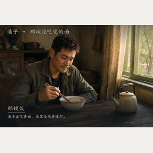
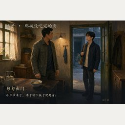
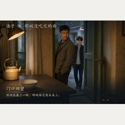
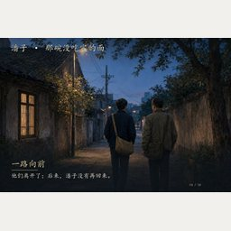
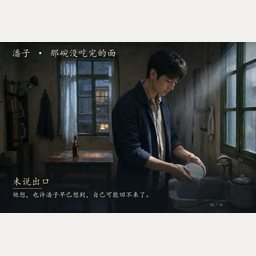

<!-- Generated by scripts/build_gallery.py; edit collection catalogs, then rebuild. -->
# 作品目录

[返回总目录](../CATALOG.md) · [在图库中浏览](../index.html#collection=daomu-notes-daomu-notes-ai-generated)

生成作品 · **6 张** · 原目录：[daomu-notes/daomu-notes-ai-generated](../daomu-notes/daomu-notes-ai-generated/)

[原合集目录](../daomu-notes/daomu-notes-ai-generated/CATALOG.md)

[分类：同人与封面](../index.html#category=fanart)

| 缩略图 | 标题与描述 | 文件与记录 |
| --- | --- | --- |
|  | **panzi last meal 01 a meal still warm** | [原图](../daomu-notes/daomu-notes-ai-generated/panzi-last-meal-01-a-meal-still-warm.png) 1536 × 1024 [元数据](../daomu-notes/daomu-notes-ai-generated/metadata/panzi-last-meal-01-a-meal-still-warm.json) [提示词](../daomu-notes/daomu-notes-ai-generated/prompts/panzi-last-meal-01-a-meal-still-warm.txt) panzi-last-meal-01-a-meal-still-warm.png |
|  | **panzi last meal 02 the unfinished bowl** | [原图](../daomu-notes/daomu-notes-ai-generated/panzi-last-meal-02-the-unfinished-bowl.png) 1536 × 1024 [元数据](../daomu-notes/daomu-notes-ai-generated/metadata/panzi-last-meal-02-the-unfinished-bowl.json) [提示词](../daomu-notes/daomu-notes-ai-generated/prompts/panzi-last-meal-02-the-unfinished-bowl.txt) panzi-last-meal-02-the-unfinished-bowl.png |
|  | **panzi last meal 03 light on the table** | [原图](../daomu-notes/daomu-notes-ai-generated/panzi-last-meal-03-light-on-the-table.png) 1536 × 1024 [元数据](../daomu-notes/daomu-notes-ai-generated/metadata/panzi-last-meal-03-light-on-the-table.json) [提示词](../daomu-notes/daomu-notes-ai-generated/prompts/panzi-last-meal-03-light-on-the-table.txt) panzi-last-meal-03-light-on-the-table.png |
|  | **panzi last meal 04 the long road away** | [原图](../daomu-notes/daomu-notes-ai-generated/panzi-last-meal-04-the-long-road-away.png) 1536 × 1024 [元数据](../daomu-notes/daomu-notes-ai-generated/metadata/panzi-last-meal-04-the-long-road-away.json) [提示词](../daomu-notes/daomu-notes-ai-generated/prompts/panzi-last-meal-04-the-long-road-away.txt) panzi-last-meal-04-the-long-road-away.png |
|  | **panzi last meal 05 return to the room** | [原图](../daomu-notes/daomu-notes-ai-generated/panzi-last-meal-05-return-to-the-room.png) 1536 × 1024 [元数据](../daomu-notes/daomu-notes-ai-generated/metadata/panzi-last-meal-05-return-to-the-room.json) [提示词](../daomu-notes/daomu-notes-ai-generated/prompts/panzi-last-meal-05-return-to-the-room.txt) panzi-last-meal-05-return-to-the-room.png |
|  | **panzi last meal 06 the bowl washed clean** | [原图](../daomu-notes/daomu-notes-ai-generated/panzi-last-meal-06-the-bowl-washed-clean.png) 1536 × 1024 [元数据](../daomu-notes/daomu-notes-ai-generated/metadata/panzi-last-meal-06-the-bowl-washed-clean.json) [提示词](../daomu-notes/daomu-notes-ai-generated/prompts/panzi-last-meal-06-the-bowl-washed-clean.txt) panzi-last-meal-06-the-bowl-washed-clean.png |
