<!-- Generated by scripts/build_gallery.py; edit collection catalogs, then rebuild. -->
# 作品目录

[返回总目录](../CATALOG.md) · [在图库中浏览](../index.html#collection=yilan-love-yilan-love-ai-generated)

生成作品 · **18 张** · 原目录：[yilan-love/yilan-love-ai-generated](../yilan-love/yilan-love-ai-generated/)

[原合集目录](../yilan-love/yilan-love-ai-generated/CATALOG.md)

[分类：绘本与故事](../index.html#category=stories)

| 缩略图 | 标题与描述 | 文件与记录 |
| --- | --- | --- |
| [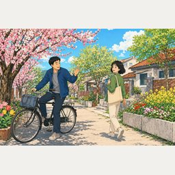](../yilan-love/yilan-love-ai-generated/yilan-bloom-01-meet-by-bike.png) | **yilan bloom 01 meet by bike** | [原图](../yilan-love/yilan-love-ai-generated/yilan-bloom-01-meet-by-bike.png) 1536 × 1024 [元数据](../yilan-love/yilan-love-ai-generated/metadata/yilan-bloom-01-meet-by-bike.json) [提示词](../yilan-love/yilan-love-ai-generated/prompts/yilan-bloom-01-meet-by-bike.txt) yilan-bloom-01-meet-by-bike.png |
| [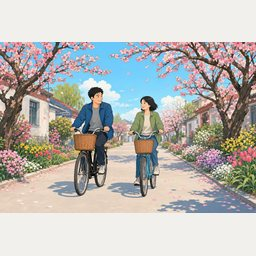](../yilan-love/yilan-love-ai-generated/yilan-bloom-02-ride-together.png) | **yilan bloom 02 ride together** | [原图](../yilan-love/yilan-love-ai-generated/yilan-bloom-02-ride-together.png) 1536 × 1024 [元数据](../yilan-love/yilan-love-ai-generated/metadata/yilan-bloom-02-ride-together.json) [提示词](../yilan-love/yilan-love-ai-generated/prompts/yilan-bloom-02-ride-together.txt) yilan-bloom-02-ride-together.png |
| [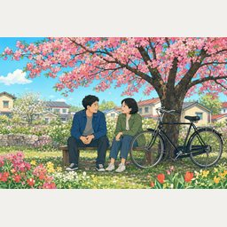](../yilan-love/yilan-love-ai-generated/yilan-bloom-03-beneath-the-blossoms.png) | **yilan bloom 03 beneath the blossoms** | [原图](../yilan-love/yilan-love-ai-generated/yilan-bloom-03-beneath-the-blossoms.png) 1536 × 1024 [元数据](../yilan-love/yilan-love-ai-generated/metadata/yilan-bloom-03-beneath-the-blossoms.json) [提示词](../yilan-love/yilan-love-ai-generated/prompts/yilan-bloom-03-beneath-the-blossoms.txt) yilan-bloom-03-beneath-the-blossoms.png |
| [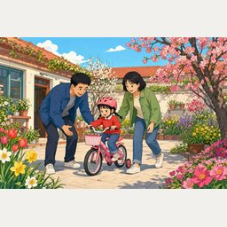](../yilan-love/yilan-love-ai-generated/yilan-bloom-04-family-in-spring.png) | **yilan bloom 04 family in spring** | [原图](../yilan-love/yilan-love-ai-generated/yilan-bloom-04-family-in-spring.png) 1536 × 1024 [元数据](../yilan-love/yilan-love-ai-generated/metadata/yilan-bloom-04-family-in-spring.json) [提示词](../yilan-love/yilan-love-ai-generated/prompts/yilan-bloom-04-family-in-spring.txt) yilan-bloom-04-family-in-spring.png |
| [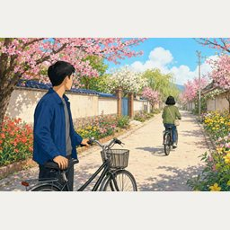](../yilan-love/yilan-love-ai-generated/yilan-bloom-05-a-gentle-parting.png) | **yilan bloom 05 a gentle parting** | [原图](../yilan-love/yilan-love-ai-generated/yilan-bloom-05-a-gentle-parting.png) 1536 × 1024 [元数据](../yilan-love/yilan-love-ai-generated/metadata/yilan-bloom-05-a-gentle-parting.json) [提示词](../yilan-love/yilan-love-ai-generated/prompts/yilan-bloom-05-a-gentle-parting.txt) yilan-bloom-05-a-gentle-parting.png |
| [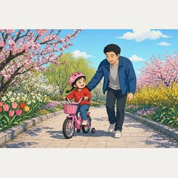](../yilan-love/yilan-love-ai-generated/yilan-bloom-06-riding-with-daughter.png) | **yilan bloom 06 riding with daughter** | [原图](../yilan-love/yilan-love-ai-generated/yilan-bloom-06-riding-with-daughter.png) 1536 × 1024 [元数据](../yilan-love/yilan-love-ai-generated/metadata/yilan-bloom-06-riding-with-daughter.json) [提示词](../yilan-love/yilan-love-ai-generated/prompts/yilan-bloom-06-riding-with-daughter.txt) yilan-bloom-06-riding-with-daughter.png |
| [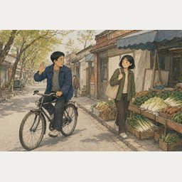](../yilan-love/yilan-love-ai-generated/yilan-love-01-first-hello.png) | **yilan love 01 first hello** | [原图](../yilan-love/yilan-love-ai-generated/yilan-love-01-first-hello.png) 1536 × 1024 [元数据](../yilan-love/yilan-love-ai-generated/metadata/yilan-love-01-first-hello.json) [提示词](../yilan-love/yilan-love-ai-generated/prompts/yilan-love-01-first-hello.txt) yilan-love-01-first-hello.png |
| [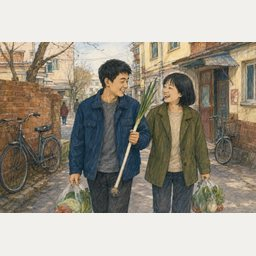](../yilan-love/yilan-love-ai-generated/yilan-love-02-walking-home.png) | **yilan love 02 walking home** | [原图](../yilan-love/yilan-love-ai-generated/yilan-love-02-walking-home.png) 1536 × 1024 [元数据](../yilan-love/yilan-love-ai-generated/metadata/yilan-love-02-walking-home.json) [提示词](../yilan-love/yilan-love-ai-generated/prompts/yilan-love-02-walking-home.txt) yilan-love-02-walking-home.png |
| [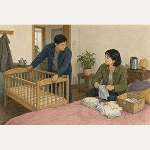](../yilan-love/yilan-love-ai-generated/yilan-love-03-new-family.png) | **yilan love 03 new family** | [原图](../yilan-love/yilan-love-ai-generated/yilan-love-03-new-family.png) 1536 × 1024 [元数据](../yilan-love/yilan-love-ai-generated/metadata/yilan-love-03-new-family.json) [提示词](../yilan-love/yilan-love-ai-generated/prompts/yilan-love-03-new-family.txt) yilan-love-03-new-family.png |
| [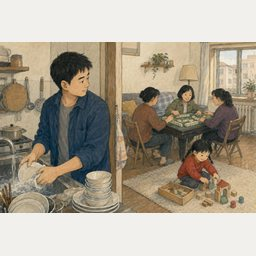](../yilan-love/yilan-love-ai-generated/yilan-love-04-everyday-strains.png) | **yilan love 04 everyday strains** | [原图](../yilan-love/yilan-love-ai-generated/yilan-love-04-everyday-strains.png) 1536 × 1024 [元数据](../yilan-love/yilan-love-ai-generated/metadata/yilan-love-04-everyday-strains.json) [提示词](../yilan-love/yilan-love-ai-generated/prompts/yilan-love-04-everyday-strains.txt) yilan-love-04-everyday-strains.png |
| [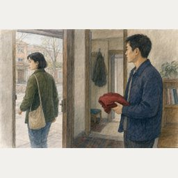](../yilan-love/yilan-love-ai-generated/yilan-love-05-a-quiet-parting.png) | **yilan love 05 a quiet parting** | [原图](../yilan-love/yilan-love-ai-generated/yilan-love-05-a-quiet-parting.png) 1536 × 1024 [元数据](../yilan-love/yilan-love-ai-generated/metadata/yilan-love-05-a-quiet-parting.json) [提示词](../yilan-love/yilan-love-ai-generated/prompts/yilan-love-05-a-quiet-parting.txt) yilan-love-05-a-quiet-parting.png |
| [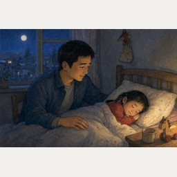](../yilan-love/yilan-love-ai-generated/yilan-love-06-bedtime-song.png) | **yilan love 06 bedtime song** | [原图](../yilan-love/yilan-love-ai-generated/yilan-love-06-bedtime-song.png) 1536 × 1024 [元数据](../yilan-love/yilan-love-ai-generated/metadata/yilan-love-06-bedtime-song.json) [提示词](../yilan-love/yilan-love-ai-generated/prompts/yilan-love-06-bedtime-song.txt) yilan-love-06-bedtime-song.png |
| [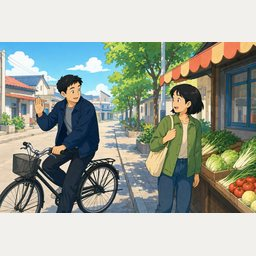](../yilan-love/yilan-love-ai-generated/yilan-sunlit-01-first-hello.png) | **yilan sunlit 01 first hello** | [原图](../yilan-love/yilan-love-ai-generated/yilan-sunlit-01-first-hello.png) 1536 × 1024 [元数据](../yilan-love/yilan-love-ai-generated/metadata/yilan-sunlit-01-first-hello.json) [提示词](../yilan-love/yilan-love-ai-generated/prompts/yilan-sunlit-01-first-hello.txt) yilan-sunlit-01-first-hello.png |
| [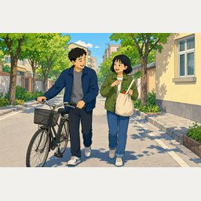](../yilan-love/yilan-love-ai-generated/yilan-sunlit-02-walking-home.png) | **yilan sunlit 02 walking home** | [原图](../yilan-love/yilan-love-ai-generated/yilan-sunlit-02-walking-home.png) 1536 × 1024 [元数据](../yilan-love/yilan-love-ai-generated/metadata/yilan-sunlit-02-walking-home.json) [提示词](../yilan-love/yilan-love-ai-generated/prompts/yilan-sunlit-02-walking-home.txt) yilan-sunlit-02-walking-home.png |
| [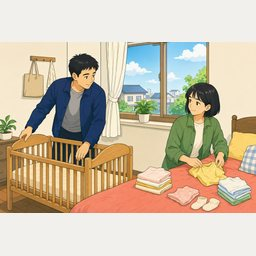](../yilan-love/yilan-love-ai-generated/yilan-sunlit-03-new-family.png) | **yilan sunlit 03 new family** | [原图](../yilan-love/yilan-love-ai-generated/yilan-sunlit-03-new-family.png) 1536 × 1024 [元数据](../yilan-love/yilan-love-ai-generated/metadata/yilan-sunlit-03-new-family.json) [提示词](../yilan-love/yilan-love-ai-generated/prompts/yilan-sunlit-03-new-family.txt) yilan-sunlit-03-new-family.png |
| [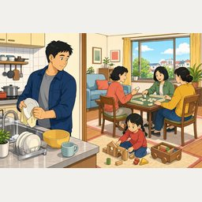](../yilan-love/yilan-love-ai-generated/yilan-sunlit-04-everyday-strains.png) | **yilan sunlit 04 everyday strains** | [原图](../yilan-love/yilan-love-ai-generated/yilan-sunlit-04-everyday-strains.png) 1536 × 1024 [元数据](../yilan-love/yilan-love-ai-generated/metadata/yilan-sunlit-04-everyday-strains.json) [提示词](../yilan-love/yilan-love-ai-generated/prompts/yilan-sunlit-04-everyday-strains.txt) yilan-sunlit-04-everyday-strains.png |
| [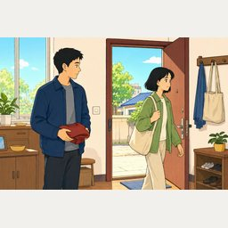](../yilan-love/yilan-love-ai-generated/yilan-sunlit-05-a-quiet-parting.png) | **yilan sunlit 05 a quiet parting** | [原图](../yilan-love/yilan-love-ai-generated/yilan-sunlit-05-a-quiet-parting.png) 1536 × 1024 [元数据](../yilan-love/yilan-love-ai-generated/metadata/yilan-sunlit-05-a-quiet-parting.json) [提示词](../yilan-love/yilan-love-ai-generated/prompts/yilan-sunlit-05-a-quiet-parting.txt) yilan-sunlit-05-a-quiet-parting.png |
| [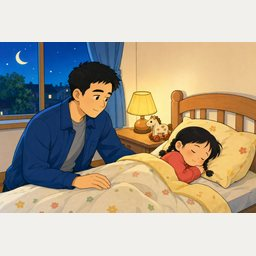](../yilan-love/yilan-love-ai-generated/yilan-sunlit-06-bedtime-song.png) | **yilan sunlit 06 bedtime song** | [原图](../yilan-love/yilan-love-ai-generated/yilan-sunlit-06-bedtime-song.png) 1536 × 1024 [元数据](../yilan-love/yilan-love-ai-generated/metadata/yilan-sunlit-06-bedtime-song.json) [提示词](../yilan-love/yilan-love-ai-generated/prompts/yilan-sunlit-06-bedtime-song.txt) yilan-sunlit-06-bedtime-song.png |
